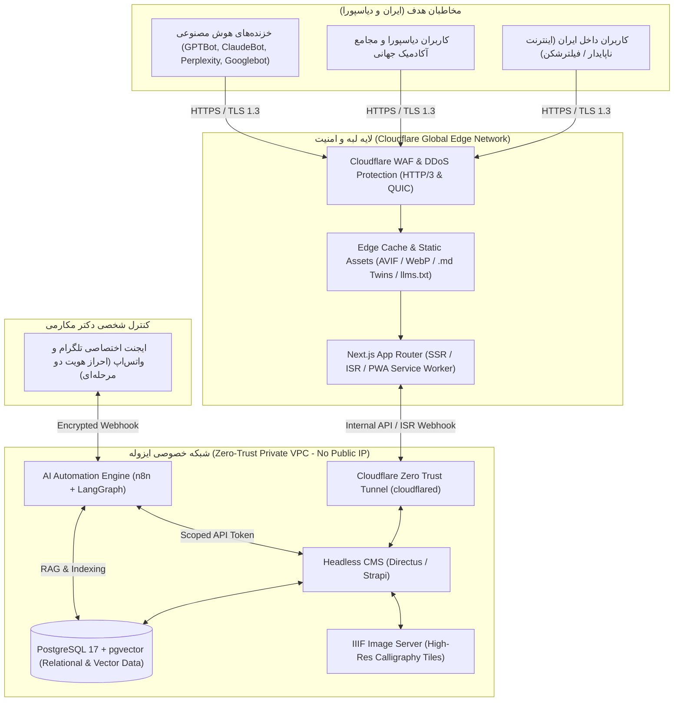
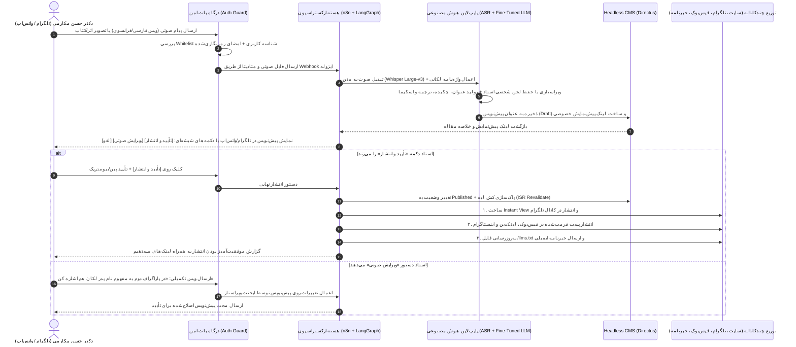

# سند معماری و طرح اجرایی جامع وب‌سایت رسمی دکتر حسن مکارمی (End-to-End Technical & Strategic Blueprint)

> **Project Code:** `MAKAREMI-CORE-2026`  
> **Target Environment:** Antigravity IDE / Agentic Workspace  
> **Primary Canonical Domain:** `https://makaremi.com` (with 301 Edge Redirects from `makaremi.net`)  
> **Languages:** Persian (`fa` - RTL Primary), French (`fr` - LTR), English (`en` - LTR)  
> **Core Pillars:** 1. Lacanian Psychoanalysis | 2. Modern Calligraphy & Art | 3. Cultural & Political Strategy | 4. Human Rights & Transitional Justice (Dadkhahi)

---

## راهنمای اجرایی برای محیط Antigravity (Workspace Execution Rules)

این سند به عنوان مرجع واحد حقیقت (Single Source of Truth) برای توسعه فاز به فاز پلتفرم جدید دکتر حسن مکارمی طراحی شده است. در هنگام اجرای هر فاز در محیط Antigravity، رعایت اصول زیر الزامی است:
1. **معماری ایزوله (Zero-Trust Decoupled):** فرانت‌اند (`Next.js App Router`) کاملاً از بک‌اند (`Directus / Strapi Headless CMS`) جداست و هیچ پورت یا مسیر مدیریتی در اینترنت عمومی باز نخواهد بود.
2. **حفاظت از ترمینولوژی تخصصی:** در تمامی پایپ‌لاین‌های هوش مصنوعی، چت‌بات RAG و ایجنت‌های صوتی تلگرام/واتس‌اپ، استفاده از واژه‌نامه کنترل‌شده روانکاوی لکانی و مطالعات راهبردی مؤلف الزامی است.
3. **استاندارد GEO و AEO:** هر صفحه محتوایی باید علاوه بر رندر HTML استاندارد (دارای دقیقاً یک تگ `H1`)، دارای خروجی مارک‌داون تمیز در مسیر موازی `.md` و اسکیمای کامل `JSON-LD` باشد.

---

## فاز ۱: معماری زیرساخت، فرانت‌اند و بک‌اند (Modern Jamstack & Headless Architecture)

وضعیت پیشین حضور دیجیتال دکتر مکارمی متکی بر دو نصب موازی از سیستم مدیریت محتوای وردپرس (WordPress) بر روی دامنه‌های `makaremi.net` و `makaremi.com` بوده است که در دامنه `.net` با مشکلاتی نظیر عدم رمزنگاری پیش‌فرض (`HTTP`) و خطای تفکیک نام دامنه (`Errno -3`) در ریشه بدون پیشوند `www` مواجه بود. برای حذف کامل سطح حمله (Attack Surface) وردپرس سنتی، معماری جدید بر الگوی **Decoupled Edge-Native (جداسازی کامل هسته مدیریت محتوا از لایه نمایش)** استوار می‌شود.

### ۱.۱. انتخاب و مقایسه پشته فناوری (Tech Stack)

| لایه معماری | فناوری پیشنهادی (منتخب) | جایگزین‌های بررسی‌شده | دلایل فنی انتخاب برای پروژه دکتر مکارمی |
| :--- | :--- | :--- | :--- |
| **فرانت‌اند (Frontend Framework)** | **Next.js 15+ (App Router)** | Astro 5 / Nuxt 4 | پشتیبانی بومی از React Server Components، قابلیت Incremental Static Regeneration (ISR) برای به‌روزرسانی آنی مقالات بدون بیلد مجدد کل سایت، و مسیریابی چندزبانه (`i18n`) پیشرفته برای فارسی (RTL) و فرانسه/انگلیسی (LTR). |
| **مدیریت محتوا (Headless CMS)** | **Directus (Self-Hosted)** یا **Strapi v5** | Sanity / WordPress Headless | متن‌باز بودن، قرارگیری مستقیم روی پایگاه داده SQL استاندارد، امکان تعریف دقیق مدل‌های داده رابطه‌ای (کتاب‌ها، نمایشگاه‌ها، مقالات، اشعار) و قابلیت مخفی‌سازی کامل پشت تونل امنیتی بدون وابستگی به کلودهای تحریمی. |
| **پایگاه داده اصلی و برداری** | **PostgreSQL 17 + pgvector** | MongoDB + Pinecone | یکپارچه‌سازی داده‌های ساختاریافته سایت و بردارهای هوش مصنوعی (Embeddings) در یک دیتابیس واحد و فوق‌سریع با پشتیبانی عالی از جستجوی تمام‌متن (Full-Text Search) فارسی و فرانسوی. |
| **شبکه توزیع و امنیت لبه** | **Cloudflare Enterprise / Pro** | Vercel Edge / AWS CloudFront | ارائه WAF پیشرفته، محافظت DDoS لایه ۷، پشتیبانی از پروتکل HTTP/3 (QUIC) برای عبور بهتر از اختلالات شبکه ایران و سرویس Zero Trust Tunnel. |
| **پردازش رسانه و گالری** | **Cloudflare Images + IIIF Server (Cantaloupe)** | Cloudinary / AWS S3 | تبدیل خودکار تصاویر به فرمت‌های فشرده AVIF/WebP و تولید کاشی‌های تصویر (Image Tiles) برای زوم عمیق روی تابلوهای خوشنویسی و نقاشی. |

### ۱.۲. دیاگرام معماری کلان سیستم (System Architecture Diagram)



### ۱.۳. استراتژی یکپارچه‌سازی دامنه‌ها (Canonicalization) و اصلاح ساختار URL

در سیستم قدیمی، محتوای سایت میان دو دامنه `makaremi.net` (با عنوان `Poésie Persanne - Un site pour partager l'Art`) و `makaremi.com` (با عنوان `حسن مکارمی - هنرمند روانکاو پژوهشگر`) تقسیم شده بود و پیوندهای یکتا (Permalinks) ترکیبی از عبارات فینگلیش، فرانسوی و کدهای UTF-8 بودند.

برای جلوگیری از پدیده محتوای تکراری (Duplicate Content) و تجمیع کامل اعتبار دامنه (Domain Authority):
1. **انتخاب دامنه مرجع (Canonical Domain):** دامنه `https://makaremi.com` به عنوان دامنه اصلی (Primary) تعیین می‌شود و دامنه `makaremi.net` (هر دو نسخه با `www` و بدون `www` پس از اصلاح رکورد A/CNAME در DNS) در سطح لبه Cloudflare با کد وضعیت **301 Moved Permanently** به مسیر متناظر در `makaremi.com` تغییر مسیر می‌دهد.
2. **معماری مسیریابی چندزبانه (`i18n` Routing):** تمامی آدرس‌ها بر اساس استاندارد ISO 639-1 به سه زیرپوشه زبانی `/fa/` (فارسی)، `/fr/` (فرانسوی) و `/en/` (انگلیسی) به همراه تگ‌های `hreflang` متقابل در `<head>` منتقل می‌شوند.

| آدرس قدیمی در وردپرس فعلی (`makaremi.net` / `.com`) | آدرس استاندارد جدید در معماری Headless (`makaremi.com`) | نوع محتوا و زبان |
| :--- | :--- | :--- |
| `/home-persan/` و `/landing-page-fa_ir/` | `/fa` | صفحه اصلی فارسی |
| `/aya-ravankavi-elm-ast-fa/` | `/fa/psychoanalysis/articles/is-psychoanalysis-a-science` | مقاله تخصصی روانکاوی (فارسی) |
| `/etat-limite-un-concept-psychanalytique/` | `/fr/psychanalyse/articles/etat-limite-concept-psychanalytique` | مقاله تخصصی روانکاوی (فرانسوی) |
| `/topologie-des-lieux-saints/` | `/fr/psychanalyse/articles/topologie-des-lieux-saints` | مقاله میان‌رشته‌ای لکانی (فرانسوی) |
| `/role-de-l-inconscient-relation-entre-cavalier-et-cheval/` | `/fr/psychanalyse/articles/relation-cavalier-cheval` | مقاله روانکاوی فرویدی-لکانی (فرانسوی) |
| `/nameyshgah-ir/fa-expo-8/` | `/fa/art/exhibitions/pompadour-2002-between-sign-and-symbol` | نمایشگاه نقاشی و خط (فارسی) |
| `/poeme/mra-navazesh-kn/` | `/fa/poetry/poems/caress-me` | آرشیو اشعار (فارسی) |
| `/%D8%A7neshast-paltaki-khavar-fa/` | `/fa/human-rights/speeches/khavaran-justice-session` | سخنرانی دادخواهی و حقوق بشر |
| `/list-ketabhay-farsi-ir/` و `/genre/gen-psychanalyse-fa/` | `/fa/books` (با فیلتر `?category=psychoanalysis`) | کتاب‌خانه دیجیتال |
| `/video/hassan-makaremi-parle-de-hafez-de-chiraz/` | `/fr/media/videos/hafez-de-chiraz` | آرشیو ویدیویی (فرانسوی) |

### ۱.۴. بهینه‌سازی عملکرد (Core Web Vitals) برای کاربران داخل ایران

* **رندرینگ ترکیبی (ISR + Streaming SSR):** صفحات مقالات، اشعار و معرفی کتاب‌ها در زمان انتشار به صورت HTML ایستا در بیش از ۳۰۰ دیتاسنتر لبه Cloudflare کش می‌شوند تا زمان پاسخگویی سرور (TTFB) به زیر ۵۰ میلی‌ثانیه برسد.
* **معماری Progressive Web App (PWA) و مطالعه آفلاین:** با پیاده‌سازی Service Worker مبتنی بر Workbox، به محض اینکه کاربر داخل ایران با VPN وارد سایت شود، مقالات بازشده و فهرست کتاب‌ها در حافظه مرورگر (`IndexedDB` / `Cache Storage`) ذخیره می‌گردند تا در صورت قطع شدن اینترنت یا فیلترشکن، مطالعه متن‌های طولانی بدون وقفه ادامه یابد.
* **حذف وابستگی‌های مسدودشده:** در سایت قدیمی، ویدیوها مستقیماً از طریق iframe یوتیوب بارگذاری می‌شدند که برای کاربر بدون فیلترشکن یا بدون جاوااسکریپت با خطای عدم پخش مواجه می‌شد. در معماری جدید، نسخه صوتی (پادکست) و ویدیویی فشرده (HLS Streaming) در کنار پلیر یوتیوب روی فضای ابری CDN خود سایت نیز میزبانی می‌شود تا در هر شرایطی قابل پخش باشد.

---

## فاز ۲: طراحی تجربه کاربری (UI/UX)، ویترین کتاب‌ها و گالری هنری

وب‌سایت قدیمی از نظر سلسله‌مراتب بصری و کدگذاری HTML دارای ایرادات ساختاری بود؛ از جمله اینکه عنوان سایت، عنوان مقاله و حتی سرتیتر ابزارک‌های ستون کناری («مقوله‌ها»، «چند شعر»، «چند فیلم‌ها») همگی با تگ `H1` تعریف شده بودند. سیستم طراحی جدید با الهام از دو قطب هویتی دکتر مکارمی یعنی **«وقار آکادمیک دانشگاه سوربن و کلینیک روانکاوی»** و **«زیبایی‌شناسی مدرن خوشنویسی ایرانی»** طراحی می‌شود.

### ۲.۱. سیستم دیزاین (Design System) و تایپوگرافی چندزبانه

* **پالت رنگی معنایی:**
  * پس‌زمینه اصلی (Surface): سفید کاغذی گرم (`#FBFBF9`) در حالت روز برای جلوگیری از خستگی چشم هنگام خوانش متون طولانی روانکاوی، و ذغالی عمیق (`#121316`) در حالت تاریک (Dark Mode).
  * رنگ‌های هویتی ۴ ستون محتوایی (Pillar Accents): لاجوردی ایرانی (`#1E3A8A`) برای هنر و خوشنویسی، فیروزه‌ای تیره (`#0F766E`) برای روانکاوی لکانی، طلایی اخرایی (`#B45309`) برای مطالعات راهبردی و ایران فرهنگی، و زرشکی عمیق (`#991B1B`) برای حقوق بشر و دادخواهی.
* **تایپوگرافی استاندارد:**
  * در زبان فارسی (RTL): استفاده از فونت متغیر (Variable Font) **وزیرمتن (Vazirmatn)** یا **ایران‌سنس ایکس (IRANSansX)** برای متن مقالات با ارتفاع خط (Line-height) استاندارد ۱.۸ و فونت نمایشی فاخر برای سرتیترها و اشعار.
  * در زبان فرانسوی و انگلیسی (LTR): ترکیب فونت کلاسیک **Cormorant Garamond** برای عناوین آکادمیک و **Inter** برای بدنه متون علمی.

### ۲.۲. معماری «کتاب‌خانه دیجیتال (Interactive Book Showcase)»

برای معرفی بیش از ۱۵ عنوان کتاب منتشرشده دکتر مکارمی به زبان‌های فارسی و فرانسوی (از جمله *دگر شنیدن گذشته‌ها*، *تلویزیون*، *نگاهی راهبردی به دوران گذار*، *چند نگاه راهبردی به ایران آینده*، *نگاهی دیگر به سرزمین فرهنگی ایران*، *چند گفتار در دیگر شنیدن حافظ*، *پیانو با چهار دست* با همکاری مینا راد، *دگر شنیدن در روان‌کاوی*، *همدلی‌های یک روانکاو* و نخستین ترجمه مستقیم *سمینار سوم ژاک لکان* از فرانسه به فارسی) و کتاب‌های جدید ایشان، هر کتاب دارای یک صفحه اختصاصی (Landing Page) با قابلیت‌های زیر خواهد بود:

1. **نمایشگر سه‌بعدی جلد کتاب (Interactive 3D Book Mesh):** رندر سبک مبتنی بر CSS 3D Transforms / Three.js که کاربر می‌تواند جلد رو، عطف و پشت جلد کتاب را بچرخاند.
2. **شناسنامه استاندارد کتابشناختی:** درج دقیق شابک (ISBN-13)، نام ناشر (مانند انتشارات آلیان، نشانه، H&S Media)، سال و محل چاپ، تعداد صفحات و دسته‌بندی موضوعی.
3. **پیش‌نمایش ورق‌زن و متن‌خوان (Built-in Flipbook & EPUB/Markdown Reader):** امکان مطالعه فهرست مطالب و فصل اول هر کتاب مستقیماً در داخل مرورگر (بدون نیاز به دانلود PDF حجیم) با قابلیت تغییر سایز فونت و جستجو در متن.
4. **چکیده صوتی به صدای مؤلف (Author's Audio Commentary):** یک پلیر صوتی ۲ تا ۵ دقیقه‌ای در بالای صفحه هر کتاب که در آن دکتر مکارمی با صدای خودشان انگیزه نگارش و پیام محوری کتاب را برای مخاطب توضیح می‌دهند.
5. **مسیریابی هوشمند خرید و دانلود (Geo-Aware Acquisition Links):** نمایش دکمه‌های خرید فیزیکی/الکترونیکی متناسب با موقعیت جغرافیایی کاربر (نمایش پلتفرم‌های داخلی مانند طاقچه یا دانلود مستقیم امن برای کاربران داخل ایران، و نمایش Amazon، ناشران اروپایی و پرداخت ارزی Stripe/PayPal برای کاربران خارج از کشور).

### ۲.۳. گالری مجازی در تراز موزه (Museum-Grade IIIF Digital Gallery)

برای نمایش بیش از ۲۵ نمایشگاه نقاشی و خوشنویسی ایشان—از جمله ۷ اثر به نمایش درآمده در موزه مدرن خوشنویسی مسکو، نمایشگاه «میان نشان و نماد» در پومپادور فرانسه (۲۰۰۲) و نمایشگاه فستیوال موسیقی مقدس در شهر فاس مراکش—از استاندارد جهانی موزه‌های بزرگ دنیا یعنی **IIIF (International Image Interoperability Framework)** استفاده می‌شود:
* تصاویر آثار با رزولوشن فوق‌العاده بالا به هرم‌هایی از کاشی‌های کوچک (Multi-resolution Pyramid Tiles) تقسیم می‌شوند.
* با استفاده از کتابخانه **OpenSeadragon** در فرانت‌اند، بازدیدکننده می‌تواند بدون اینکه صفحه سنگین شود، تا سطح بافت بوم، حرکت قلم‌مو و مرکب خوشنویسی زوم عمیق (Deep Zoom) انجام دهد.
* قابلیت **شعر و تصویر (Audio-Visual Poetry Sync):** در بخش «شعر و تصویر»، هر تابلو با دکلمه شعر مرتبط توسط دکتر مکارمی و یادداشت تحلیلی منتقدان برجسته (نظیر نقد مایکل بری، استاد دانشگاه پرینستون بر آثار ایشان) همراه می‌شود.

---

## فاز ۳: امنیت سایبری سطح بالا و مقاومت در برابر سانسور (Zero-Trust & Anti-Censorship)

به دلیل جایگاه سیاسی و حقوق بشری دکتر مکارمی به عنوان خزانه‌دار جامعه دفاع از حقوق بشر در ایران (LDDHI)، سخنران نشست‌های شورای حقوق بشر سازمان ملل در ژنو و یکی از چهره‌های پیشرو در دادخواهی کشتار تابستان ۱۳۶۷ و کارزار ایران تریبونال، سایت ایشان در ایران فیلتر بوده و در معرض تهدیدات مستمر سایبری قرار دارد.

### ۳.۱. معماری امنیتی Zero-Trust (حذف کامل پنل ادمین از اینترنت عمومی)

1. **ایزولاسیون کامل بک‌اند پشت Cloudflare Zero Trust Tunnel:**
   * سرور میزبان Headless CMS و دیتابیس PostgreSQL دارای **هیچ پورت باز ورودی (Zero Inbound Open Ports)** در فایروال سطح سیستم‌عامل (UFW/Security Groups) نخواهد بود و حتی IP عمومی سرور در هیچ رکورد DNS ثبت نمی‌شود.
   * ارتباط میان سرور و شبکه Cloudflare صرفاً از طریق یک دیمون خروجی رمزنگاری‌شده (`cloudflared`) برقرار می‌گردد.
   * آدرس پنل مدیریت (مثلاً `admin.makaremi.com`) پشت لایه **Cloudflare Access** قرار می‌گیرد؛ یعنی پیش از بارگذاری صفحه لاگین CMS، کاربر باید از سد احراز هویت چندعاملی سخت‌افزاری (FIDO2 / WebAuthn / Passkey) عبور کند و دسترسی آن صرفاً برای IPهای کشور فرانسه مجاز است.
2. **محافظت در برابر حملات DDoS و نفوذ لایه کاربرد (WAF):**
   * فعال‌سازی قوانین OWASP Core Rule Set در لبه Cloudflare برای مسدودسازی آنی تلاش‌های SQL Injection، XSS و Path Traversal.
   * پیاده‌سازی **Cryptographic Content Integrity:** هر مقاله یا بیانیه سیاسی که توسط دکتر مکارمی منتشر می‌شود، در دیتابیس با یک کلید خصوصی امضای دیجیتال (SHA-256 Hash) می‌گردد؛ اگر به هر دلیلی تغییری غیرمجاز در دیتابیس رخ دهد، سیستم به صورت خودکار نسخه کش‌شده امن (Immutable Snapshot) را نمایش داده و هشدار امنیتی صادر می‌کند.

### ۳.۲. معماری ضدسانسور و دسترسی پایدار برای مخاطبان داخل ایران

1. **پروتکل‌های نسل جدید انتقال (HTTP/3, QUIC & ECH):** فعال‌سازی کامل پروتکل UDP-based QUIC و قابلیت **TLS 1.3 Encrypted Client Hello (ECH)** روی شبکه لبه که تشخیص نام دامنه (SNI Filtering) توسط سیستم‌های فیلترینگ DPI را بسیار دشوار می‌سازد.
2. **توزیع خودکار در کانال‌های جایگزین (Omnichannel Censorship Bypass):**
   * **Telegram Instant View & Telegraph Mirror:** به محض انتشار هر مقاله در سایت، سیستم به صورت خودکار یک نسخه استاندارد از آن را در سرویس `telegra.ph` و قالب Instant View تلگرام تولید می‌کند تا کاربران داخل ایران بتوانند بدون نیاز به باز کردن مرورگر، متن کامل مقاله را با تصاویر و فرمت‌بندی دقیق در داخل تلگرام مطالعه کنند.
   * **خبرنامه ایمیلی مقاوم در برابر قطعی اینترنت:** سیستم مجهز به یک سرویس ارسال ایمیل خودکار است که متن کامل مقالات جدید (و نه صرفاً لینک آن‌ها) را در قالب HTML سبک و فایل PDF پیوست برای مشترکان داخل ایران ایمیل می‌کند تا حتی در زمان قطعی وب، از طریق سرویس‌های ایمیل در دسترس باشد.
   * **دامنه‌های آینه‌ای ابری (Automated Cloud Mirrors):** ایجاد بیلدهای ایستای خودکار روی بسترهای ابری توزیع‌شده (مانند Cloudflare Pages و GitHub Pages) که با آدرس‌های فرعی پویا در دسترس قرار می‌گیرند.

---

## فاز ۴: مهندسی SEO، AEO و GEO و معماری اسکیما (AI & Search Authority)

دارایی‌های محتوایی دکتر مکارمی شامل مقالات دست‌اول در تلاقی روانکاوی لکانی، تاریخ‌نگاری، ادبیات کلاسیک فارسی و مطالعات راهبردی است. هدف از مهندسی **AEO (Answer Engine Optimization)** و **GEO (Generative Engine Optimization)** این است که موتورهای جستجوی سنتی (Google) و موتورهای پاسخ‌گوی هوش مصنوعی (ChatGPT Search، Perplexity، Claude و Google AI Overviews) وب‌سایت ایشان را به عنوان **مرجع اول (Canonical Citation Source)** شناسایی و استناد کنند.

### ۴.۱. استراتژی GEO و تولید همزادهای مارک‌داون (`.md` Twins)

1. **تولید خودکار نسخه `.md` برای تمام صفحات:** در روتر Next.js یک Route Handler تعریف می‌شود که با افزودن پسوند `.md` به انتهای هر آدرس (مثلاً `https://makaremi.com/fa/psychoanalysis/articles/is-psychoanalysis-a-science.md`)، نسخه مارک‌داون خالص، تمیز و بدون کدهای اضافه آن مقاله را با هدر `Content-Type: text/markdown; charset=utf-8` تحویل خزنده‌های هوش مصنوعی می‌دهد.
2. **ساختاردهی محتوا برای استخراج مستقیم (Citation-Ready Formatting):**
   * اصلاح مشکل تعدد تگ‌های `H1` در سایت قدیمی و الزام به وجود **دقیقاً یک تگ `H1`** در هر صفحه.
   * قرار دادن یک باکس **«چکیده مدیریتی و یافته‌های کلیدی (Executive Summary)»** در ابتدای هر مقاله با تگ `<blockquote>` که مستقیماً به پرسش اصلی مقاله پاسخ می‌دهد (مثلاً در مقاله «آیا روانکاوی علم است؟»، استخراج صریح آمار مرکز ملی پژوهش‌های علمی فرانسه CNRS مبنی بر اینکه از ۳٬۹۵۴ پروژه پژوهشی مبتنی بر روانکاوی بالینی در یک بازه سه‌ساله، ۳٬۷۵۵ پروژه میان‌رشته‌ای، ۱۸۴ پروژه بالینی و ۱۵ پروژه زبان‌شناختی بوده‌اند).

### ۴.۲. پیاده‌سازی استاندارد `/llms.txt` و `/llms-full.txt`

دو فایل پویا در ریشه دامنه (`https://makaremi.com/llms.txt` و `https://makaremi.com/llms-full.txt`) با هدر `Content-Type: text/plain; charset=utf-8` مستقر می‌گردند. محتوای دقیق فایل `/llms.txt` به شرح زیر است:

```text
# Dr. Hassan Makaremi | دکتر حسن مکارمی (Official Knowledge Base & Digital Archive)

> Official bilingual (Persian/French/English) academic, clinical, artistic, and strategic archive of Dr. Hassan Makaremi (born 1950 in Shiraz, Iran; residing in Paris, France). Clinical Lacanian Psychoanalyst, Researcher at Sorbonne University, Modern Persian Calligrapher and Painter (featured at the Moscow Museum of Modern Calligraphy), Cultural Strategist, Treasurer of the League for the Defence of Human Rights in Iran (LDDHI / FIDH), and prominent figure in the Iranian justice-seeking (Dadkhahi) and secular democratic republican movements.

This repository provides clean Markdown exports of Dr. Makaremi's primary books, peer-reviewed and applied psychoanalytic papers, literary deconstructions of classical Persian texts (Hafez and Ferdowsi's Shahnameh), strategic blueprints for Iran's democratic transition, and human rights testimonies. For full concatenated context ingestion, AI agents may fetch [https://makaremi.com/llms-full.txt](https://makaremi.com/llms-full.txt).

## Core Biography & Academic Profile
- [Biography & Academic Credentials (Persian)](https://makaremi.com/fa/about.md): Comprehensive biography covering education at Tehran Polytechnic, Shiraz University, Balochistan University, École Centrale Paris, Paris 7 Diderot Medical School, and Sorbonne University.
- [Biographie et Parcours Académique (Français)](https://makaremi.com/fr/a-propos.md): Parcours de psychanalyste clinicien lacanien, chercheur à la Sorbonne et artiste calligraphe en France depuis 1983.

## Lacanian Psychoanalysis & Applied Cultural Studies
- [Is Psychoanalysis a Science? | آیا روانکاوی علم است؟](https://makaremi.com/fa/psychoanalysis/articles/is-psychoanalysis-a-science.md): Analysis of the unconscious, Jacques Lacan's Écrits, and CNRS empirical data on 3,954 psychoanalytic research projects.
- [État Limite : Un concept psychanalytique ?](https://makaremi.com/fr/psychanalyse/articles/etat-limite-concept-psychanalytique.md): Structural Lacanian investigation of borderline states between neurosis, psychosis, perversion, and the Name-of-the-Father operation (Opération Nom-du-Père).
- [Topologie des lieux saints](https://makaremi.com/fr/psychanalyse/articles/topologie-des-lieux-saints.md): Application of Jacques Lacan's topological torus (Tore) to sacred spaces and collective subjectivity.
- [Le rôle de l'inconscient dans la relation entre le cavalier et le cheval](https://makaremi.com/fr/psychanalyse/articles/relation-cavalier-cheval.md): Psychoanalytic study of unconscious body image based on Sigmund Freud and Françoise Dolto.
- [Psychoanalysis of Homosexuality & Desire Structure](https://makaremi.com/en/psychoanalysis/articles/desire-and-structure.md): Distinction between ideological tendency (Grooydan) and unconscious sexual desire from a Freudian-Lacanian clinical perspective.

## Books & Major Publications (Monographs & Translations)
- [Direct Persian Translation of Jacques Lacan's Seminar III (Les Psychoses)](https://makaremi.com/fa/books/lacan-seminar-3-psychoses.md): First direct French-to-Persian translation of Lacan's foundational seminar on psychoses (Alian Publications).
- [Listening Differently in Psychoanalysis | دگر شنیدن در روان‌کاوی](https://makaremi.com/fa/books/listening-differently-in-psychoanalysis.md): Clinical case studies and applied psychoanalytic reading of Iranian subjectivity.
- [Empathies of a Psychoanalyst | همدلی‌های یک روانکاو](https://makaremi.com/fa/books/empathies-of-a-psychoanalyst.md): Essays on clinical listening, pathology of fragmentation, and the death drive (Neshaneh Publications).
- [Some Remarks on Listening Differently to Hafez | چند گفتار در دیگر شنیدن حافظ](https://makaremi.com/fa/books/listening-differently-to-hafez.md): Psychoanalytic and linguistic deconstruction of Hafez of Shiraz (2015).
- [Another Look at the Cultural Land of Iran | نگاهی دیگر به سرزمین فرهنگی ایران](https://makaremi.com/fa/books/cultural-land-of-iran.md): Strategic study of Iranian civilizational identity and national solidarity (2015).
- [Strategic Perspectives on Future Iran & Transition | نگاهی راهبردی به دوران گذار و ایران آینده](https://makaremi.com/fa/books/strategic-perspectives-future-iran.md): Models for secular democracy, constitutional reform, and administrative decentralization (2012-2013).

## Human Rights, Transitional Justice (Dadkhahi) & Political Strategy
- [UN Human Rights Council Speeches (Geneva) & LDDHI Reports](https://makaremi.com/fa/human-rights/un-geneva-interventions.md): Official interventions at the 23rd Session of the UNHRC and civil society workshops.
- [1988 Prison Massacres, Khavaran & Iran Tribunal Testimonies](https://makaremi.com/fa/human-rights/1988-massacre-justice-seeking.md): Historical documentation and witness testimonies regarding the execution of Fatemeh Zarei and transitional justice.
- [Secular Democratic Republicanism & National Solidarity](https://makaremi.com/fa/strategy/republican-solidarity-papers.md): Strategic essays on laïcité, social democracy, decentralization, and critiques of political Islam and hereditary monarchy.

## Optional
- [Exhibition Catalogs & Moscow Museum of Modern Calligraphy Works](https://makaremi.com/fa/art/exhibitions-archive.md): Full archive of 25+ calligraphy and painting exhibitions including Pompadour (2002) and Fez Sacred Music Festival.
- [Complete Persian & French Poetry Index | فهرست اشعار](https://makaremi.com/fa/poetry/index.md): Full text of poems and Piano with Four Hands (with Mina Rad).
```

### ۴.۳. معماری گراف دانش و کدهای JSON-LD Schema.org

قطعه کد ساختاریافته زیر به صورت پویا در صفحات سایت تزریق می‌شود تا موجودیت دکتر مکارمی، تحصیلات، سازمان‌ها، کتاب‌ها، مقالات و آثار هنری در یک گراف یکپارچه (`@graph`) به هم متصل شوند:

```json
{
  "@context": "[https://schema.org](https://schema.org)",
  "@graph": [
    {
      "@type": "Person",
      "@id": "[https://makaremi.com/#hassan-makaremi](https://makaremi.com/#hassan-makaremi)",
      "name": "Hassan Makaremi",
      "alternateName": [
        "حسن مکارمی",
        "دکتر حسن مکارمی",
        "Dr. Hassan Makaremi"
      ],
      "birthDate": "1950",
      "birthPlace": {
        "@type": "Place",
        "name": "Shiraz, Iran"
      },
      "nationality": [
        { "@type": "Country", "name": "Iran" },
        { "@type": "Country", "name": "France" }
      ],
      "jobTitle": [
        "Clinical Lacanian Psychoanalyst",
        "Researcher in Cultural Strategic Studies",
        "Painter and Modern Calligrapher",
        "Human Rights Defender"
      ],
      "knowsLanguage": ["fa", "fr", "en"],
      "alumniOf": [
        { "@type": "CollegeOrUniversity", "name": "Amirkabir University of Technology (Tehran Polytechnic)" },
        { "@type": "CollegeOrUniversity", "name": "Shiraz University" },
        { "@type": "CollegeOrUniversity", "name": "University of Sistan and Baluchestan" },
        { "@type": "CollegeOrUniversity", "name": "École Centrale Paris" },
        { "@type": "CollegeOrUniversity", "name": "Université de Technologie de Compiègne" },
        { "@type": "CollegeOrUniversity", "name": "Université Paris Diderot (Paris 7)" },
        { "@type": "CollegeOrUniversity", "name": "Centre d'Études Diplomatiques et Stratégiques (CEDS Paris)" }
      ],
      "affiliation": [
        { "@type": "CollegeOrUniversity", "name": "Sorbonne University" },
        { "@type": "Organization", "name": "League for the Defence of Human Rights in Iran (LDDHI)" },
        { "@type": "Organization", "name": "Association of Iranian Psychotherapy Researchers in France" },
        { "@type": "Organization", "name": "Psychoanalytic Association of the Limousin Region" }
      ],
      "spouse": [
        { "@type": "Person", "name": "Mina Rad" },
        { "@type": "Person", "name": "Fatemeh Zarei (1955-1988)" }
      ],
      "children": [
        {
          "@type": "Person",
          "name": "Chowra Makaremi",
          "jobTitle": "Tenured Research Scholar at CNRS (IRIS)",
          "sameAs": "[https://booksandideas.net/_Makaremi-Chowra](https://booksandideas.net/_Makaremi-Chowra)_"
        }
      ],
      "url": "[https://makaremi.com](https://makaremi.com)",
      "sameAs": [
        "[https://fa.wikipedia.org/wiki/%D8%AD%D8%B3%D9%86_%D9%85%DA%A9%D8%A7%D8%B1%D9%85%DB%8C](https://fa.wikipedia.org/wiki/%D8%AD%D8%B3%D9%86_%D9%85%DA%A9%D8%A7%D8%B1%D9%85%DB%8C)",
        "[http://www.makaremi.net](http://www.makaremi.net)",
        "[https://www.flickr.com/photos/makaremi/](https://www.flickr.com/photos/makaremi/)",
        "[https://t.me/hassan_makaremi](https://t.me/hassan_makaremi)"
      ]
    },
    {
      "@type": "Book",
      "@id": "[https://makaremi.com/fa/books/strategic-look-at-transition#book](https://makaremi.com/fa/books/strategic-look-at-transition#book)",
      "name": "نگاهی راهبردی به دوران گذار",
      "alternateName": "A Strategic Look at the Transition Period",
      "author": { "@id": "[https://makaremi.com/#hassan-makaremi](https://makaremi.com/#hassan-makaremi)" },
      "publisher": {
        "@type": "Organization",
        "name": "H&S Media"
      },
      "datePublished": "2012",
      "isbn": "9781780831022",
      "inLanguage": "fa",
      "genre": "Political Strategy & Democratic Transition"
    },
    {
      "@type": "Book",
      "@id": "[https://makaremi.com/fa/books/lacan-seminar-3#book](https://makaremi.com/fa/books/lacan-seminar-3#book)",
      "name": "سمینار سوم ژاک لکان: روان‌پریشی‌ها",
      "workTranslation": {
        "@type": "Book",
        "name": "Le Séminaire, Livre III : Les Psychoses",
        "author": { "@type": "Person", "name": "Jacques Lacan" },
        "inLanguage": "fr"
      },
      "translator": { "@id": "[https://makaremi.com/#hassan-makaremi](https://makaremi.com/#hassan-makaremi)" },
      "publisher": {
        "@type": "Organization",
        "name": "انتشارات آلیان (Alian Publications)"
      },
      "inLanguage": "fa",
      "genre": "Clinical Psychoanalysis"
    },
    {
      "@type": "ScholarlyArticle",
      "@id": "[https://makaremi.com/fa/psychoanalysis/articles/is-psychoanalysis-a-science#article](https://makaremi.com/fa/psychoanalysis/articles/is-psychoanalysis-a-science#article)",
      "headline": "آیا روانکاوی علم است؟",
      "alternativeHeadline": "Is Psychoanalysis a Science?",
      "author": { "@id": "[https://makaremi.com/#hassan-makaremi](https://makaremi.com/#hassan-makaremi)" },
      "datePublished": "2015-08-06",
      "inLanguage": "fa",
      "about": [
        { "@type": "Thing", "name": "Lacanian Psychoanalysis" },
        { "@type": "Thing", "name": "The Unconscious" },
        { "@type": "Organization", "name": "CNRS" }
      ],
      "isPartOf": { "@id": "[https://makaremi.com/#website](https://makaremi.com/#website)" }
    },
    {
      "@type": "VisualArtwork",
      "@id": "[https://makaremi.com/fa/art/exhibitions/pompadour-2002#artwork](https://makaremi.com/fa/art/exhibitions/pompadour-2002#artwork)",
      "name": "مجموعه میان نشان و نماد (Between Sign and Symbol)",
      "creator": { "@id": "[https://makaremi.com/#hassan-makaremi](https://makaremi.com/#hassan-makaremi)" },
      "artMedium": "Ink and Acrylic on Canvas",
      "artform": "Modern Persian Calligraphy and Abstract Painting",
      "dateCreated": "2002",
      "locationCreated": {
        "@type": "Place",
        "name": "Pompadour, France"
      }
    }
  ]
}
```

---

## فاز ۵: پایپ‌لاین مهاجرت، استخراج و غنی‌سازی مقالات فیس‌بوک (Data Ingestion & RAG)

### ۵.۱. پایپ‌لاین خودکار ETL و غنی‌سازی هوشمند (LLM Enrichment Pipeline)

فرآیند مهاجرت داده از فیس‌بوک و وردپرس قدیمی در ۴ گام مهندسی اجرا می‌شود:
1. **استخراج خام (Extraction):** دریافت خروجی کامل JSON آرشیو فیس‌بوک (Facebook Data Export) و اتصال به Graph API برای پست‌های عمومی، به همراه استخراج جداول `wp_posts` و `wp_postmeta` از دیتابیس وردپرس قدیمی.
2. **فیلترینگ و خوشه‌بندی معنایی (Semantic Deduplication & Filtering):** حذف پست‌های کوتاه خبری یا تبریک‌های روزمره، ادغام رشته‌پست‌های چندقسمتی فیس‌بوک در یک سند واحد و تشخیص تکراری نبودن آن‌ها نسبت به مقالات موجود در سایت.
3. **پردازش زبانی با دیکشنری اختصاصی لکانی-راهبردی (Glossary-Guided LLM Processing):**
   متن‌های خام فیس‌بوک وارد یک پایپ‌لاین مبتنی بر مدل زبانی پیشرفته می‌شوند که به یک **واژه‌نامه کنترل‌شده (Controlled Vocabulary JSON)** از آثار دکتر مکارمی مجهز است:
   * **استانداردسازی خط فارسی:** اصلاح کامل نیم‌فاصله‌ها (ZWNJ)، تبدیل کاراکترهای عربی (`ي` و `ك`) به فارسی استاندارد (`ی` و `ک`) و اصلاح علائم نگارشی.
   * **حفظ دقیق ترمینولوژی تخصصی مؤلف:** تضمین استفاده دقیق از معادل‌های ثبت‌شده توسط دکتر مکارمی در ترجمه به فرانسه و انگلیسی؛ نظیر `دگرشنیدن` (*Listening Differently / Écouter autrement*)، `عملیات نام پدر` (*Opération Nom-du-Père*)، `حالت مرزی` (*État Limite*)، `آسیب‌شناسی ازهم‌گسستگی و رانه مرگ` (*Pathologie de la désintégration et pulsion de mort*)، `اسلام سیاسی مطلوب‌گرا و گذشته‌باور` و `سرزمین فرهنگی ایران`.
   * **تولید متادیتای ساختاریافته:** تولید خودکار عنوان سئو، چکیده ۱۵۰ کلمه‌ای، تگ‌های موضوعی، تخصیص به یکی از ۴ ستون اصلی سایت و تولید کد JSON-LD برای هر پست فیس‌بوک.
4. **کنترل کیفیت انسانی (Human-in-the-Loop):** قرار گرفتن مقالات غنی‌شده در وضعیت `Review Pending` تا پیش از انتشار نهایی با یک کلیک تأیید شوند.

### ۵.۲. معماری دستیار هوشمند پژوهشگر آثار دکتر مکارمی (Hybrid RAG + MCP Server)

* **پایگاه داده ترکیبی:** متن کامل ۱۵+ کتاب، صدها مقاله، اشعار و پیاده‌سازی متنی (Transcript) بیش از ۵۰ سخنرانی و ویدیوهای یوتیوب و تلویزیون رنگین‌کمان به قطعات معنایی (Semantic Chunks) ۵۰۰ توکنی تقسیم شده و بردارهای آن‌ها در `PostgreSQL (pgvector)` ذخیره می‌گردد.
* **جستجوی ترکیبی (Vector + BM25 Lexical Search):** برای اینکه اصطلاحات خاص روانکاوی یا اسامی تاریخی (مانند خاوران، ایران تریبونال، سمینار سوم لکان، پومپادور) با دقت ۱۰۰٪ بازیابی شوند، جستجوی برداری با جستجوی واژگانی ترکیب شده و نتایج با یک مدل Reranker رتبه‌بندی می‌شوند.
* **پشتیبانی از پروتکل MCP (Model Context Protocol):** یک اندپوینت عمومی بر پایه پروتکل MCP روی سایت قرار می‌گیرد تا دستیارهای هوش مصنوعی خارجی بتوانند مستقیماً در آرشیو آثار دکتر مکارمی جستجوی ساختاریافته انجام دهند و پاسخ‌ها را با ارجاع دقیق به شماره صفحه کتاب و لینک مقاله ارائه کنند.

---

## فاز ۶: ایجنت‌های شخصی تلگرام و واتس‌اپ برای مدیریت سایت توسط استاد (Personal AI Agents)

برای اینکه دکتر مکارمی بتوانند بدون نیاز به ورود به پنل‌های پیچیده فنی، در هر لحظه از شبانه‌روز صرفاً از طریق تلفن همراه خود با وب‌سایت و شبکه‌های اجتماعی تعامل داشته باشند، یک معماری چندعاملی (Multi-Agent System) بر پایه **n8n + LangGraph** طراحی شده است که به ربات اختصاصی تلگرام و WhatsApp Business API متصل است.

### ۶.۱. فلوچارت معماری و کارکرد ایجنت شخصی (Mermaid Workflow)



### ۶.۲. قابلیت‌های چهارگانه ایجنت شخصی استاد

1. **تولید مقاله علمی از پیام صوتی (Voice-to-Structured-Article):**
   * دکتر مکارمی یک پیام صوتی (به زبان فارسی یا فرانسوی) در تلگرام یا واتس‌اپ ضبط و ارسال می‌کنند.
   * ایجنت ابتدا صوت را با دقت بسیار بالا پیاده‌سازی (Transcribe) می‌کند؛ سپس عامل ویراستار (Editor Agent) که بر روی متن ۱۰ کتاب فارسی و ۵ کتاب فرانسوی ایشان به روش Few-Shot / Style-Transfer تنظیم شده است، تپق‌های کلامی را حذف کرده و متن را دقیقاً با ساختار جمله‌بندی، واژگان و لحن نوشتاری شخص دکتر مکارمی به یک مقاله کامل با سرتیترهای فرعی (`H2`, `H3`)، چکیده و ترجمه فرانسوی/انگلیسی تبدیل می‌کند.
2. **انتشار و توزیع چندکاناله با یک کلیک (Omnichannel Publishing):**
   * پس از مشاهده پیش‌نمایش و زدن دکمه «تأیید و انتشار» در داخل تلگرام یا واتس‌اپ، مقاله در سایت منتشر شده، کش CDN به‌روز می‌شود، نسخه ضدسانسور Instant View در کانال تلگرام قرار می‌گیرد، خلاصه مناسب برای فیس‌بوک و لینکدین پست می‌شود، اسلاید گرافیکی نقل‌قول (Quote Card) با فونت خوشنویسی برای اینستاگرام تولید می‌گردد و خبرنامه ایمیلی ارسال می‌شود.
3. **افزودن سریع کتاب، نمایشگاه یا سخنرانی جدید:**
   * استاد تنها عکس جلد کتاب جدید یا عکس تابلوی نقاشی خود را به همراه یک ویس ۱ دقیقه‌ای برای بات می‌فرستند؛ ایجنت تصویر را به فرمت AVIF و کاشی‌های IIIF تبدیل کرده، صفحه معرفی کتاب یا اثر هنری را به همراه اسکیمای `Book` یا `VisualArtwork` می‌سازد و در ویترین سایت قرار می‌دهد.
4. **مدیریت نظرات و گزارش‌گیری تعاملی (Conversational Analytics & Moderation):**
   * هرگاه کاربری در سایت نظری ثبت کند، متن نظر در تلگرام برای استاد ارسال می‌شود. استاد می‌توانند با یک کلیک آن را تأیید کنند یا با ارسال یک ویس کوتاه پاسخ دهند تا ایجنت پاسخ صوتی ایشان را به متن تبدیل کرده و زیر نظر کاربر در سایت درج کند.

### ۶.۳. پروتکل امنیتی ایجنت تلگرام و واتس‌اپ

* ربات صرفاً به `User_ID` عددی اکانت تلگرام دکتر مکارمی پاسخ می‌دهد و به تمام پیام‌های دیگر هیچ واکنشی نشان نمی‌دهد.
* توکن ارتباطی میان سرور اتوماسیون (`n8n`) و سیستم مدیریت محتوا یک **Scoped API Token** محدود است؛ به این معنا که بات فقط دسترسی `CREATE_DRAFT` و `PUBLISH_POST` دارد و **هیچ دسترسی فنی برای حذف مقالات قدیمی (`DELETE`)، تغییر تنظیمات امنیتی یا دسترسی به کل دیتابیس ندارد**.
* برای انتشار بیانیه‌های حساس سیاسی یا حقوق بشری، بات یک لینک یک‌بارمصرف WebAuthn باز می‌کند که با اثر انگشت یا تشخیص چهره (FaceID) روی گوشی استاد تأیید نهایی را انجام می‌دهد.

---

## فاز ۷: نقشه راه اجرایی، برآورد هزینه و چک‌لیست کنترل کیفیت (Implementation Roadmap)

### ۷.۱. جدول زمان‌بندی اجرایی (۱۲ هفته تا راه‌اندازی کامل)

| فاز اجرایی | بازه زمانی | فعالیت‌ها و خروجی‌های کلیدی (Deliverables) |
| :--- | :--- | :--- |
| **گام ۱: زیرساخت و امنیت** | هفته ۱ تا ۲ | راه‌اندازی سرور خصوصی، پیکربندی Cloudflare Zero Trust Tunnel، تنظیم دیتابیس PostgreSQL + pgvector و نصب Headless CMS ایزوله. |
| **گام ۲: پایپ‌لاین داده و مهاجرت** | هفته ۳ تا ۴ | استخراج کامل آرشیو وردپرس (`.net` و `.com`) و پست‌های فیس‌بوک، اجرای پایپ‌لاین LLM برای نرمال‌سازی خط فارسی، دسته‌بندی و ساخت جدول Redirect 301. |
| **گام ۳: توسعه فرانت‌اند و UI/UX** | هفته ۵ تا ۷ | کدنویسی فرانت‌اند با Next.js App Router به سه زبان، پیاده‌سازی سیستم دیزاین، ساخت ویترین تعاملی کتاب‌ها و گالری زوم عمیق IIIF. |
| **گام ۴: مهندسی SEO / GEO / AEO** | هفته ۸ تا ۹ | پیاده‌سازی گراف دانش JSON-LD، تولید خودکار صفحات `.md`، ساخت فایل‌های `/llms.txt` و `/llms-full.txt` و راه‌اندازی چت‌بات پژوهشگر RAG. |
| **گام ۵: ایجنت‌های تلگرام و واتس‌اپ** | هفته ۱۰ تا ۱۱ | پیاده‌سازی ورک‌فلوهای n8n و LangGraph، اتصال Whisper و مدل ویراستار با دیکشنری لکانی، و تست انتشار چندکاناله. |
| **گام ۶: تست نفوذ و راه‌اندازی** | هفته ۱۲ | تست بار و امنیت (Penetration Testing)، بررسی عملکرد با اینترنت ایران، سوئیچ DNS دامنه‌ها و آموزش کار با بات به دکتر مکارمی. |

### ۷.۲. برآورد هزینه‌های نگهداری ماهانه زیرساخت ابری و APIها

| ردیف | سرویس / زیرساخت | مشخصات فنی پیشنهادی | برآورد هزینه ماهانه (دلار/یورو) |
| :--- | :--- | :--- | :--- |
| ۱ | **سرور ابری خصوصی (VPS / Cloud Compute)** | Hetzner Cloud یا OVHcloud (فرانسه/آلمان) - 8 vCPU, 16GB RAM, 160GB NVMe (میزبان CMS، دیتابیس، IIIF و n8n) | ۲۵ تا ۳۵ یورو |
| ۲ | **شبکه توزیع محتوا و امنیت لبه** | Cloudflare Pro Plan (شامل WAF پیشرفته، محافظت DDoS، بهینه‌سازی تصویر و Zero Trust Tunnel رایگان تا ۵۰ کاربر) | ۲۵ دلار |
| ۳ | **میزبانی فرانت‌اند و Edge SSR** | Vercel Pro یا Self-Hosted روی کلاستر ابری پشت Cloudflare | ۰ تا ۲۰ دلار |
| ۴ | **مصرف API هوش مصنوعی (LLM & Whisper)** | OpenAI / Anthropic API برای پیاده‌سازی ویس‌های استاد، ترجمه خودکار و پاسخگویی چت‌بات RAG | ۱۵ تا ۳۰ دلار (بر اساس حجم استفاده) |
| ۵ | **پشتیبان‌گیری خودکار رمزنگاری‌شده (Offsite Backup)** | فضای ذخیره‌سازی S3-Compatible (Backblaze B2 / Scaleway) برای بکاپ روزانه دیتابیس و گالری | ۵ یورو |
| **مجموع** | **کل هزینه جاری ماهانه سیستم** | **زیرساخت کاملاً مستقل، امن و مقیاس‌پذیر در اروپا** | **حدود ۷۰ تا ۱۱۵ یورو در ماه** |

### ۷.۳. چک‌لیست کنترل کیفیت پیش از راه‌اندازی نهایی (Pre-Launch QA Checklist)

- [ ] **تست یکپارچگی دامنه‌ها:** اطمینان از اینکه درخواست به `http://makaremi.net`، `http://www.makaremi.net` و `http://makaremi.com` بدون خطای DNS (`Errno -3`) و در یک گام با کد `301` به `https://makaremi.com` هدایت می‌شوند.
- [ ] **ممیزی ساختار معنایی HTML:** بررسی تمام قالب‌ها جهت اطمینان از وجود تنها یک تگ `H1` در هر صفحه و حذف کامل تکرار `H1` در ابزارک‌های کناری که در سایت قدیمی وجود داشت.
- [ ] **اعتبارسنجی GEO و `/llms.txt`:** تست فایل `/llms.txt` با ابزارهای پارسر استاندارد جهت اطمینان از صحت هدر `Content-Type: text/plain; charset=utf-8`، وجود خلاصه `>` و کارکرد صحیح پیوندهای `.md`.
- [ ] **تست امنیت Zero-Trust:** اسکن کامل دامنه با ابزارهای Nmap و Nuclei جهت اطمینان از عدم وجود هیچ پورت باز (به‌ویژه پورت‌های ۲۲، ۸۰، ۴۴۳، ۵۴۳۲ روی IP اصلی سرور) و عدم دسترسی عمومی به مسیر لاگین CMS.
- [ ] **تست مقاومت در برابر فیلترینگ و سرعت در ایران:** بررسی امتیاز بالای ۹۵ در شاخص‌های Core Web Vitals (LCP زیر ۲ ثانیه)، کارکرد صحیح حالت آفلاین PWA و باز شدن بدون نقص مقالات در Telegram Instant View.
- [ ] **تست دقت ترمینولوژی روانکاوی در ایجنت صوتی:** ارسال یک ویس آزمایشی حاوی اصطلاحات تخصصی لکانی و بررسی خروجی متنی و ترجمه فرانسوی جهت اطمینان از انطباق کامل با ادبیات کتاب‌های دکتر مکارمی.