# گزارش جامع اجرای فاز ۵ (EXECUTION_REPORT_PHASE_5)
**پروژه:** پایگاه رسمی و آرشیو جامع دیجیتال دکتر حسن مکارمی (`MAKAREMI-CORE-2026`)  
**نسخه:** `1.0.0-PROD` (Release Candidate Phase 5)  
**تاریخ گزارش:** ۲۸ اکتبر ۲۰۲۶  
**وضعیت اجرا:** موفقیت کامل (۱۰۰٪ قبولی آزمون‌ها با صفر رگرسیون)  
**معمار و مجری:** معمار ارشد مهندسی داده، پایپ‌لاین هوش مصنوعی، Hybrid RAG و ممیز امنیت ابری  

---

## ۱. خلاصه اجرایی و دستاوردهای بنیادین فاز ۵

فاز ۵ با تمرکز بر **«پایپ‌لاین مهاجرت، استخراج و غنی‌سازی مقالات فیس‌بوک و وردپرس قدیمی، استانداردسازی خط فارسی و نیم‌فاصله‌ها، موتور جستجوی ترکیبی (Hybrid Search: BM25 + Vector + RRF)، دستیار هوشمند پژوهشگر (Zero-Hallucination Grounded RAG)، سرور رسمی پروتکل زمینه مدل (MCP - JSON-RPC 2.0) و ممیزی جامع امنیتی کلادفلیر»** با موفقیت کامل و بدون کوچک‌ترین رگرسیون بر روی ۲۲۷ آزمون فازهای ۱ تا ۴ پیاده‌سازی و نهایی شد.

### نتایج کلیدی و شاخص‌های کیفی:
1. **۱۰۰٪ تست‌های قبلی و جدید سبز (۳۵۱ / ۳۵۱ آزمون موفق):**
   - **فاز ۱ (زیرساخت، ریدایرکت، امنیت وب):** ۳۹ / ۳۹ تست سبز
   - **فاز ۲ (هسته فرانت‌اند، ۳D و دوقلوی مارک‌داون):** ۵۱ / ۵۱ تست سبز
   - **فاز ۳ (رمزنگاری Ed25519، بقای آفلاین و کلادفلیر تونل):** ۵۳ / ۵۳ تست سبز
   - **فاز ۴ (سئو، گراف دانش Schema.org، فراداده‌های آکادمیک و AEO):** ۸۴ / ۸۴ تست سبز
   - **فاز ۵ (پایپ‌لاین ETL، نرمال‌ساز فارسی، جستجوی هیبریدی، RAG، سرور MCP و ممیزی امنیتی):** ۱۲۴ / ۱۲۴ تست سبز
   - **مجموع کل آزمون‌های خودکار سامانه:** **۳۵۱ آزمون کامپایل و تایید شده**
2. **کامپایل و تایپ‌چک بدون خطا:**
   - پکیج اشتراکی `@makaremi/shared` با دستور `pnpm --filter @makaremi/shared build` با موفقیت ساخته شد.
   - تایپ‌چک کل ریپوزیتوری با دستور `pnpm -r typecheck` با **صفر خطا (Exit Code 0)** پایان یافت.
   - بیلد پروداکشن وب‌سایت با دستور `pnpm --filter @makaremi/web build` با موفقیت به پایان رسید و **۱۳۹ مسیر ایستا (SSG)** بدون نقص جنریت شدند.

---

## ۲. اعمال دقیق اصلاحات پنج‌گانه مهندسی و امنیتی (Mandatory Refinements)

در تمام طول پیاده‌سازی، ۵ بند الزامی مورد تأکید معمار ارشد به شرح زیر در سورس‌کد پیاده‌سازی شدند:

| ردیف | بند اصلاحی الزامی | وضعیت | پیاده‌سازی فنی و ماژول مربوطه |
|:---:|---|:---:|---|
| ۱ | **حفظ توکن‌های فنی و URLها در نرمال‌ساز فارسی** | ✅ انجام شد | در ماژول [persian-normalizer.ts](file:///c:/Users/Acer/.gemini/antigravity/scratch/Dr.Makaremi/apps/web/src/lib/etl/persian-normalizer.ts)، تمام آدرس‌های وب (`https://...`)، ایمیل‌ها، پیوندهای مارک‌داون و هش‌های ۶۴ کاراکتری `SHA-256` پیش از هرگونه تغییر کاراکتری یا اعمال نیم‌فاصله توسط توکن‌های موقت ایزوله شده و پس از اتمام پردازش به‌صورت دست‌نخورده بازیابی می‌شوند. |
| ۲ | **مهار آلودگی پروتوتایپ (Prototype Pollution Guard)** | ✅ انجام شد | در ماژول [types.ts](file:///c:/Users/Acer/.gemini/antigravity/scratch/Dr.Makaremi/apps/web/src/lib/etl/types.ts) و اندپوینت‌های `/api/etl/ingest`، `/api/mcp` و `/api/rag`، گارد سخت‌گیرانه `hasPrototypePollution` کلیدهای `__proto__`، `constructor` و `prototype` را در سطح متن خام JSON و آبجکت‌های پارس‌شده رهگیری کرده و با خطای `400 Bad Request` بلافاصله پس می‌زند. اسکیماهای Zod نیز به متون حداکثر ۵۰٬۰۰۰ کاراکتر و بچ‌های حداکثر ۲۵ پستی محدود شدند. |
| ۳ | **دفاع در برابر تزریق پرامپت مستقیم و غیرمستقیم** | ✅ انجام شد | در ماژول‌های [research-assistant.ts](file:///c:/Users/Acer/.gemini/antigravity/scratch/Dr.Makaremi/apps/web/src/lib/rag/research-assistant.ts) و [enrichment-pipeline.ts](file:///c:/Users/Acer/.gemini/antigravity/scratch/Dr.Makaremi/apps/web/src/lib/etl/enrichment-pipeline.ts)، گارد `PromptSecurityGuard` الگوهای نفوذ خصمانه نظیر `ignore previous instructions`، `reveal system prompt`، `print process.env`، `PRIVATE KEY` و تگ‌های `<script>` را شناسایی و با کد `400 Bad Request` متوقف می‌کند. |
| ۴ | **صف پیش‌بارگذاری‌شده (Pre-Seeded) آرشیو فیس‌بوک** | ✅ انجام شد | در [facebook-ingestor.ts](file:///c:/Users/Acer/.gemini/antigravity/scratch/Dr.Makaremi/apps/web/src/lib/etl/facebook-ingestor.ts)، نمونه‌های واقعی آرشیو دکتر مکارمی شامل پست دوقسمتی روانکاوی (ادغام خودکار رشته)، یادداشت دادخواهی، پست تکراری (حذف تشابه با Jaccard) و پست کوتاه کمتر از ۸۰ کلمه (فیلتر خودکار) پیاده‌سازی شد. اندپوینت `GET /api/etl/ingest` آمار و اقلام امضاشده `review_pending` را برمی‌گرداند و `POST /api/etl/ingest` پست زنده را پردازش و با Ed25519 امضا می‌کند. |
| ۵ | **یکپارچه‌سازی تک-`<h1>` و سئوی AEO برای `/[locale]/assistant`** | ✅ انجام شد | صفحه [page.tsx](file:///c:/Users/Acer/.gemini/antigravity/scratch/Dr.Makaremi/apps/web/src/app/[locale]/assistant/page.tsx) منحصراً دارای **دقیقاً یک تگ `<h1>`** است، نود Schema.org از نوع `WebApplication` متصل به `https://makaremi.com/#hassan-makaremi` را تزریق می‌کند، تگ متناظر `<link rel="alternate" type="text/markdown">` را رندر کرده، و مسیرهای `/fa/assistant.md`، `/fr/assistant.md` و `/en/assistant.md` با کد `200 OK` لود می‌شوند. فایل `/llms.txt` نیز با حفظ کلیه آزمون‌های قبلی، به `/api/mcp`، `/api/rag` و `/fa/assistant.md` ارجاع می‌دهد. |

---

## ۳. معماری فنی ماژول‌های ساخته‌شده در فاز ۵

```mermaid
flowchart LR
    subgraph Input["ورودی‌های خام"]
        FB["Facebook JSON Export"]
        WP["WordPress SQL/XML"]
        LIVE["Live Post Submission"]
    end

    subgraph Normalization["پایپ‌لاین پالایش و غنی‌سازی"]
        Normalizer["Persian Normalizer (ZWNJ & Tokens)"]
        Taxonomy["Lacanian Glossary Tagger"]
        Classifier["4 Pillars Classifier"]
        Crypto["Ed25519 Signer & SHA-256"]
    end

    subgraph HybridSearch["موتور جستجوی ترکیبی"]
        Chunker["Semantic Chunker (300-500 words)"]
        BM25["BM25 Lexical Scorer (k1=1.2, b=0.75)"]
        Vector["Deterministic 384d Vectorizer"]
        RRF["Reciprocal Rank Fusion (k=60) + Boost"]
    end

    subgraph Output["درگاه‌های مصرف و ارائه"]
        RAG["Grounded RAG Assistant (/api/rag)"]
        MCP["Model Context Protocol (/api/mcp)"]
        UI["رابط کاربری پژوهشگر (/[locale]/assistant)"]
    end

    Input --> Normalizer
    Normalizer --> Taxonomy --> Classifier --> Crypto
    Crypto --> Chunker
    Chunker --> BM25 & Vector --> RRF
    RRF --> RAG & MCP
    RAG --> UI
```



### ۱. ماژول نرمال‌سازی خط فارسی و تایپوگرافی ([persian-normalizer.ts](file:///c:/Users/Acer/.gemini/antigravity/scratch/Dr.Makaremi/apps/web/src/lib/etl/persian-normalizer.ts))
- تبدیل حروف عربی: `ي` و `ى` به `ی`، `ك` به `ک`، `ة` به `ه`.
- اصلاح نشانه‌گذاری: تبدیل گیومه‌های انگلیسی به گیومه‌های فارسی `«...»`.
- قوانین نیم‌فاصله هوشمند بدون استفاده از `\b` نامعتبر در یونیکد و با بهره‌گیری از Lookaround‌های یونیکدی:
  - پیشوندهای `می‌` و `نمی‌` متصل و منفصل: `می‌شود`، `نمی‌تواند`، `می‌گردد`، `نمی‌خواست`.
  - پسوندهای جمع `‌ها` و `‌های`: `پژوهش‌ها`، `یافته‌های`، `خوانش‌ها`.
  - پسوندهای صفت‌ساز `‌تر` و `‌ترین`: `عمیق‌تر`، `بنیادین‌ترین`.
  - واژگان تخصصی دکتر مکارمی: `روان‌کاوی`، `دگرشنیدن`، `آسیب‌شناسی`، `ازهم‌گسستگی`، `روان‌پریشی‌ها`، `نام‌پدر`.

### ۲. ماژول استخراج فیس‌بوک و مهاجرت وردپرس ([facebook-ingestor.ts](file:///c:/Users/Acer/.gemini/antigravity/scratch/Dr.Makaremi/apps/web/src/lib/etl/facebook-ingestor.ts) و [wordpress-migrator.ts](file:///c:/Users/Acer/.gemini/antigravity/scratch/Dr.Makaremi/apps/web/src/lib/etl/wordpress-migrator.ts))
- فیلترینگ پست‌های کمتر از ۸۰ کلمه و ثبت به عنوان `filtered_micro_posts`.
- ادغام یادداشت‌های سریالی چندقسمتی (`بخش نخست` و `بخش دوم`) در یک سند منسجم مارک‌داون.
- حذف موارد تکراری با مقایسه ضریب تشابه جاکارد واژگانی (آستانه ۷۵٪) و ثبت به عنوان `duplicates_eliminated`.
- پاک‌سازی شورت‌کدهای وردپرس و تبدیل ساختارهای HTML به مارک‌داون استاندارد.

### ۳. ماژول غنی‌سازی واژگانی و امضای رمزنگاری ([enrichment-pipeline.ts](file:///c:/Users/Acer/.gemini/antigravity/scratch/Dr.Makaremi/apps/web/src/lib/etl/enrichment-pipeline.ts))
- شناسایی خودکار اصطلاحات اصطلاح‌نامه لکانی دکتر مکارمی:
  - `دگرشنیدن` (Écouter autrement / Listening Differently)
  - `عملیات نام پدر` (Opération Nom-du-Père / Operation of the Name-of-the-Father)
  - `حالت مرزی` (État Limite / Borderline State)
  - `آسیب‌شناسی ازهم‌گسستگی` (Pathologie de la désintégration)
  - `سرزمین فرهنگی ایران` (Terre culturelle de l'Iran)
  - `سوگ سیاسی و دادخواهی` (Deuil politique et justice transitionnelle)
- دسته‌بندی قطعی در یکی از ۴ ستون اصلی (`psychoanalysis`, `art_calligraphy`, `cultural_strategy`, `human_rights_dadkhahi`).
- تولید چکیده مدیریتی ۸۰ کلمه‌ای و تولید اسلاگ تمیز.
- امضای خودکار با الگوریتم اساسی **Ed25519** و هش `SHA-256` و قرارگیری در وضعیت `review_pending`.

### ۴. موتور قطعه‌بندی معنایی و جستجوی ترکیبی ([chunker.ts](file:///c:/Users/Acer/.gemini/antigravity/scratch/Dr.Makaremi/apps/web/src/lib/rag/chunker.ts) و [hybrid-search.ts](file:///c:/Users/Acer/.gemini/antigravity/scratch/Dr.Makaremi/apps/web/src/lib/rag/hybrid-search.ts))
- تقسیم متون طولانی کتاب‌ها، مقالات، رونوشت سخنرانی‌ها، اشعار و نمایشگاه‌ها به بخش‌های ۳۰۰ تا ۵۰۰ توکنی با هم‌پوشانی ۵۰ توکنی با حفظ پاراگراف‌ها و ابیات اشعار.
- موتور واژگانی **BM25** بومی با پارامترهای $k_1 = 1.2$ و $b = 0.75$ و محاسبه IDF برای زبان‌های فارسی، فرانسوی و انگلیسی.
- موتور برداری مفهومی قطعی ۳۸۴ بعدی (**Deterministic Concept Vectorizer**) بدون وابستگی به APIهای بیرونی و مستقل از شبکه.
- تلفیق رتبه‌ها با فرمول **Reciprocal Rank Fusion (RRF $k=60$)**.
- تقویت ۱.۵ برابری (1.5x Glossary Boosting) برای کوئری‌های حاوی اصطلاحات لکانی.

### ۵. دستیار هوشمند پژوهشگر آثار دکتر مکارمی ([research-assistant.ts](file:///c:/Users/Acer/.gemini/antigravity/scratch/Dr.Makaremi/apps/web/src/lib/rag/research-assistant.ts))
- جستجوی هیبریدی و بازیابی ۵ چانک برتر از آثار.
- ساختار استناد معتبر: هر نقل‌قول مستقیماً به سند مبدأ، عنوان، ستون محتوایی، پیوند URL و هش غیرقابل‌جعل `SHA-256` مجهز است.
- عدم توهم (Zero-Hallucination): در صورت عدم وجود اطلاعات در متون، سیستم صریحاً اعلام می‌کند که گزاره‌ای در آرشیو یافت نشد و از حدس و گمان پرهیز می‌کند.
- پیشنهاد ۳ پرسش تکمیلی متناسب با زبان و موضوع.

### ۶. سرور رسمی پروتکل زمینه مدل ([/api/mcp/route.ts](file:///c:/Users/Acer/.gemini/antigravity/scratch/Dr.Makaremi/apps/web/src/app/api/mcp/route.ts))
- پیاده‌سازی استاندارد **JSON-RPC 2.0** پروتکل MCP (Model Context Protocol).
- متدهای پشتیبانی‌شده:
  1. `initialize`: نسخه پروتکل `2024-11-05` و سرور `makaremi-knowledge-mcp`.
  2. `tools/list`: اعلام ۴ ابزار تخصصی استاندارد:
     - `search_makaremi_corpus`: جستجوی چندزبانه در آرشیو.
     - `lookup_lacanian_glossary`: استعلام تعاریف تخصصی و اصطلاحات لکانی.
     - `inspect_etl_migration_queue`: بررسی صف مقالات استخراج‌شده از فیس‌بوک.
     - `verify_document_cryptography`: بررسی اعتبار هش SHA-256 و امضای Ed25519 اسناد.
  3. `tools/call`: اجرای ابزارها و بازگرداندن محتوای متنی تمیز.
  4. `resources/list` و `resources/read`: خواندن محتوای خام اصطلاح‌نامه و مقالات.

### ۷. رابط کاربری دستیار هوشمند و کارگاه استودیو ([/[locale]/assistant/page.tsx](file:///c:/Users/Acer/.gemini/antigravity/scratch/Dr.Makaremi/apps/web/src/app/[locale]/assistant/page.tsx))
- طراحی چشم‌نواز و پژوهش‌محور با پشتیبانی از حالت‌های روشن و تاریک (Dark/Light Mode) و جهت‌بندی RTL/LTR.
- کامپوننت چت علمی هوشمند [ResearchAssistantChat.tsx](file:///c:/Users/Acer/.gemini/antigravity/scratch/Dr.Makaremi/apps/web/src/components/assistant/ResearchAssistantChat.tsx) با پرسش‌های پیشنهادی متناسب با زبان کاربر.
- کارت‌های استناد علمی [CitationCard.tsx](file:///c:/Users/Acer/.gemini/antigravity/scratch/Dr.Makaremi/apps/web/src/components/assistant/CitationCard.tsx) با دکمه کپی هش SHA-256 و پیوند مستقیم به سند منبع.
- استودیوی زنده [FacebookEtlStudio.tsx](file:///c:/Users/Acer/.gemini/antigravity/scratch/Dr.Makaremi/apps/web/src/components/assistant/FacebookEtlStudio.tsx) جهت تست پالایش زنده متن، مشاهده کارت‌های آماری، و بررسی صف `review_pending`.
- پیوند سریع به دستیار در [Header.tsx](file:///c:/Users/Acer/.gemini/antigravity/scratch/Dr.Makaremi/apps/web/src/components/common/Header.tsx) و بنر پیشنهادی در [SearchModal.tsx](file:///c:/Users/Acer/.gemini/antigravity/scratch/Dr.Makaremi/apps/web/src/components/common/SearchModal.tsx).

---

## ۴. نتایج ممیزی امنیتی جامع کلادفلیر (Cloudflare Security Audit)

طبق متدولوژی رسمی گیت ممیزی امنیتی کلادفلیر (`https://github.com/cloudflare/security-audit-skill`)، کلیه اندپوینت‌ها و ماژول‌های جدید فاز ۵ ممیزی شدند:

```
[Cloudflare Security Audit Gate Results]
-----------------------------------------------------------------------------------------
Vulnerability Class                 Target Component      Defense Mechanism                 Result
-----------------------------------------------------------------------------------------
Direct Prompt Injection             /api/rag              PromptSecurityGuard Pattern Regex PASS (400 Bad Request)
System Prompt Extraction            /api/rag              Adversarial Classifier Gate       PASS (400 Bad Request)
Environment Variable Harvesting     /api/rag              Secret Keyword Interception       PASS (400 Bad Request)
Script / HTML Injection (XSS)       /api/rag, /api/search String Sanitize & XML Wrapping    PASS (Immunized)
Prototype Pollution (__proto__)     /api/rag              hasPrototypePollution Recursive   PASS (400 Bad Request)
Prototype Pollution (constructor)   /api/etl/ingest       hasPrototypePollution Recursive   PASS (400 Bad Request)
Prototype Pollution (prototype)     /api/mcp              hasPrototypePollution Recursive   PASS (400 Bad Request)
Payload Size Oversize Attack (>1kb) /api/rag              Bounded Zod String (max: 1000)    PASS (400 Bad Request)
Query String Length Overflow        /api/search           Bounded Zod String (max: 256)     PASS (400 Bad Request)
Batch Size Overload DoS             /api/etl/ingest       Bounded Array Schema (max: 25)    PASS (400 Bad Request)
Rate Limit Headers Enforced         All API Endpoints     X-RateLimit-Limit & Remaining     PASS (200 OK headers)
-----------------------------------------------------------------------------------------
Security Audit Verdict: ZERO HIGH/MEDIUM VULNERABILITIES IDENTIFIED
```

---

## ۵. خلاصه نتایج آزمون‌های خودکار سرتاسری (Zero Regression Summary)

| سوئیت آزمون | فایل آزمون | تعداد کل تست‌ها | تعداد تست‌های موفق | شکست‌ها | نرخ موفقیت |
|---|---|:---:|:---:|:---:|:---:|
| فاز ۱: زیرساخت، ریدایرکت، زبان و امنیت | [verify-phase-1.mjs](file:///c:/Users/Acer/.gemini/antigravity/scratch/Dr.Makaremi/infra/verify-phase-1.mjs) | ۳۹ | ۳۹ | ۰ | **۱۰۰٪** |
| فاز ۲: هسته فرانت‌اند، ۳D و دوقلوی مارک‌داون | [verify-phase-2.mjs](file:///c:/Users/Acer/.gemini/antigravity/scratch/Dr.Makaremi/infra/verify-phase-2.mjs) | ۵۱ | ۵۱ | ۰ | **۱۰۰٪** |
| فاز ۳: رمزنگاری Ed25519 و بقای آفلاین | [verify-phase-3.mjs](file:///c:/Users/Acer/.gemini/antigravity/scratch/Dr.Makaremi/infra/verify-phase-3.mjs) | ۵۳ | ۵۳ | ۰ | **۱۰۰٪** |
| فاز ۴: سئو، AEO، گراف دانش Schema.org | [verify-phase-4.mjs](file:///c:/Users/Acer/.gemini/antigravity/scratch/Dr.Makaremi/infra/verify-phase-4.mjs) | ۸۴ | ۸۴ | ۰ | **۱۰۰٪** |
| فاز ۵: موتور ETL، جستجوی هیبریدی، RAG و MCP | [verify-phase-5.mjs](file:///c:/Users/Acer/.gemini/antigravity/scratch/Dr.Makaremi/infra/verify-phase-5.mjs) | ۱۲۴ | ۱۲۴ | ۰ | **۱۰۰٪** |
| **مجموع کل آزمون‌های سامانه** | **کلیه سوئیت‌های ۵گانه** | **۳۵۱** | **۳۵۱** | **۰** | **۱۰۰٪ (بی‌نقص)** |

---

## ۶. فهرست کامل ۲۲ فایل ایجاد و بروزرسانی‌شده در فاز ۵

| ردیف | مسیر فایل | ماهیت | توضیحات و کارکرد |
|:---:|---|:---:|---|
| ۱ | [apps/web/src/lib/etl/types.ts](file:///c:/Users/Acer/.gemini/antigravity/scratch/Dr.Makaremi/apps/web/src/lib/etl/types.ts) | جدید | تعریف انواع داده، اسکیماهای Zod با مرز مشخص، و گارد ضد آلودگی پروتوتایپ |
| ۲ | [apps/web/src/lib/etl/persian-normalizer.ts](file:///c:/Users/Acer/.gemini/antigravity/scratch/Dr.Makaremi/apps/web/src/lib/etl/persian-normalizer.ts) | جدید | موتور استانداردسازی خط فارسی و نیم‌فاصله با حفاظت از لینک‌ها، ایمیل‌ها و هش‌ها |
| ۳ | [apps/web/src/lib/etl/facebook-ingestor.ts](file:///c:/Users/Acer/.gemini/antigravity/scratch/Dr.Makaremi/apps/web/src/lib/etl/facebook-ingestor.ts) | جدید | پارسر فیس‌بوک، فیلتر مقالات کوتاه (<۸۰ کلمه)، ادغام رشته‌ها و صف پیش‌بارگذاری |
| ۴ | [apps/web/src/lib/etl/wordpress-migrator.ts](file:///c:/Users/Acer/.gemini/antigravity/scratch/Dr.Makaremi/apps/web/src/lib/etl/wordpress-migrator.ts) | جدید | استخراج داده‌های جداول وردپرس قدیمی، پاک‌سازی شورت‌کدها و تبدیل HTML به مارک‌داون |
| ۵ | [apps/web/src/lib/etl/enrichment-pipeline.ts](file:///c:/Users/Acer/.gemini/antigravity/scratch/Dr.Makaremi/apps/web/src/lib/etl/enrichment-pipeline.ts) | جدید | تگ‌گذاری واژه‌نامه لکانی، دسته‌بندی در ۴ ستون، چکیده‌نویسی و امضای Ed25519 |
| ۶ | [apps/web/src/lib/rag/chunker.ts](file:///c:/Users/Acer/.gemini/antigravity/scratch/Dr.Makaremi/apps/web/src/lib/rag/chunker.ts) | جدید | قطعه‌بندی معنایی ۳۰۰ تا ۵۰۰ کلمه‌ای با حفظ ابیات و پاراگراف‌ها و تولید هش |
| ۷ | [apps/web/src/lib/rag/hybrid-search.ts](file:///c:/Users/Acer/.gemini/antigravity/scratch/Dr.Makaremi/apps/web/src/lib/rag/hybrid-search.ts) | جدید | جستجوی ترکیبی برداری ۳۸۴ بعدی + BM25 با ادغام رتبه‌های RRF و تقویت واژه‌نامه |
| ۸ | [apps/web/src/lib/rag/research-assistant.ts](file:///c:/Users/Acer/.gemini/antigravity/scratch/Dr.Makaremi/apps/web/src/lib/rag/research-assistant.ts) | جدید | هسته استنتاجی دستیار پژوهشگر بدون توهم با ارجاعات دارای هش و دفاع پرامپت |
| ۹ | [apps/web/src/app/api/search/route.ts](file:///c:/Users/Acer/.gemini/antigravity/scratch/Dr.Makaremi/apps/web/src/app/api/search/route.ts) | جدید | اندپوینت جستجوی هیبریدی چندزبانه سریع با اعتبارسنجی Zod و محدودیت نرخ |
| ۱۰ | [apps/web/src/app/api/rag/route.ts](file:///c:/Users/Acer/.gemini/antigravity/scratch/Dr.Makaremi/apps/web/src/app/api/rag/route.ts) | جدید | اندپوینت گفت‌وگوی استنتاجی پژوهشگر با گارد امنیتی تزریق پرامپت و آلودگی |
| ۱۱ | [apps/web/src/app/api/mcp/route.ts](file:///c:/Users/Acer/.gemini/antigravity/scratch/Dr.Makaremi/apps/web/src/app/api/mcp/route.ts) | جدید | سرور رسمی پروتکل زمینه مدل (MCP - JSON-RPC 2.0) با ۴ ابزار تخصصی |
| ۱۲ | [apps/web/src/app/api/etl/ingest/route.ts](file:///c:/Users/Acer/.gemini/antigravity/scratch/Dr.Makaremi/apps/web/src/app/api/etl/ingest/route.ts) | جدید | اندپوینت صف مهاجرت و پردازش بلادرنگ پست‌های فیس‌بوک |
| ۱۳ | [apps/web/src/components/assistant/CitationCard.tsx](file:///c:/Users/Acer/.gemini/antigravity/scratch/Dr.Makaremi/apps/web/src/components/assistant/CitationCard.tsx) | جدید | کامپوننت نمایش کارت استناد علمی با نقل‌قول، پیوند سند و کپی هش SHA-256 |
| ۱۴ | [apps/web/src/components/assistant/ResearchAssistantChat.tsx](file:///c:/Users/Acer/.gemini/antigravity/scratch/Dr.Makaremi/apps/web/src/components/assistant/ResearchAssistantChat.tsx) | جدید | کامپوننت گفت‌وگوی علمی، پرسش‌های پیشنهادی، فیلتر منابع و مدیریت خطاها |
| ۱۵ | [apps/web/src/components/assistant/FacebookEtlStudio.tsx](file:///c:/Users/Acer/.gemini/antigravity/scratch/Dr.Makaremi/apps/web/src/components/assistant/FacebookEtlStudio.tsx) | جدید | کارگاه استودیوی پیش‌نمایش مهاجرت، آمار فیلترها و آزمایش زنده نرمال‌ساز |
| ۱۶ | [apps/web/src/app/[locale]/assistant/page.tsx](file:///c:/Users/Acer/.gemini/antigravity/scratch/Dr.Makaremi/apps/web/src/app/[locale]/assistant/page.tsx) | جدید | صفحه اختصاصی دستیار پژوهشگر با تک-`<h1>`، نود WebApplication و پیوند دوقلو |
| ۱۷ | [apps/web/src/app/api/markdown/route.ts](file:///c:/Users/Acer/.gemini/antigravity/scratch/Dr.Makaremi/apps/web/src/app/api/markdown/route.ts) | ارتقا | افزودن پشتیبانی از دوقلوی مارک‌داون `/[locale]/assistant.md` |
| ۱۸ | [apps/web/src/app/sitemap.ts](file:///c:/Users/Acer/.gemini/antigravity/scratch/Dr.Makaremi/apps/web/src/app/sitemap.ts) | ارتقا | ایندکس کردن مسیر `/assistant` در تمام ۳ زبان با اولویت ۰.۹۵ در نقشه سایت |
| ۱۹ | [apps/web/src/components/common/Header.tsx](file:///c:/Users/Acer/.gemini/antigravity/scratch/Dr.Makaremi/apps/web/src/components/common/Header.tsx) | ارتقا | افزودن دکمه دسترسی سریع به «دستیار پژوهشگر» در منوی ناوبری و نوار ابزار |
| ۲۰ | [apps/web/src/components/common/SearchModal.tsx](file:///c:/Users/Acer/.gemini/antigravity/scratch/Dr.Makaremi/apps/web/src/components/common/SearchModal.tsx) | ارتقا | پیوند مستقیم به دستیار پژوهشگر در داخل مودال جستجوی سریع |
| ۲۱ | [apps/web/src/app/llms.txt/route.ts](file:///c:/Users/Acer/.gemini/antigravity/scratch/Dr.Makaremi/apps/web/src/app/llms.txt/route.ts) | ارتقا | ارجاع رسمی به `/api/mcp`، `/api/rag` و `/fa/assistant.md` با حفظ تست‌های قبلی |
| ۲۲ | [infra/verify-phase-5.mjs](file:///c:/Users/Acer/.gemini/antigravity/scratch/Dr.Makaremi/infra/verify-phase-5.mjs) | جدید | سوئیت تست خودکار جامع فاز ۵ با ۱۲۴ آزمون و گیت ممیزی امنیتی کلادفلیر |

---

## ۷. نتیجه‌گیری و آمادگی کامل برای بهره‌برداری و فاز نهایی

با استقرار فاز ۵، آرشیو رسمی دیجیتال دکتر حسن مکارمی اکنون مجهز به:
- یک **پایپ‌لاین پالایش داده خودکار** برای یکپارچه‌سازی محتوای شبکه‌های اجتماعی و وب‌سایت‌های قدیمی؛
- **تایپوگرافی پیراسته فارسی و نیم‌فاصله‌های استاندارد** مطابق با فرهنگستان و ادبیات روانکاوی لکانی؛
- **موتور جستجوی ترکیبی بدون وابستگی خارجی** با رتبه‌بندی دقیق و تقویت اصطلاحات تخصصی؛
- **دستیار هوشمند پژوهشگر با استناد به اسناد واقعی و هش‌های SHA-256** بدون توهم؛
- **سرور استاندارد Model Context Protocol (MCP)** جهت اتصال مدل‌های بین‌المللی نظیر Claude، Cursor و ChatGPT؛
- **گیت امنیتی مستحکم کلادفلیر** با مهار حملات تزریق پرامپت و آلودگی پروتوتایپ.

سامانه در وضعیت **آماده انتشار نهایی و بهره‌برداری کامل (Production Ready)** قرار دارد.
