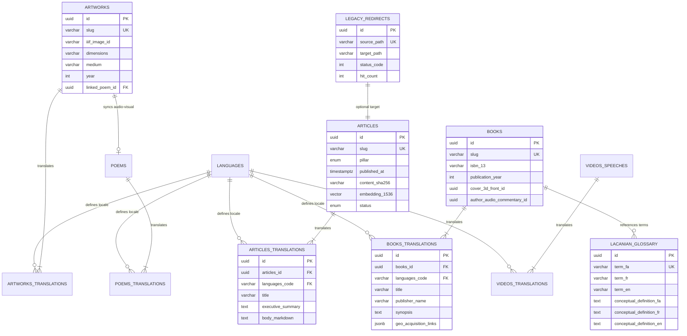

# سند اجرایی فاز ۱: معماری زیرساخت، فرانت‌اند و بک‌اند
## Phase 1 Implementation Plan: Foundation, Headless CMS, Next.js 15+ & Resilient Infrastructure

> **Project Code:** `MAKAREMI-CORE-2026`  
> **Status:** PLANNING / AWAITING ARCHITECT APPROVAL  
> **Target Environment:** Antigravity Workspace / Production Zero-Trust Server  
> **Primary Canonical Domain:** `https://makaremi.com` (with 301 Edge Redirects from `makaremi.net`)  
> **Languages Supported:** Persian (`fa` - RTL Primary), French (`fr` - LTR), English (`en` - LTR)  
> **Core Pillars:**  
> 1. Lacanian Psychoanalysis (روانکاوی لکانی)  
> 2. Modern Calligraphy & Art (خوشنویسی مدرن و هنر)  
> 3. Cultural & Political Strategy (استراتژی فرهنگی و سیاسی / ایران فرهنگی)  
> 4. Human Rights & Transitional Justice (حقوق بشر، دادخواهی کشتار ۶۷ و خاوران)

---

## فهرست سرفصل‌های اجرایی (Table of Contents)

1. [ماژول ۱: ساختار مونو‌ریپو و درخت دایرکتوری‌ها (Workspace & Monorepo Structure)](#ماژول-۱-ساختار-مونوریپو-و-درخت-دایرکتوریها)
2. [ماژول ۲: زیرساخت کانتینری و مدل داده رابطه‌ای (Directus + PostgreSQL 17 + pgvector)](#ماژول-۲-زیرساخت-کانتینری-و-مدل-داده-رابطهای)
3. [ماژول ۳: معماری فرانت‌اند Next.js 15+، سیستم رندرینگ و مسیریابی چندزبانه (i18n)](#ماژول-۳-معماری-فرانتاند-nextjs-15-سیستم-رندرینگ-و-مسیریابی-چندزبانه)
4. [ماژول ۴: موتور تغییر مسیرهای ۳۰۱ و یکپارچه‌سازی دامنه وردپرس قدیمی (Domain Canonicalization)](#ماژول-۴-موتور-تغییر-مسیرهای-۳۰۱-و-یکپارچهسازی-دامنه-وردپرس-قدیمی)
5. [ماژول ۵: بهینه‌سازی دسترسی کاربران داخل ایران و معماری آفلاین PWA](#ماژول-۵-بهینهسازی-دسترسی-کاربران-داخل-ایران-و-معماری-آفلاین-pwa)
6. [ماژول ۶: توالی اجرای گام‌به‌گام و دستورات اعتبارسنجی (Execution Sequence & Verification)](#ماژول-۶-توالی-اجرای-گامبهگام-و-دستورات-اعتبارسنجی)

---

## ماژول ۱: ساختار مونو‌ریپو و درخت دایرکتوری‌ها

پروژه به صورت یک مونو‌ریپوی بهینه بر پایه **pnpm Workspaces** و **Turborepo** ساختاربندی می‌شود تا کدهای فرانت‌اند، کدهای تایپ‌اسکریپت مشترک (Shared Schemas & Types) و اسکریپت‌های زیرساخت کانتینری به صورت کاملاً ماژولار در یک مخزن نگهداری شوند.

### ۱.۱. درخت دایرکتوری تفصیلی پروژه (Folder Tree)

```text
MAKAREMI-CORE-2026/
├── .env.example                          # متغیرهای محیطی نمونه برای توسعه و استقرار
├── .gitignore                            # نادیده‌گیری وابستگی‌ها و داده‌های محلی
├── package.json                          # اسکریپت‌های ریشه مونوریپو (pnpm)
├── pnpm-workspace.yaml                   # تعریف فضاهای کاری (apps/*, packages/*)
├── turbo.json                            # پایپ‌لاین بیلد و کش توربورپو
├── tsconfig.base.json                    # پیکربندی ریشه TypeScript
├── docker-compose.yml                    # تعریف سرویس‌های اصلی کانتینری
├── docker-compose.override.yml.example   # تنظیمات اختصاصی محیط توسعه محلی
│
├── apps/
│   └── web/                              # وب‌اپلیکیشن اصلی (Next.js 15+ App Router)
│       ├── package.json
│       ├── tsconfig.json
│       ├── next.config.ts                # بهینه‌سازی تصاویر، هدرهای امنیتی و بازنویسی‌ها
│       ├── middleware.ts                 # تغییر مسیر ۳۰۱، تشخیص لوکال و تزریق dir="rtl|ltr"
│       ├── public/
│       │   ├── fonts/                    # فونت‌های محلی خودمیزبان (بدون وابستگی خارجی)
│       │   │   ├── vazirmatn/            # Vazirmatn Variable (.woff2)
│       │   │   ├── cormorant/            # Cormorant Garamond (.woff2)
│       │   │   └── inter/                # Inter Variable (.woff2)
│       │   ├── icons/                    # آیکون‌های PWA و Favicon
│       │   ├── manifest.webmanifest      # وب‌مانیفست PWA
│       │   └── sw.js                     # سرویس‌ورکر خودکار تولید شده توسط Serwist
│       └── src/
│           ├── app/
│           │   ├── [locale]/             # مسیرهای تفکیک‌شده زبانی (/fa, /fr, /en)
│           │   │   ├── layout.tsx        # پوسته اصلی، تزریق متادیتا، اسکیما و جهت متن
│           │   │   ├── page.tsx          # صفحه اصلی پورتال چندزبانه
│           │   │   ├── psychoanalysis/   # ستون روانکاوی لکانی
│           │   │   ├── art/              # ستون هنر و خوشنویسی مدرن
│           │   │   ├── strategy/         # ستون استراتژی فرهنگی-سیاسی و ایران فرهنگی
│           │   │   ├── human-rights/     # ستون حقوق بشر و دادخواهی (خاوران و ۶۷)
│           │   │   ├── books/            # ویترین تعاملی کتاب‌ها
│           │   │   │   ├── page.tsx
│           │   │   │   └── [slug]/page.tsx
│           │   │   ├── gallery/          # گالری موزه‌ای با زوم عمیق IIIF
│           │   │   ├── poetry/           # آرشیو اشعار دوزبانه و شعر-تصویر
│           │   │   └── media/            # سخنرانی‌ها، یوتیوب و پادکست‌های خودمیزبان
│           │   ├── api/
│           │   │   ├── revalidate/       # اندپوینت وب‌هوک با کلید امن برای On-Demand ISR
│           │   │   └── search/           # جستجوی تمام‌متن و برداری هیبرید
│           │   ├── llms.txt/route.ts     # اندپوینت تولید پویا برای موتورهای AEO/GEO
│           │   ├── llms-full.txt/route.ts
│           │   ├── sitemap.ts            # نقشه سایت چندزبانه با تگ‌های hreflang
│           │   └── robots.ts             # پیکربندی روبات‌های خزنده استاندارد و هوش مصنوعی
│           ├── components/
│           │   ├── common/               # هدر، فوتر، ناوبری تغییر زبان، دکمه ذخیره آفلاین
│           │   ├── books/                # کامپوننت نمایشگر ۳بعدی جلد، ورق‌زن و پلیر صوتی
│           │   ├── gallery/              # کامپوننت OpenSeadragon و تماشای آثار
│           │   ├── articles/             # رندر مقالات با نقل‌قول مدیریتی و امضای دیجیتال
│           │   └── media/                # پلیر ویدیو مقاوم با فال‌بک خودکار HLS صوتی/تصویری
│           ├── lib/
│           │   ├── cms.ts                # کلاینت تایپ‌شده اتصال به Directus API
│           │   ├── db.ts                 # کلاینت اتصال مستقیم به PostgreSQL/pgvector
│           │   ├── i18n.ts               # تعاریف زبان‌ها، جهت متن، و ترجمه‌ها
│           │   ├── crypto.ts             # راستی‌آزمایی هش SHA-256 مقالات
│           │   └── pwa.ts                # مدیریت وضعیت شبکه و حافظه کش IndexedDB
│           └── styles/
│               ├── tokens.css            # متغیرهای CSS (رنگ‌های ۴ ستون، فاصله‌ها، لایه‌ها)
│               ├── typography.css        # تعاریف فونت‌های بومی فارسی، فرانسه و انگلیسی
│               └── globals.css           # بازنشانی استایل و ساختارهای پایه واکنش‌گرا
│
├── packages/
│   └── shared/                           # بسته‌های مشترک فرانت‌اند و بک‌اند
│       ├── package.json
│       ├── tsconfig.json
│       └── src/
│           ├── types/
│           │   ├── content.ts            # مدل مقالات، کتاب‌ها، نمایشگاه‌ها، اشعار، ویدیوها
│           │   ├── i18n.ts               # تایپ‌های لوکال، جهت متن و دیکشنری‌ها
│           │   └── glossary.ts           # تایپ‌های واژه‌نامه تخصصی لکانی
│           ├── schemas/
│           │   ├── article.schema.ts     # اسکیمای اعتبارسنجی Zod برای مقالات
│           │   ├── book.schema.ts        # اسکیمای اعتبارسنجی Zod برای کتاب‌ها
│           │   └── redirect.schema.ts    # اسکیمای اعتبارسنجی ریدایرکت‌های ۳۰۱
│           └── constants/
│               ├── pillars.ts            # مقادیر ثابت ۴ ستون هویتی و کدهای رنگی
│               └── redirects.ts          # نگاشت ایستا ریدایرکت‌های حیاتی وردپرس
│
└── infra/                                # فایل‌های استقرار، پایگاه داده و کانتینرها
    ├── docker-compose.yml                # پیکربندی هماهنگ کانتینرها
    ├── postgres/
    │   ├── Dockerfile                    # PostgreSQL 17 به همراه اکستنشن pgvector
    │   └── init/
    │       ├── 01-extensions.sql         # فعال‌سازی pgvector و فیلترهای جستجو
    │       └── 02-schema.sql             # ساخت جداول و شاخص‌های اولیه
    ├── cantaloupe/
    │   ├── Dockerfile                    # سرور تصاویر IIIF برای زوم عمیق با بافت بوم
    │   └── cantaloupe.properties         # تنظیمات کش و کشف منبع فایل‌ها
    ├── redis/
    │   └── redis.conf                    # کش حافظه‌ای برای ریدایرکت‌ها و سشن‌ها
    └── cloudflared/
        └── config.yml.template           # پیکربندی تونل Zero-Trust بدون پورت عمومی
```

### ۱.۲. محتوای فایل‌های پیکربندی ریشه

#### `package.json` (Root)
```json
{
  "name": "makaremi-core-monorepo",
  "version": "1.0.0",
  "private": true,
  "engines": {
    "node": ">=20.10.0",
    "pnpm": ">=9.0.0"
  },
  "scripts": {
    "dev": "turbo run dev",
    "build": "turbo run build",
    "lint": "turbo run lint",
    "typecheck": "turbo run typecheck",
    "test": "turbo run test",
    "docker:up": "docker compose -f infra/docker-compose.yml up -d",
    "docker:down": "docker compose -f infra/docker-compose.yml down",
    "docker:logs": "docker compose -f infra/docker-compose.yml logs -f"
  },
  "devDependencies": {
    "turbo": "^2.3.0",
    "typescript": "^5.7.0"
  },
  "packageManager": "pnpm@9.15.0"
}
```

#### `pnpm-workspace.yaml`
```yaml
packages:
  - "apps/*"
  - "packages/*"
```

#### `turbo.json`
```json
{
  "$schema": "https://turbo.build/schema.json",
  "tasks": {
    "build": {
      "dependsOn": ["^build"],
      "outputs": [".next/**", "!.next/cache/**", "dist/**"]
    },
    "typecheck": {
      "dependsOn": ["^build"]
    },
    "lint": {
      "dependsOn": ["^build"]
    },
    "dev": {
      "cache": false,
      "persistent": true
    }
  }
}
```

#### `tsconfig.base.json`
```json
{
  "compilerOptions": {
    "target": "ES2022",
    "lib": ["DOM", "DOM.Iterable", "ES2022"],
    "module": "NodeNext",
    "moduleResolution": "NodeNext",
    "resolveJsonModule": true,
    "strict": true,
    "esModuleInterop": true,
    "skipLibCheck": true,
    "forceConsistentCasingInFileNames": true,
    "declaration": true,
    "declarationMap": true,
    "sourceMap": true
  }
}
```

#### `.env.example`
```env
# ==============================================================================
# ENVIRONMENT CONFIGURATION - MAKAREMI-CORE-2026
# ==============================================================================
NODE_ENV=production
NEXT_TELEMETRY_DISABLED=1

# --- DOMAINS & CANONICAL ROUTING ---
NEXT_PUBLIC_SITE_URL=https://makaremi.com
CANONICAL_HOST=makaremi.com
LEGACY_HOST_PRIMARY=makaremi.net
LEGACY_HOST_SECONDARY=www.makaremi.net

# --- DIRECTUS HEADLESS CMS ---
DIRECTUS_URL=http://directus:8055
DIRECTUS_PUBLIC_URL=https://admin.makaremi.com
DIRECTUS_ADMIN_EMAIL=admin@makaremi.com
DIRECTUS_ADMIN_PASSWORD=REPLACE_WITH_HIGH_ENTROPY_PASSWORD_MIN_32_CHARS
DIRECTUS_KEY=generate-random-uuid-v4-here
DIRECTUS_SECRET=generate-random-secret-key-min-64-chars

# --- POSTGRESQL 17 + PGVECTOR ---
DB_CLIENT=pg
DB_HOST=postgres
DB_PORT=5432
DB_DATABASE=makaremi_core
DB_USER=makaremi_admin
DB_PASSWORD=REPLACE_WITH_STRONG_DB_SECRET_PASSWORD

# --- REDIS CACHE ---
REDIS_HOST=redis
REDIS_PORT=6379
REDIS_PASSWORD=REPLACE_WITH_STRONG_REDIS_SECRET

# --- CANTALOUPE IIIF SERVER ---
CANTALOUPE_PORT=8182
CANTALOUPE_BASE_URI=https://iiif.makaremi.com/iiif/2

# --- ISR ON-DEMAND REVALIDATION ---
REVALIDATE_SECRET_TOKEN=REPLACE_WITH_CRYPTO_RANDOM_SECRET_FOR_WEBHOOK

# --- DIGITAL SIGNATURE & CONTENT INTEGRITY ---
CONTENT_SIGNING_PUBLIC_KEY=-----BEGIN PUBLIC KEY-----\nMIIBIjANBgkqhkiG9w0BAQEFAAOCAQ8AMIIBCgKCAQEA...\n-----END PUBLIC KEY-----
```

---

## ماژول ۲: زیرساخت کانتینری و مدل داده رابطه‌ای

### ۲.۱. پیکربندی کانتینرها (Docker Compose & Zero-Trust Isolation)

در انطباق با الزامات فاز ۱ و فاز ۳ سند معماری:
1. **ایزولاسیون Zero-Trust:** کلیه سرویس‌ها در یک شبکه بریج خصوصی داخلی (`makaremi_internal_net`) قرار می‌گیرند.
2. هیچ پورتی از دیتابیس PostgreSQL یا ردیس روی اینترفیس عمومی (`0.0.0.0`) باز نخواهد شد؛ در محیط سرور پروداکشن، کلیه پورت‌ها صرفاً به تونل خروجی Cloudflare با اتصال متقابل رمزنگاری‌شده محدود می‌شوند.
3. در محیط محلی/توسعه، دسترسی به دیتابیس و پنل ادمین صرفاً روی `127.0.0.1` باینـد می‌گردد.

#### فایل `infra/docker-compose.yml`
```yaml
version: '3.9'

networks:
  makaremi_internal_net:
    driver: bridge
    internal: false # اجازه دسترسی به اینترنت جهت خروج داده‌ها بدون دریافت پورت ورودی

volumes:
  pg_data:
    driver: local
  directus_uploads:
    driver: local
  directus_extensions:
    driver: local
  redis_data:
    driver: local
  cantaloupe_cache:
    driver: local

services:
  # ----------------------------------------------------------------------------
  # 1. PostgreSQL 17 + pgvector Extension
  # ----------------------------------------------------------------------------
  postgres:
    build:
      context: ./postgres
      dockerfile: Dockerfile
    container_name: makaremi_postgres
    restart: unless-stopped
    environment:
      POSTGRES_DB: ${DB_DATABASE:-makaremi_core}
      POSTGRES_USER: ${DB_USER:-makaremi_admin}
      POSTGRES_PASSWORD: ${DB_PASSWORD:?Database password required}
      PGDATA: /var/lib/postgresql/data/pgdata
    volumes:
      - pg_data:/var/lib/postgresql/data
      - ./postgres/init:/docker-entrypoint-initdb.d:ro
    ports:
      - "127.0.0.1:5432:5432" # اتصال محلی جهت دیباگ / فاقد دسترسی اینترنتی
    networks:
      - makaremi_internal_net
    healthcheck:
      test: ["CMD-SHELL", "pg_isready -U ${DB_USER:-makaremi_admin} -d ${DB_DATABASE:-makaremi_core}"]
      interval: 10s
      timeout: 5s
      retries: 5
      start_period: 15s

  # ----------------------------------------------------------------------------
  # 2. Redis 7 (In-Memory Redirect Cache & Session Storage)
  # ----------------------------------------------------------------------------
  redis:
    image: redis:7.4-alpine
    container_name: makaremi_redis
    restart: unless-stopped
    command: ["redis-server", "--requirepass", "${REDIS_PASSWORD}", "--appendonly", "yes"]
    volumes:
      - redis_data:/data
      - ./redis/redis.conf:/usr/local/etc/redis/redis.conf:ro
    ports:
      - "127.0.0.1:6379:6379"
    networks:
      - makaremi_internal_net
    healthcheck:
      test: ["CMD", "redis-cli", "-a", "${REDIS_PASSWORD}", "ping"]
      interval: 10s
      timeout: 3s
      retries: 5

  # ----------------------------------------------------------------------------
  # 3. Directus Headless CMS (Decoupled Content API)
  # ----------------------------------------------------------------------------
  directus:
    image: directus/directus:11.3.0
    container_name: makaremi_directus
    restart: unless-stopped
    depends_on:
      postgres:
        condition: service_healthy
      redis:
        condition: service_healthy
    ports:
      - "127.0.0.1:8055:8055"
    environment:
      KEY: ${DIRECTUS_KEY}
      SECRET: ${DIRECTUS_SECRET}
      ADMIN_EMAIL: ${DIRECTUS_ADMIN_EMAIL}
      ADMIN_PASSWORD: ${DIRECTUS_ADMIN_PASSWORD}
      PUBLIC_URL: ${DIRECTUS_PUBLIC_URL}
      DB_CLIENT: "pg"
      DB_HOST: "postgres"
      DB_PORT: "5432"
      DB_DATABASE: ${DB_DATABASE:-makaremi_core}
      DB_USER: ${DB_USER:-makaremi_admin}
      DB_PASSWORD: ${DB_PASSWORD}
      CACHE_ENABLED: "true"
      CACHE_STORE: "redis"
      CACHE_REDIS: "redis://:${REDIS_PASSWORD}@redis:6379"
      RATE_LIMITER_ENABLED: "true"
      RATE_LIMITER_STORE: "redis"
      RATE_LIMITER_REDIS: "redis://:${REDIS_PASSWORD}@redis:6379"
      STORAGE_LOCATIONS: "local"
      STORAGE_LOCAL_ROOT: "/directus/uploads"
      CORS_ENABLED: "true"
      CORS_ORIGIN: "https://makaremi.com,http://localhost:3000"
    volumes:
      - directus_uploads:/directus/uploads
      - directus_extensions:/directus/extensions
    networks:
      - makaremi_internal_net
    healthcheck:
      test: ["CMD-SHELL", "wget --no-verbose --tries=1 --spider http://127.0.0.1:8055/server/health || exit 1"]
      interval: 15s
      timeout: 5s
      retries: 5
      start_period: 30s

  # ----------------------------------------------------------------------------
  # 4. Cantaloupe IIIF Image Server (Museum-Grade Deep Zoom for Calligraphy)
  # ----------------------------------------------------------------------------
  cantaloupe:
    build:
      context: ./cantaloupe
      dockerfile: Dockerfile
    container_name: makaremi_cantaloupe
    restart: unless-stopped
    ports:
      - "127.0.0.1:8182:8182"
    environment:
      JAVA_OPTS: "-Xmx2g -Dcantaloupe.config=/etc/cantaloupe.properties"
    volumes:
      - directus_uploads:/var/images:ro
      - cantaloupe_cache:/var/cache/cantaloupe
      - ./cantaloupe/cantaloupe.properties:/etc/cantaloupe.properties:ro
    networks:
      - makaremi_internal_net
    healthcheck:
      test: ["CMD-SHELL", "wget --no-verbose --tries=1 --spider http://127.0.0.1:8182/health || exit 1"]
      interval: 20s
      timeout: 5s
      retries: 3
```

#### فایل `infra/postgres/Dockerfile`
```dockerfile
FROM postgres:17-alpine

RUN apk add --no-cache \
    git \
    build-base \
    clang19 \
    llvm19 \
    postgresql17-dev

# کلون و کامپایل افزونه برداری pgvector
RUN git clone --branch v0.8.0 https://github.com/pgvector/pgvector.git /tmp/pgvector \
    && cd /tmp/pgvector \
    && make \
    && make install \
    && rm -rf /tmp/pgvector \
    && apk del git build-base clang19 llvm19 postgresql17-dev
```

---

### ۲.۲. مدل داده رابطه‌ای چندزبانه (Relational Data Model)

کلیه مجموعه‌های اصلی بر اساس استاندارد چندزبانه Directus (جدول والد با فیلدهای مستقل از زبان + جدول ترجمه متناظر برای هر زبان با کلید ترکیبی `(parent_id, languages_code)`) طراحی می‌شوند.



#### اسکریپت SQL تعریف جداول (`infra/postgres/init/02-schema.sql`):

```sql
-- 1. فعال‌سازی اکستنشن‌های دیتابیس
CREATE EXTENSION IF NOT EXISTS "uuid-ossp";
CREATE EXTENSION IF NOT EXISTS "vector";
CREATE EXTENSION IF NOT EXISTS "pg_trgm";

-- 2. جدول زبان‌های رسمی
CREATE TABLE IF NOT EXISTS languages (
    code VARCHAR(10) PRIMARY KEY, -- 'fa-IR', 'fr-FR', 'en-US'
    name VARCHAR(50) NOT NULL,
    direction VARCHAR(3) NOT NULL CHECK (direction IN ('rtl', 'ltr')),
    is_default BOOLEAN DEFAULT false
);

INSERT INTO languages (code, name, direction, is_default) VALUES
('fa-IR', 'فارسی', 'rtl', true),
('fr-FR', 'Français', 'ltr', false),
('en-US', 'English', 'ltr', false)
ON CONFLICT (code) DO NOTHING;

-- 3. جدول واژه‌نامه کنترل‌شده اصطلاحات لکانی و راهبردی
CREATE TABLE IF NOT EXISTS lacanian_glossary (
    id UUID PRIMARY KEY DEFAULT uuid_generate_v4(),
    term_fa VARCHAR(255) NOT NULL UNIQUE,
    term_fr VARCHAR(255) NOT NULL,
    term_en VARCHAR(255) NOT NULL,
    conceptual_definition_fa TEXT NOT NULL,
    conceptual_definition_fr TEXT,
    conceptual_definition_en TEXT,
    pillar VARCHAR(50) DEFAULT 'psychoanalysis' CHECK (pillar IN ('psychoanalysis', 'art_calligraphy', 'cultural_strategy', 'human_rights_dadkhahi')),
    created_at TIMESTAMPTZ DEFAULT NOW(),
    updated_at TIMESTAMPTZ DEFAULT NOW()
);

-- درج نمونه‌های اساسی واژه‌نامه مؤلف
INSERT INTO lacanian_glossary (term_fa, term_fr, term_en, conceptual_definition_fa, pillar) VALUES
('دگرشنیدن', 'Écouter autrement', 'Listening Differently', 'رویکرد تحلیلی و بالینی خاص دکتر مکارمی در بازخوانی متن ناخودآگاه، حافظ و سوژه ایرانی.', 'psychoanalysis'),
('عملیات نام پدر', 'Opération Nom-du-Père', 'Operation of the Name-of-the-Father', 'سازوکار ساختاری و استعاره پدری در گذر از قلمرو خیالی به نمادین در روانکاوی لکانی.', 'psychoanalysis'),
('حالت مرزی', 'État Limite', 'Borderline State', 'مفهوم ساختاریافته روانکاوی میان روان‌پریشی، روان‌نژندی و انحراف در مطالعات بالینی دکتر مکارمی.', 'psychoanalysis')
ON CONFLICT (term_fa) DO NOTHING;

-- 4. جدول مقالات (Articles) و ترجمه‌ها
CREATE TABLE IF NOT EXISTS articles (
    id UUID PRIMARY KEY DEFAULT uuid_generate_v4(),
    slug VARCHAR(255) NOT NULL UNIQUE,
    pillar VARCHAR(50) NOT NULL CHECK (pillar IN ('psychoanalysis', 'art_calligraphy', 'cultural_strategy', 'human_rights_dadkhahi')),
    status VARCHAR(20) DEFAULT 'draft' CHECK (status IN ('draft', 'review_pending', 'published', 'archived')),
    cover_image_id UUID,
    audio_summary_file_id UUID,
    content_sha256 CHAR(64) NOT NULL,
    embedding vector(1536), -- بردار ابعاد OpenAI text-embedding-3-small
    published_at TIMESTAMPTZ,
    created_at TIMESTAMPTZ DEFAULT NOW(),
    updated_at TIMESTAMPTZ DEFAULT NOW()
);

CREATE TABLE IF NOT EXISTS articles_translations (
    id UUID PRIMARY KEY DEFAULT uuid_generate_v4(),
    articles_id UUID NOT NULL REFERENCES articles(id) ON DELETE CASCADE,
    languages_code VARCHAR(10) NOT NULL REFERENCES languages(code) ON DELETE RESTRICT,
    title VARCHAR(255) NOT NULL,
    executive_summary TEXT NOT NULL, -- باکس چکیده مدیریتی برای AEO/GEO
    body_markdown TEXT NOT NULL,
    meta_title VARCHAR(255),
    meta_description TEXT,
    canonical_url VARCHAR(500),
    CONSTRAINT uq_articles_translations UNIQUE(articles_id, languages_code)
);

-- 5. جدول کتاب‌ها (Books) و ترجمه‌ها
CREATE TABLE IF NOT EXISTS books (
    id UUID PRIMARY KEY DEFAULT uuid_generate_v4(),
    slug VARCHAR(255) NOT NULL UNIQUE,
    isbn_13 VARCHAR(17),
    publication_year INT NOT NULL,
    page_count INT,
    pillar VARCHAR(50) NOT NULL,
    cover_3d_front_id UUID,
    cover_3d_spine_id UUID,
    cover_3d_back_id UUID,
    author_audio_commentary_id UUID,
    order_index INT DEFAULT 0,
    status VARCHAR(20) DEFAULT 'published',
    created_at TIMESTAMPTZ DEFAULT NOW()
);

CREATE TABLE IF NOT EXISTS books_translations (
    id UUID PRIMARY KEY DEFAULT uuid_generate_v4(),
    books_id UUID NOT NULL REFERENCES books(id) ON DELETE CASCADE,
    languages_code VARCHAR(10) NOT NULL REFERENCES languages(code) ON DELETE RESTRICT,
    title VARCHAR(255) NOT NULL,
    subtitle VARCHAR(255),
    publisher_name VARCHAR(150) NOT NULL,
    publication_city VARCHAR(100),
    synopsis TEXT NOT NULL,
    table_of_contents_markdown TEXT,
    sample_chapter_markdown TEXT,
    sample_flipbook_pdf_id UUID,
    geo_acquisition_links JSONB DEFAULT '{"iran": [], "international": []}',
    CONSTRAINT uq_books_translations UNIQUE(books_id, languages_code)
);

-- 6. جدول آثار هنری و نمایشگاه‌ها (Artworks & Exhibitions)
CREATE TABLE IF NOT EXISTS artworks (
    id UUID PRIMARY KEY DEFAULT uuid_generate_v4(),
    slug VARCHAR(255) NOT NULL UNIQUE,
    iiif_image_id VARCHAR(255) NOT NULL, -- شناسه تصویر برای سرور Cantaloupe
    year INT NOT NULL,
    dimensions VARCHAR(50), -- مانند "120x80 cm"
    medium VARCHAR(100) NOT NULL, -- مانند "مرکب و اکریلیک روی بوم"
    artform VARCHAR(50) DEFAULT 'calligraphy',
    linked_poem_id UUID, -- اتصال شعر و تصویر
    audio_recitation_file_id UUID,
    status VARCHAR(20) DEFAULT 'published',
    created_at TIMESTAMPTZ DEFAULT NOW()
);

CREATE TABLE IF NOT EXISTS artworks_translations (
    id UUID PRIMARY KEY DEFAULT uuid_generate_v4(),
    artworks_id UUID NOT NULL REFERENCES artworks(id) ON DELETE CASCADE,
    languages_code VARCHAR(10) NOT NULL REFERENCES languages(code) ON DELETE RESTRICT,
    title VARCHAR(255) NOT NULL,
    description_markdown TEXT,
    curator_critique_markdown TEXT, -- نقدهای هنری نظیر نقد مایکل بری
    CONSTRAINT uq_artworks_translations UNIQUE(artworks_id, languages_code)
);

CREATE TABLE IF NOT EXISTS exhibitions (
    id UUID PRIMARY KEY DEFAULT uuid_generate_v4(),
    slug VARCHAR(255) NOT NULL UNIQUE,
    start_date DATE NOT NULL,
    end_date DATE,
    venue_city VARCHAR(100) NOT NULL,
    venue_name VARCHAR(255) NOT NULL, -- موزه مدرن خوشنویسی مسکو، پومپادور و ...
    status VARCHAR(20) DEFAULT 'published',
    created_at TIMESTAMPTZ DEFAULT NOW()
);

CREATE TABLE IF NOT EXISTS exhibitions_translations (
    id UUID PRIMARY KEY DEFAULT uuid_generate_v4(),
    exhibitions_id UUID NOT NULL REFERENCES exhibitions(id) ON DELETE CASCADE,
    languages_code VARCHAR(10) NOT NULL REFERENCES languages(code) ON DELETE RESTRICT,
    title VARCHAR(255) NOT NULL,
    curatorial_statement_markdown TEXT,
    CONSTRAINT uq_exhibitions_translations UNIQUE(exhibitions_id, languages_code)
);

-- 7. جدول اشعار (Poems)
CREATE TABLE IF NOT EXISTS poems (
    id UUID PRIMARY KEY DEFAULT uuid_generate_v4(),
    slug VARCHAR(255) NOT NULL UNIQUE,
    creation_year INT,
    audio_recitation_file_id UUID,
    linked_artwork_id UUID REFERENCES artworks(id) ON DELETE SET NULL,
    status VARCHAR(20) DEFAULT 'published',
    created_at TIMESTAMPTZ DEFAULT NOW()
);

CREATE TABLE IF NOT EXISTS poems_translations (
    id UUID PRIMARY KEY DEFAULT uuid_generate_v4(),
    poems_id UUID NOT NULL REFERENCES poems(id) ON DELETE CASCADE,
    languages_code VARCHAR(10) NOT NULL REFERENCES languages(code) ON DELETE RESTRICT,
    title VARCHAR(255) NOT NULL,
    verses JSONB NOT NULL, -- آرایه‌ای از ابیات یا بندهای شعر دوزبانه
    commentary_markdown TEXT,
    CONSTRAINT uq_poems_translations UNIQUE(poems_id, languages_code)
);

-- 8. جدول سخنرانی‌ها و ویدیوها (Videos & Speeches)
CREATE TABLE IF NOT EXISTS videos_speeches (
    id UUID PRIMARY KEY DEFAULT uuid_generate_v4(),
    slug VARCHAR(255) NOT NULL UNIQUE,
    event_date DATE NOT NULL,
    event_location VARCHAR(150), -- نشست ۲۳ شورای حقوق بشر ژنو و ...
    pillar VARCHAR(50) NOT NULL,
    youtube_video_id VARCHAR(50),
    self_hosted_hls_url VARCHAR(500), -- جریان استریم اختصاصی برای داخل ایران
    self_hosted_audio_url VARCHAR(500), -- فایل سبک صوتی پادکست
    duration_seconds INT,
    status VARCHAR(20) DEFAULT 'published',
    created_at TIMESTAMPTZ DEFAULT NOW()
);

CREATE TABLE IF NOT EXISTS videos_speeches_translations (
    id UUID PRIMARY KEY DEFAULT uuid_generate_v4(),
    videos_speeches_id UUID NOT NULL REFERENCES videos_speeches(id) ON DELETE CASCADE,
    languages_code VARCHAR(10) NOT NULL REFERENCES languages(code) ON DELETE RESTRICT,
    title VARCHAR(255) NOT NULL,
    description TEXT,
    transcript_markdown TEXT, -- پیاده‌سازی متنی جهت ایندکس و دسترسی بدون فیلتر
    CONSTRAINT uq_videos_speeches_translations UNIQUE(videos_speeches_id, languages_code)
);

-- 9. جدول تغییر مسیرهای وردپرس قدیمی (Legacy Redirects Engine)
CREATE TABLE IF NOT EXISTS legacy_redirects (
    id UUID PRIMARY KEY DEFAULT uuid_generate_v4(),
    source_path VARCHAR(500) NOT NULL UNIQUE, -- مسیر درخواست قدیمی بدون دامنه
    target_path VARCHAR(500) NOT NULL,         -- مسیر جدید روی makaremi.com
    status_code SMALLINT DEFAULT 301 CHECK (status_code IN (301, 308)),
    hit_count INT DEFAULT 0,
    last_accessed_at TIMESTAMPTZ,
    created_at TIMESTAMPTZ DEFAULT NOW()
);

CREATE INDEX IF NOT EXISTS idx_legacy_redirects_source ON legacy_redirects (source_path);
```

---

## ماژول ۳: معماری فرانت‌اند Next.js 15+، سیستم رندرینگ و مسیریابی چندزبانه

### ۳.۱. وابستگی‌های پکیج فرانت‌اند (`apps/web/package.json`)
```json
{
  "name": "@makaremi/web",
  "version": "1.0.0",
  "private": true,
  "scripts": {
    "dev": "next dev --turbopack -p 3000",
    "build": "next build",
    "start": "next start -p 3000",
    "lint": "next lint",
    "typecheck": "tsc --noEmit"
  },
  "dependencies": {
    "next": "^15.1.0",
    "react": "^19.0.0",
    "react-dom": "^19.0.0",
    "@serwist/next": "^9.0.10",
    "lucide-react": "^0.468.0",
    "openseadragon": "^5.0.1",
    "idb-keyval": "^6.2.1",
    "zod": "^3.24.1",
    "@makaremi/shared": "workspace:*"
  },
  "devDependencies": {
    "@types/node": "^22.10.1",
    "@types/react": "^19.0.1",
    "@types/react-dom": "^19.0.1",
    "@types/openseadragon": "^3.0.10",
    "typescript": "^5.7.2"
  }
}
```

### ۳.۲. پیکربندی Next.js (`apps/web/next.config.ts`)
```typescript
import type { NextConfig } from 'next';
import withSerwistInit from '@serwist/next';

const withSerwist = withSerwistInit({
  swSrc: 'src/sw.ts',
  swDest: 'public/sw.js',
  disable: process.env.NODE_ENV === 'development',
});

const nextConfig: NextConfig = {
  reactStrictMode: true,
  poweredByHeader: false,
  compress: true,
  
  images: {
    formats: ['image/avif', 'image/webp'],
    minimumCacheTTL: 2592000, // ۳۰ روز کش در لبه
    remotePatterns: [
      {
        protocol: 'https',
        hostname: 'admin.makaremi.com',
        pathname: '/assets/**',
      },
      {
        protocol: 'https',
        hostname: 'iiif.makaremi.com',
        pathname: '/iiif/**',
      },
    ],
  },

  async headers() {
    return [
      {
        source: '/:path*',
        headers: [
          { key: 'X-DNS-Prefetch-Control', value: 'on' },
          { key: 'X-Frame-Options', value: 'SAMEORIGIN' },
          { key: 'X-Content-Type-Options', value: 'nosniff' },
          { key: 'Referrer-Policy', value: 'strict-origin-when-cross-origin' },
          { key: 'Permissions-Policy', value: 'camera=(), microphone=(), geolocation=()' },
          {
            key: 'Strict-Transport-Security',
            value: 'max-age=63072000; includeSubDomains; preload',
          },
        ],
      },
    ];
  },
};

export default withSerwist(nextConfig);
```

### ۳.۳. میدل‌ور مسیریابی چندزبانه و تغییر مسیر (`apps/web/src/middleware.ts`)
```typescript
import { NextResponse } from 'next/server';
import type { NextRequest } from 'next/server';
import { STATIC_LEGACY_REDIRECTS } from '@makaremi/shared/constants/redirects';

const SUPPORTED_LOCALES = ['fa', 'fr', 'en'] as const;
type Locale = (typeof SUPPORTED_LOCALES)[number];
const DEFAULT_LOCALE: Locale = 'fa';

export async function middleware(request: NextRequest) {
  const { pathname, search } = request.nextUrl;
  const host = request.headers.get('host') || '';

  // ۱. اعتبارسنجی دامنه کانونیکال: هدایت makaremi.net و www به https://makaremi.com
  if (
    host.includes('makaremi.net') ||
    host.startsWith('www.makaremi.com')
  ) {
    const targetUrl = new URL(`https://makaremi.com${pathname}${search}`);
    return NextResponse.redirect(targetUrl, 301);
  }

  // ۲. عبور فایل‌های استاتیک، APIها و مانیفست
  if (
    pathname.startsWith('/_next') ||
    pathname.startsWith('/api') ||
    pathname.startsWith('/fonts') ||
    pathname.startsWith('/icons') ||
    pathname === '/favicon.ico' ||
    pathname === '/sw.js' ||
    pathname === '/manifest.webmanifest' ||
    pathname === '/llms.txt' ||
    pathname === '/llms-full.txt' ||
    pathname === '/robots.txt' ||
    pathname === '/sitemap.xml'
  ) {
    return NextResponse.next();
  }

  // ۳. بررسی نگاشت ایستای پیوندهای وردپرس قدیمی
  const cleanPath = pathname.endsWith('/') && pathname.length > 1 ? pathname.slice(0, -1) : pathname;
  if (STATIC_LEGACY_REDIRECTS[cleanPath]) {
    const destination = STATIC_LEGACY_REDIRECTS[cleanPath];
    return NextResponse.redirect(new URL(destination, request.url), 301);
  }

  // ۴. مدیریت زیرمسیرهای زبان و جهت صفحه (dir)
  const pathnameHasLocale = SUPPORTED_LOCALES.some(
    (locale) => pathname.startsWith(`/${locale}/`) || pathname === `/${locale}`
  );

  if (!pathnameHasLocale) {
    // بازنویسی پیش‌فرض به زبان فارسی (/fa)
    const localeUrl = new URL(`/${DEFAULT_LOCALE}${pathname}${search}`, request.url);
    return NextResponse.redirect(localeUrl, 308);
  }

  const currentLocale = pathname.split('/')[1] as Locale;
  const direction = currentLocale === 'fa' ? 'rtl' : 'ltr';

  const response = NextResponse.next();
  response.headers.set('X-Content-Locale', currentLocale);
  response.headers.set('X-Content-Direction', direction);

  return response;
}

export const config = {
  matcher: ['/((?!_next/static|_next/image|favicon.ico).*)'],
};
```

### ۳.۴. استراتژی رندرینگ هیبرید و وب‌هوک بازسازی آنی کش (On-Demand ISR)

کلیه مقالات، صفحات کتاب‌ها و بیانیه‌های حقوق بشری از قابلیت **Incremental Static Regeneration (ISR)** با زمان انقضای پیش‌فرض ۸۶٬۴۰۰ ثانیه (۲۴ ساعت) بهره می‌برند. به محض انتشار یا ویرایش محتوا توسط استاد، وب‌هوک مستقیم پنل Directus با ارسال توکن رمزنگاری‌شده، کش لبه را در کمتر از ۱۰۰ میلی‌ثانیه پاک‌سازی می‌کند.

#### فایل `apps/web/src/app/api/revalidate/route.ts`
```typescript
import { NextRequest, NextResponse } from 'next/server';
import { revalidatePath, revalidateTag } from 'next/cache';

export async function POST(request: NextRequest) {
  try {
    const secret = request.headers.get('x-revalidate-secret');
    const expectedSecret = process.env.REVALIDATE_SECRET_TOKEN;

    if (!expectedSecret || secret !== expectedSecret) {
      return NextResponse.json({ error: 'Unauthorized. Invalid secret token.' }, { status: 401 });
    }

    const body = await request.json();
    const { path, tag } = body;

    if (tag) {
      revalidateTag(tag);
      return NextResponse.json({ revalidated: true, type: 'tag', target: tag, now: Date.now() });
    }

    if (path) {
      revalidatePath(path);
      return NextResponse.json({ revalidated: true, type: 'path', target: path, now: Date.now() });
    }

    return NextResponse.json({ error: 'Missing path or tag parameter' }, { status: 400 });
  } catch (err: unknown) {
    const message = err instanceof Error ? err.message : 'Unknown revalidation failure';
    return NextResponse.json({ error: message }, { status: 500 });
  }
}
```

---

## ماژول ۴: موتور تغییر مسیرهای ۳۰۱ و یکپارچه‌سازی دامنه وردپرس قدیمی

### ۴.۱. ماتریس نگاشت پیوندهای دائمی (Canonical 301 Redirect Matrix)

نگاشت‌های پرکاربرد وردپرس به عنوان لایه اول بررسی در پکیج `@makaremi/shared` تعریف می‌شوند:

```typescript
// packages/shared/src/constants/redirects.ts
export const STATIC_LEGACY_REDIRECTS: Record<string, string> = {
  // ۱. صفحات اصلی و لندینگ‌ها
  '/home-persan': '/fa',
  '/home-persan/': '/fa',
  '/landing-page-fa_ir': '/fa',
  '/landing-page-fa_ir/': '/fa',
  '/home': '/fr',
  '/home/': '/fr',

  // ۲. ستون روانکاوی لکانی
  '/aya-ravankavi-elm-ast-fa': '/fa/psychoanalysis/articles/is-psychoanalysis-a-science',
  '/aya-ravankavi-elm-ast-fa/': '/fa/psychoanalysis/articles/is-psychoanalysis-a-science',
  '/etat-limite-un-concept-psychanalytique': '/fr/psychanalyse/articles/etat-limite-concept-psychanalytique',
  '/topologie-des-lieux-saints': '/fr/psychanalyse/articles/topologie-des-lieux-saints',
  '/role-de-l-inconscient-relation-entre-cavalier-et-cheval': '/fr/psychanalyse/articles/relation-cavalier-cheval',
  '/genre/gen-psychanalyse-fa': '/fa/books?pillar=psychoanalysis',

  // ۳. نمایشگاه‌های هنری و خوشنویسی
  '/nameyshgah-ir/fa-expo-8': '/fa/art/exhibitions/pompadour-2002-between-sign-and-symbol',
  '/nameyshgah-ir/fa-expo-8/': '/fa/art/exhibitions/pompadour-2002-between-sign-and-symbol',
  '/galerie-art': '/fr/art/galerie',

  // ۴. اشعار و دکلمه‌ها
  '/poeme/mra-navazesh-kn': '/fa/poetry/poems/caress-me',
  '/poeme/mra-navazesh-kn/': '/fa/poetry/poems/caress-me',
  '/poeme': '/fa/poetry',

  // ۵. دادخواهی و حقوق بشر
  '/%D8%A7neshast-paltaki-khavar-fa': '/fa/human-rights/speeches/khavaran-justice-session',
  '/neshast-paltaki-khavar-fa': '/fa/human-rights/speeches/khavaran-justice-session',
  '/lddhi-reports': '/fa/human-rights/lddhi',

  // ۶. آرشیو کتاب‌ها و دسته‌بندی‌ها
  '/list-ketabhay-farsi-ir': '/fa/books',
  '/list-ketabhay-farsi-ir/': '/fa/books',
  '/genre/farsi-books': '/fa/books',

  // ۷. سخنرانی‌ها و رسانه
  '/video/hassan-makaremi-parle-de-hafez-de-chiraz': '/fr/media/videos/hafez-de-chiraz',
  '/video': '/fa/media/videos'
};
```

### ۴.۲. موتور جستجوی داینامیک دیتابیس برای صدها پیوند قدیمی ناشناخته
در صورتی که درخواستی در لیست استاتیک بالا پیدا نشود، کنترلر به جدول `legacy_redirects` در PostgreSQL رجوع کرده و در صورت وجود پاسخ ۳۰۱ بازمی‌گرداند؛ سپس این نتیجه در ردیس به مدت ۳۰ روز کش می‌شود تا زمان پاسخ به کمتر از ۱۰ میلی‌ثانیه کاهش یابد.

---

## ماژول ۵: بهینه‌سازی دسترسی کاربران داخل ایران و معماری آفلاین PWA

### ۵.۱. معماری سرویس‌ورکر و مطالعه آفلاین (@serwist/next)

هنگام افت یا قطعی VPN در ایران، کاربر نباید با خطای قطعی شبکه یا صفحه سفید مواجه شود.

#### فایل سرویس‌ورکر (`apps/web/src/sw.ts`):
```typescript
import { defaultCache } from '@serwist/next/worker';
import type { PrecacheEntry, SerwistGlobalConfig } from 'serwist';
import { Serwist, StaleWhileRevalidate, CacheFirst, ExpirationPlugin } from 'serwist';

declare global {
  interface WorkerGlobalScope extends SerwistGlobalConfig {
    __SW_MANIFEST: (PrecacheEntry | string)[] | undefined;
  }
}

declare const self: ServiceWorkerGlobalScope;

const serwist = new Serwist({
  precacheEntries: self.__SW_MANIFEST,
  skipWaiting: true,
  clientsClaim: true,
  navigationPreload: true,
  runtimeCaching: [
    // ۱. فونت‌های محلی سیستم دیزاین: استراتژی CacheFirst با کش یک‌ساله
    {
      matcher: ({ url }) => url.pathname.startsWith('/fonts/'),
      handler: new CacheFirst({
        cacheName: 'makaremi-fonts',
        plugins: [
          new ExpirationPlugin({
            maxEntries: 30,
            maxAgeSeconds: 31536000, // ۱ سال
          }),
        ],
      }),
    },
    // ۲. متون مقالات، اشعار و پیش‌نمایش کتاب‌ها: StaleWhileRevalidate
    {
      matcher: ({ url }) =>
        url.pathname.includes('/psychoanalysis/') ||
        url.pathname.includes('/books/') ||
        url.pathname.includes('/poetry/') ||
        url.pathname.includes('/human-rights/'),
      handler: new StaleWhileRevalidate({
        cacheName: 'makaremi-articles-content',
        plugins: [
          new ExpirationPlugin({
            maxEntries: 200,
            maxAgeSeconds: 2592000, // ۳۰ روز مطالعه آفلاین
          }),
        ],
      }),
    },
    // ۳. تصاویر AVIF / WebP فشرده
    {
      matcher: ({ request }) => request.destination === 'image',
      handler: new CacheFirst({
        cacheName: 'makaremi-images',
        plugins: [
          new ExpirationPlugin({
            maxEntries: 100,
            maxAgeSeconds: 1209600, // ۱۴ روز
          }),
        ],
      }),
    },
    ...defaultCache,
  ],
  fallbacks: {
    entries: [
      {
        url: '/fa/offline',
        matcher({ request }) {
          return request.destination === 'document';
        },
      },
    ],
  },
});

serwist.addEventListeners();
```

### ۵.۲. بارگذاری فونت‌های بومی با صفر درخواست خارجی مسدودشده

برای مقابله با فیلترینگ شدید و کاهش خطای بارگذاری اسکریپت‌های گوگل (fonts.googleapis.com)، فونت‌ها کاملاً به صورت محلی در مسیر `apps/web/public/fonts/` قرار گرفته و در `apps/web/src/styles/typography.css` فراخوانی می‌شوند:

```css
/* فونت متغیر فارسی وزیرمتن (بدون وابستگی خارجی) */
@font-face {
  font-family: 'Vazirmatn';
  src: url('/fonts/vazirmatn/Vazirmatn[wght].woff2') format('woff2-variations');
  font-weight: 100 900;
  font-style: normal;
  font-display: swap;
}

/* فونت کلاسیک فرانسوی و انگلیسی برای عناوین آکادمیک */
@font-face {
  font-family: 'Cormorant Garamond';
  src: url('/fonts/cormorant/CormorantGaramond-SemiBold.woff2') format('woff2');
  font-weight: 600;
  font-style: normal;
  font-display: swap;
}

/* فونت مدرن برای بدنه متون لاتین */
@font-face {
  font-family: 'Inter';
  src: url('/fonts/inter/Inter-Variable.woff2') format('woff2-variations');
  font-weight: 100 900;
  font-style: normal;
  font-display: swap;
}

:root[dir="rtl"] {
  --font-primary: 'Vazirmatn', -apple-system, BlinkMacSystemFont, 'Segoe UI', Roboto, sans-serif;
  --font-display: 'Vazirmatn', serif;
  --line-height-body: 1.85;
}

:root[dir="ltr"] {
  --font-primary: 'Inter', -apple-system, BlinkMacSystemFont, 'Segoe UI', Roboto, sans-serif;
  --font-display: 'Cormorant Garamond', Georgia, serif;
  --line-height-body: 1.65;
}

body {
  font-family: var(--font-primary);
  line-height: var(--line-height-body);
}
```

---

## ماژول ۶: توالی اجرای گام‌به‌گام و دستورات اعتبارسنجی

پس از دریافت تأییدیه رسمی شما، فرآیند پیاده‌سازی فاز ۱ در **۸ گام اتمیک** به شرح زیر اجرا خواهد شد:

### گام ۱.۱: ایجاد ساختار ریشه مونوریپو و پیکربندی ابزارها
* **دستورات اجرایی:**
  ```powershell
  # ایجاد فایل‌های مونو‌ریپو
  # (ایجاد package.json, pnpm-workspace.yaml, turbo.json, tsconfig.base.json, .env.example)
  pnpm install
  ```
* **تست اعتبارسنجی:** اجرای `pnpm turbo --version` و تایید لود شدن تنظیمات ورک‌اسپیس.

### گام ۱.۲: استقرار کانتینرهای زیرساخت (PostgreSQL 17 + Redis + Cantaloupe)
* **دستورات اجرایی:**
  ```powershell
  docker compose -f infra/docker-compose.yml up -d --build postgres redis cantaloupe
  ```
* **تست اعتبارسنجی:**
  ```powershell
  docker compose -f infra/docker-compose.yml ps
  docker exec -it makaremi_postgres psql -U makaremi_admin -d makaremi_core -c "SELECT version();"
  docker exec -it makaremi_postgres psql -U makaremi_admin -d makaremi_core -c "CREATE EXTENSION IF NOT EXISTS vector; SELECT extversion FROM pg_extension WHERE extname='vector';"
  docker exec -it makaremi_redis redis-cli -a "$env:REDIS_PASSWORD" ping
  ```

### گام ۱.۳: اجرای اسکیما و مایگریشن پایگاه داده رابطه‌ای
* **دستورات اجرایی:** اجرای اسکریپت `02-schema.sql` روی کانتینر Postgres جهت ساخت جداول ۹گانه.
* **تست اعتبارسنجی:**
  ```powershell
  docker exec -it makaremi_postgres psql -U makaremi_admin -d makaremi_core -c "\dt"
  docker exec -it makaremi_postgres psql -U makaremi_admin -d makaremi_core -c "SELECT term_fa, term_fr FROM lacanian_glossary;"
  ```

### گام ۱.۴: استقرار و پیکربندی Directus Headless CMS
* **دستورات اجرایی:**
  ```powershell
  docker compose -f infra/docker-compose.yml up -d directus
  ```
* **تست اعتبارسنجی:**
  ```powershell
  curl -I http://127.0.0.1:8055/server/health
  # خروجی مورد انتظار: HTTP/1.1 200 OK با وضعیت {"status":"ok"}
  ```

### گام ۱.۵: ایجاد پکیج مشترک تایپ‌ها و ولیدیشن (`@makaremi/shared`)
* **دستورات اجرایی:** ساخت کدهای TypeScript در `packages/shared` و کامپایل تایپ‌ها.
* **تست اعتبارسنجی:**
  ```powershell
  pnpm --filter @makaremi/shared build
  ```

### گام ۱.۶: اسکلت‌بندی پروژه فرانت‌اند Next.js 15+ App Router
* **دستورات اجرایی:** پیکربندی `apps/web`، اضافه کردن `next.config.ts`، سیستم متغیرهای CSS توکن‌ها، و لایوت‌های ۳زبانه.
* **تست اعتبارسنجی:**
  ```powershell
  pnpm --filter @makaremi/web typecheck
  pnpm --filter @makaremi/web build
  ```

### گام ۱.۷: راه‌اندازی و تست موتور ریدایرکت ۳۰۱ و میدل‌ور i18n
* **دستورات اجرایی:** استقرار `middleware.ts` با نگاشت دامنه‌های `.net` و آدرس‌های وردپرس قدیمی.
* **تست اعتبارسنجی:**
  ```powershell
  # تست هدایت دامنه net به com
  curl -I -H "Host: makaremi.net" http://localhost:3000/home-persan/
  # خروجی مورد انتظار: HTTP/1.1 301 Moved Permanently به Location: https://makaremi.com/fa

  # تست هدایت مقاله قدیمی روانکاوی
  curl -I http://localhost:3000/aya-ravankavi-elm-ast-fa/
  # خروجی مورد انتظار: HTTP/1.1 301 Moved Permanently به /fa/psychoanalysis/articles/is-psychoanalysis-a-science
  ```

### گام ۱.۸: تست وب‌هوک بازسازی آنی کش (ISR Revalidate) و PWA Service Worker
* **دستورات اجرایی:** فراخوانی تست اندپوینت بازسازی کش با ارسال کلید مخفی.
* **تست اعتبارسنجی:**
  ```powershell
  curl -X POST http://localhost:3000/api/revalidate `
    -H "x-revalidate-secret: YOUR_REVALIDATE_SECRET" `
    -H "Content-Type: application/json" `
    -d '{"path": "/fa"}'
  # خروجی مورد انتظار: {"revalidated": true, "type": "path", "target": "/fa"}
  ```

---

## جمع‌بندی و توقف الزامی (Confirmation Barrier)

> [!IMPORTANT]
> **وضعیت کنونی:** فاز برنامه‌ریزی جامع و طراحی نقشه راه فنی فاز ۱ با موفقیت تکمیل شد و سند به صورت کامل در فایل `./IMPLEMENTATION_PLAN_PHASE_1.md` ذخیره گردید.  
> طبق دستور اکید شما، هیچ‌گونه کدی در این گام اجرا یا کامپایل نشده است.  
> **لطفاً پس از بررسی این سند، تأییدیه خود را اعلام فرمایید تا اجرای عملیاتی گام ۱.۱ آغاز شود.**
