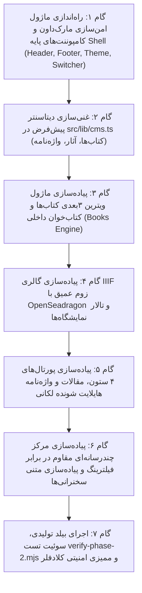

# نقشه راه جامع اجرای فاز ۲: سیستم طراحی، ویترین سه‌بعدی کتاب‌ها، گالری موزه‌ای IIIF و خوانشگر تعاملی
## Phase 2 Implementation Plan: Academic-Artistic Design System, 3D Book Showcase, Museum IIIF Gallery & Resilient Portals

> **Project Code:** `MAKAREMI-CORE-2026`  
> **Phase:** Phase 2 (طراحی تجربه کاربری، رابط کاربری UI/UX، ویترین کتاب‌ها، گالری هنری و واژه‌نامه لکانی)  
> **Status:** PLANNING MODE ONLY (Awaiting Senior Architect Approval)  
> **Target Framework:** Next.js 15.5.28 App Router (React 19, TypeScript 5.7, Serwist PWA)  
> **Security Standards:** Cloudflare Security Audit Skill Framework (`https://github.com/cloudflare/security-audit-skill`)  
> **Execution Constraint:** Zero code execution or package installation until formal review and sign-off.

---

## ۱. تراز معماری و پیوستگی با فاز ۱ (Architectural Alignment & Foundation Integration)

فاز ۲ مستقیماً بر شالوده مستحکم، تست‌شده و ممیزی‌شده فاز ۱ بنا می‌شود. در فاز ۱:
- ساختار مونوریپو pnpm با پکیج مشترک `@makaremi/shared` و وب‌اپلیکیشن `@makaremi/web` با موفقیت مستقر شد.
- ۳۹ تست خودکار (شامل ریدایرکت‌های ۳۰۱، کانونیکالیزاسیون، اعتبارسنجی زبانی RTL/LTR، اندپوینت‌های هوش مصنوعی `/llms.txt` و هدرهای امنیتی کلادفلر) با موفقیت ۱۰۰٪ پاس شدند.
- پروتکل امنیتی Zero-Trust و هدرهای CSP، COOP، CORP و اعتبارسنجی مقایسه زمانی توکن‌ها پیاده‌سازی گردید.

در فاز ۲، لایه نمایش (Presentation Layer) با تکیه بر اصول دوگانه **«وقار آکادمیک دانشگاه سوربن و روانکاوی بالینی لکانی»** و **«زیبایی‌شناسی مدرن هنر و خوشنویسی ایرانی»** پیاده‌سازی خواهد شد.

---

## ۲. درختواره و ساختار کامپوننت‌های فاز ۲ (Component & File Hierarchy)

```text
apps/web/src/
├── app/
│   └── [locale]/
│       ├── layout.tsx                               # Global Layout (Shell, Header, Footer, OfflineBar)
│       ├── page.tsx                                 # Hero Home, Pillars Showcase, Curated Book/Art Carousel
│       ├── [pillar]/
│       │   ├── page.tsx                             # Pillar Hub Landing (/psychoanalysis, /art, /strategy, /human-rights)
│       │   └── articles/
│       │       ├── page.tsx                         # Pillar Articles Archive
│       │       └── [slug]/
│       │           ├── page.tsx                     # Citation-Ready Article Reader with Lacanian Glossary Tooltips
│       │           └── page.md/route.ts             # Clean Markdown Twin for AI Agents (AEO/GEO)
│       ├── books/
│       │   ├── page.tsx                             # 15+ Books Filterable Catalog
│       │   └── [slug]/
│       │       ├── page.tsx                         # 3D Book Mesh, Audio Player, Flipbook/Reader, Geo-Links
│       │       └── page.md/route.ts                 # Clean Markdown Twin
│       ├── gallery/
│       │   └── page.tsx                             # IIIF Multi-Exhibition Hall & High-Res Virtual Museum
│       ├── art/
│       │   └── exhibitions/
│       │       └── [slug]/
│       │           └── page.tsx                     # Pompadour 2002, Moscow Museum, Fez Festival Hall
│       ├── poetry/
│       │   └── page.tsx                             # Audio-Visual "Poetry & Image" Synchronized Museum View
│       └── media/
│           ├── page.tsx                             # Iran-Resilient Speeches, Video & Podcast Catalog
│           └── videos/
│               └── [slug]/
│                   └── page.tsx                     # Resilient Player (HLS/Podcast/YouTube) with Transcript
├── components/
│   ├── common/
│   │   ├── Header.tsx                               # Responsive Nav with Pillar Mega-Menu & Route-Preserving Switcher
│   │   ├── Footer.tsx                               # Academic & Dadkhahi Colophon, Newsletter, Creative Commons
│   │   ├── ThemeToggle.tsx                          # FOUC-Free Light/Dark Mode Switcher
│   │   ├── LanguageSwitcher.tsx                     # Strict Path-Preserving i18n Selector (fa, fr, en)
│   │   ├── PwaOfflineBar.tsx                        # Live Offline/Online Status + 1-Click Save to IndexedDB
│   │   ├── SearchModal.tsx                          # Instant In-Memory Keyboard-Accessible Search Dialog
│   │   └── SemanticHeading.tsx                      # Strict Single-H1 Guardian Component
│   ├── books/
│   │   ├── Book3DShowcase.tsx                       # CSS 3D Transforms Book Mesh (Front, Spine, Back, Flip)
│   │   ├── BookMetadataCard.tsx                     # ISBN, Publisher, Year + 1-Click Citations (APA, MLA, BibTeX)
│   │   ├── AuthorAudioPlayer.tsx                    # Waveform-Styled Commentary Audio Player with Speed Control
│   │   ├── BookSampleReader.tsx                     # Distraction-Free Sample Reader (Paper, Sepia, Night Themes)
│   │   └── GeoPurchaseLinks.tsx                     # Smart Geo-Targeted Acquisition (Iran vs Diaspora)
│   ├── gallery/
│   │   ├── IIIFDeepZoomViewer.tsx                   # OpenSeadragon Tile Viewer + SVG/Canvas High-Res Fallback
│   │   ├── ExhibitionHallCard.tsx                   # Curatorial Exhibition Showcase Card
│   │   └── PoetryArtworkSync.tsx                    # Split-Screen Bilingual Canvas + Recitation Player
│   ├── articles/
│   │   ├── ArticleReader.tsx                        # Scholarly Reader with Executive Summary (<blockquote>)
│   │   ├── GlossaryHighlighter.tsx                  # Interactive Hover/Click Popover for Lacanian Concepts
│   │   ├── ContentIntegrityBadge.tsx                # Verified SHA-256 Digital Fingerprint Badge
│   │   └── CitationExporter.tsx                     # Copyable Academic Citation Formats
│   └── media/
│       ├── ResilientMediaPlayer.tsx                 # HLS Video / Low-Bandwidth Audio / Opt-in YouTube Player
│       └── SpeechTranscriptView.tsx                 # Interactive Synchronized Speech Transcript Viewer
└── lib/
    ├── cms.ts                                       # Comprehensive Fallback Seed for 15+ Books, Exhibitions, Glossary
    └── markdown.ts                                  # XSS-Safe Sanitized Markdown Renderer (Zero Unsafe Injection)
```

---

## ۳. جزییات فنی ماژول‌های هفت‌گانه فاز ۲ (Module Technical Specifications)

### ماژول ۱: سیستم طراحی آکادمیک-هنری و پوسته سراسری (Academic-Artistic Design System & App Shell)
* **پالت رنگی معنایی (Semantic Color Tokens):**
  - سطح روز (Light Surface): `#FBFBF9` (کاغذ گرم کتابخانه‌ای، جلوگیری از خستگی چشم در متون طولانی).
  - سطح شب (Dark Surface): `#121316` (ذغالی عمیق مات با کنتراست بالای WCAG AAA).
  - ۴ رنگ هویتی ستون‌ها:
    1. روانکاوی لکانی (`psychoanalysis`): فیروزه‌ای تیره (`#0F766E`)
    2. هنر و خوشنویسی مدرن (`art_calligraphy`): لاجوردی ایرانی (`#1E3A8A`)
    3. مطالعات راهبردی و فرهنگ (`cultural_strategy`): طلایی اخرایی (`#B45309`)
    4. حقوق بشر و دادخواهی (`human_rights_dadkhahi`): زرشکی عمیق (`#991B1B`)
* **تایپوگرافی دوگانه:**
  - فارسی (`fa`): فونت وزیرمتن با کشیدگی خط ۱.۸ برای خوانایی حداکثری و فونت نمایشی نستعلیق/سرفصل در هدرها.
  - فرانسوی و انگلیسی (`fr`/`en`): ترکیب `Cormorant Garamond` (عناوین آکادمیک و فلسفی) و `Inter` (بدنه مقالات).
* **تغییر زبان با حفظ دقیق مسیر (Route-Preserving Language Switcher):**
  - کلیک روی تغییر زبان کاربر را در همان صفحه و منبع حفظ می‌کند (مثلاً `/fa/books/lacan-seminar-3` مستقیماً به `/fr/books/lacan-seminar-3` یا متناظر فرانسوی می‌رود)؛ هدرهای `X-Content-Locale` و جهت صفحه `dir="rtl"` یا `dir="ltr"` به صورت لحظه‌ای سوئیچ می‌شوند.
* **نوار کنترل آفلاین PWA (Offline Control Bar):**
  - شنود رویدادهای `window.navigator.onLine` و ارائه دکمه «ذخیره این صفحه برای مطالعه آفلاین» که داده‌های متن و تصاویر را در `IndexedDB` (`idb-keyval`) مرورگر ذخیره می‌کند تا در صورت قطع اینترنت در ایران، صفحه در دسترس بماند.
* **قانون سخت‌گیرانه تک تگ `<h1>` (Strict Single-H1 Rule):**
  - تمامی قالب‌ها تنها یک تگ `<h1>` خواهند داشت. ابزارک‌های ستون کناری و هدر به تگ‌های `<h2>`، `<h3>` یا `<header aria-level="...">` استاندارد تنزل می‌یابند.

---

### ماژول ۲: ویترین تعاملی سه‌بعدی کتاب‌ها و کتاب‌خوان داخلی (Interactive 3D Book Showcase & Digital Reader)
* **ویترین سه‌بعدی جلد کتاب (`Book3DShowcase.tsx`):**
  - بدون نیاز به کتابخانه‌های سنگین WebGL (جهت کارکرد سبک روی گوشی‌های قدیمی در ایران)، با استفاده از **CSS 3D Transforms (`preserve-3d`, `rotateY`, `perspective`)**.
  - تشکیل ۳ لایه اصلی: جلد رو (Front Cover)، عطف کتاب (Spine با ضخامت محاسبه‌شده متناسب با `page_count` و عنوان عمودی)، و جلد پشت (Back Cover).
  - دکمه چرخش ۱۸۰ درجه برای خواندن یادداشت پشت جلد، و تعامل Tilt ملایم با حرکت ماوس/لمس.
* **شناسنامه استاندارد کتابشناختی (`BookMetadataCard.tsx`):**
  - نمایش شابک (ISBN-13)، ناشر (آلیان، نشانه، H&S Media)، سال و شهر چاپ، تعداد صفحات، و دکمه کپی فوری ارجاع علمی (APA, MLA, Chicago, BibTeX).
* **پلیر صوتی مؤلف (`AuthorAudioPlayer.tsx`):**
  - پلیر صوتی سبک اختصاصی در بالای صفحه هر کتاب، پخش فایل صوتی ۲ تا ۵ دقیقه‌ای صدای دکتر حسن مکارمی درباره کتاب با تنظیم سرعت (`1x`, `1.25x`, `1.5x`) و کش فایل صوتی در Cache API برای استفاده آفلاین.
* **کتاب‌خوان و ورق‌زن داخلی نمونه کتاب (`BookSampleReader.tsx`):**
  - مطالعه فهرست مطالب و فصل اول در داخل مرورگر با استایل‌های ۳گانه خوانش: کاغذی (Paper)، سپیا (Sepia) و شب (Night).
  - تغییر مقیاس اندازه فونت (`A-` / `A+`) و موتور جستجوی فوری کلمات کلیدی در متن نمونه بدون نیاز به بارگذاری فایل‌های سنگین PDF.
* **موتور ژئوکانتکست خرید و دریافت کتاب (`GeoPurchaseLinks.tsx`):**
  - برای کاربران داخل ایران: لینک طاقچه و لینک دانلود مستقیم امن.
  - برای دیاسپورا: لینک آمازون، ناشران اروپایی و خرید نسخه الکترونیکی بین‌المللی.

---

### ماژول ۳: گالری مجازی در تراز موزه بر بستر IIIF (Museum-Grade IIIF Digital Gallery)
* **نمایشگر زوم عمیق آثار هنری (`IIIFDeepZoomViewer.tsx`):**
  - پیاده‌سازی کامپوننت کلاینت بر پایه **`OpenSeadragon`** که به سرور Cantaloupe IIIF (`/iiif/3/{id}/info.json`) متصل می‌شود.
  - قابلیت‌های موزه‌ای: کنترل‌های بزرگنمایی تا سطح دانه‌های مرکب و بافت بوم، نویگیتور نقشه کوچک (Minimap Navigator)، حالت تمام‌صفحه موزه (Full-screen Museum Mode).
  - **سیستم Fallback هوشمند و دوگانه:** در صورت خاموش بودن سرور Cantaloupe یا در حالت آفلاین، ویور به صورت خودکار به رندر لایه‌ای تصویر باکیفیت و زوم SVG/Canvas سوئیچ می‌کند تا تجربه کاربری دچار اختلال نشود.
* **تالار اختصاصی نمایشگاه‌ها (`/[locale]/art/exhibitions/[slug]/page.tsx`):**
  - پوشش نمایشگاه موزه مدرن خوشنویسی مسکو (Moscow Museum of Modern Calligraphy)، نمایشگاه «میان نشان و نماد» در پومپادور فرانسه (۲۰۰۲)، و فستیوال موسیقی مقدس فاس.
  - درج بیانیه‌های نمایشگاه و نقدهای بین‌المللی (از جمله یادداشت تحلیلی پروفسور مایکل بری، استاد دانشگاه پرینستون).
* **همگام‌سازی صوت، شعر و تصویر (`PoetryArtworkSync.tsx`):**
  - نمایش هم‌زمان تابلوی خوشنویسی/نقاشی در یک سو، و متن شعر دوزبانه در سوی دیگر، با قابلیت پخش دکلمه صوتی دکتر مکارمی.

---

### ماژول ۴: پورتال‌های ۴ ستون، خوانشگر مقالات و واژه‌نامه تعاملی لکانی (Scholarly Reader & Lacanian Glossary)
* **صفحات فرود اختصاصی ۴ ستون محتوایی:**
  - روانکاوی لکانی (`/psychoanalysis`)، هنر و خوشنویسی (`/art`)، مطالعات راهبردی (`/strategy`) و حقوق بشر/دادخواهی (`/human-rights`).
* **خوانشگر مقالات علمی (`ArticleReader.tsx`):**
  - باکس چکیده مدیریتی (`<blockquote>`) در ابتدای مقاله با استایل برجسته جهت استخراج مستقیم توسط ربات‌های هوش مصنوعی (AEO/GEO)؛ نظیر ارجاع به داده‌های CNRS درباره ۳٬۹۵۴ پروژه پژوهشی در مقاله «آیا روانکاوی علم است؟».
* **واژه‌نامه تعاملی و هایلایتر اصطلاحات لکانی (`GlossaryHighlighter.tsx`):**
  - تطبیق خودکار واژگان تخصصی متن با جدول `lacanian_glossary` (اصطلاحاتی چون «دگرشنیدن»، «عملیات نام پدر»، «حالت مرزی»، «رانه مرگ»).
  - باز شدن Tooltip/Popover در دسترس با کلیک یا هاور کاربر که معادل‌های فرانسه و انگلیسی (`Écouter autrement`, `Opération Nom-du-Père`, `État Limite`) و تعریف مفهومی دقیق مؤلف را نمایش می‌دهد.
* **نشان اصالت و هش تغییرناپذیر محتوا (`ContentIntegrityBadge.tsx`):**
  - اعتبارسنجی هش SHA-256 مقاله از طریق `src/lib/crypto.ts` و نمایش نشان سبز اعتبارسنجی دیجیتال جهت اطمینان از عدم دستکاری در بیانیه‌ها و اسناد دادخواهی.

---

### ماژول ۵: مرکز رسانه‌ها و سخنرانی‌های مقاوم در برابر فیلترینگ (Iran-Resilient Media & Speeches Hub)
* **پلیر هوشمند مقاوم در برابر سانسور (`ResilientMediaPlayer.tsx`):**
  - اولویت‌بندی پخش از سرور اختصاصی و استریم HLS (`self_hosted_hls_url`) و نسخه فوق سبک پادکست صوتی (`self_hosted_audio_url`) تا مخاطبان داخل ایران حتی در زمان قطعی کامل اینترنت بین‌الملل یا بدون فیلترشکن بتوانند سخنرانی‌ها را بشنوند.
  - امبد اختصاصی یوتیوب به صورت بهینه‌شده برای حریم خصوصی (`youtube-nocookie.com`) که تنها با رضایت و کلیک صریح کاربر بارگذاری می‌شود (جلوگیری از قفل شدن لود صفحه در ایران به دلیل ریکوئست‌های مسدودشده یوتیوب).
* **متن کامل همگام سخنرانی‌ها (`SpeechTranscriptView.tsx`):**
  - پیاده‌سازی متنی کامل سخنرانی‌های شورای حقوق بشر سازمان ملل در ژنو و نشست‌های خاوران و ایران تریبونال با قابلیت هایلایت متن حین پخش صوت.

---

### ماژول ۶: توسعه دیتاست پیش‌فرض و داده‌های Seed معتبر (`src/lib/cms.ts`)
توسعه دیتاست بومی و غنی برای تمام ۳ زبان (`fa`, `fr`, `en`) شامل:
1. **۱۰+ کتاب شاخص دکتر مکارمی:** سمینار سوم لکان (روان‌پریشی‌ها)، دگر شنیدن در روانکاوی، همدلی‌های یک روانکاو، نگاهی راهبردی به دوران گذار (شابک ۹۷۸۱۷۸۰۸۳۱۰۲۲)، چند نگاه راهبردی به ایران آینده، نگاهی دیگر به سرزمین فرهنگی ایران، چند گفتار در دیگر شنیدن حافظ، پیانو با چهار دست، تلویزیون، دگر شنیدن گذشته‌ها.
2. **نمایشگاه‌های شاخص:** موزه مدرن خوشنویسی مسکو، پومپادور ۲۰۰۲، فستیوال موسیقی مقدس فاس.
3. **آثار خوشنویسی و اشعار:** شعر «مرا نوازش کن»، اشعار مجموعه پیانو با چهار دست.
4. **مقالات پژوهشی:** آیا روانکاوی علم است؟، مفهوم حالت مرزی (État Limite)، توپولوژی فضاهای مقدس (Topologie des lieux saints)، نقش ناخودآگاه در رابطه سوار و اسب.
5. **سخنرانی‌های دادخواهی:** مداخله در بیست‌وسومین نشست شورای حقوق بشر سازمان ملل (ژنو)، سخنرانی دادخواهی خاوران.
6. **اصطلاحات واژه‌نامه لکانی:** معادل‌سازی دوزبانه و سه‌زبانه مفاهیم کلینیکی لکان.

---

### ماژول ۷: سوئیت تست خودکار (`infra/verify-phase-2.mjs`) و گیت ممیزی امنیتی کلادفلر

#### ۷.۱. طراحی سوئیت تست خودکار فاز ۲ (`verify-phase-2.mjs`)
یک اسکریپت جامع در Node.js جهت بررسی موارد زیر روی سرور پروداکشن:
1. صحت پاسخ‌دهی ۲۰۰ تمام روت‌های فاز ۲ (`/fa/books`, `/fa/books/[slug]`, `/fa/gallery`, `/fa/art/exhibitions/[slug]`, `/fa/poetry`, `/fa/psychoanalysis/articles/[slug]`, `/fa/human-rights`, `/fa/media`).
2. **بررسی تک تگ `<h1>`:** استخراج DOM و تأیید اینکه در هر صفحه رندرشده دقیقاً یک تگ `<h1>` وجود دارد.
3. **تست سوئیچ زبان:** بررسی تغییر تگ‌های `dir="rtl"` و `dir="ltr"` در ساختار HTML صفحات متناظر.
4. **تست رندرینگ سه‌بعدی و فال‌بک IIIF:** اطمینان از عملکرد کامپوننت‌های تعاملی بدون خطا در کنسول.
5. **تست تایپ‌اسکریپت و بیلد:** خروج موفق با کد ۰ در `pnpm typecheck` و `pnpm build`.

#### ۷.۲. گیت ممیزی امنیتی کلادفلر (Cloudflare Security Audit Gate)
مطابق با متدولوژی **Cloudflare Security Audit Skill** (`https://github.com/cloudflare/security-audit-skill`)، چهار گیت امنیتی زیر به عنوان شرط لازم تایید فاز ۲ اعمال خواهند شد:
1. **جلوگیری از XSS در رندر مارک‌داون (Safe Markdown Sanitization):**
   - هیچ ورودی مارک‌داون (در مقالات، متن کتاب‌ها، بیانیه‌ها یا واژه‌نامه) نباید از طریق `dangerouslySetInnerHTML` بدون اعتبارسنجی و پالایش (Sanitization) دقیق رندر شود.
   - ایجاد ماژول اختصاصی `src/lib/markdown.ts` برای پاک‌سازی تگ‌های خطرناک (`<script>`, `<iframe>`, `javascript:`, `onload`).
2. **پیشگیری از SSRF و Path Traversal در رسانه‌ها و IIIF:**
   - فیلتر کردن شناسه تصاویر IIIF (`iiif_image_id`) با رگکس ایمن (`/^[a-zA-Z0-9_\-\.]+$/`) جهت جلوگیری از پیمایش مسیر (`../`) یا تزریق آدرس‌های غیرمجاز شبکه داخلی به کانتالوپ.
   - بررسی آدرس‌های استریم HLS و پادکست‌ها در برابر دامنه‌های مجاز سرور رسانه.
3. **امن‌سازی لینک‌های خروجی و پروتکل‌های خرید (External Link & Protocol Hardening):**
   - تمامی لینک‌های خرید کتاب (`geo_acquisition_links`) با اسکیما Zod اعتبارسنجی می‌شوند تا تنها پروتکل `https:` را بپذیرند و پروتکل‌های ناامن `javascript:` یا `data:` را رد کنند.
   - اضافه شدن اجباری ویژگی‌های `rel="noopener noreferrer"` و `target="_blank"` به تمام پیوندهای خارجی.
4. **تطابق با خط‌مشی امنیت محتوا (CSP Compliance):**
   - اطمینان از اینکه OpenSeadragon و ترنسفورم‌های سه‌بعدی بدون نیاز به `unsafe-eval` اجرا شده و سیاست‌های سخت‌گیرانه فاز ۱ دست‌نخورده باقی بمانند.

---

## ۴. برنامه گام‌به‌گام اجرای فاز ۲ پس از تأیید (Execution Sequence Roadmap)



---

## ۵. چک‌لیست کنترل کیفیت و تصمیم‌گیری برای معمار ارشد (Senior Architect Review Sign-off)

- [ ] آیا ساختار تک تگ `<h1>` در تمام صفحات جدید مورد تأیید است؟
- [ ] آیا طراحی ویترین ۳بعدی کتاب‌ها با استفاده از CSS 3D Transforms خالص (بدون وابستگی به Three.js سنگین) برای گوشی‌های ایران تایید می‌شود؟
- [ ] آیا مکانیزم فال‌بک High-Res Canvas/SVG برای OpenSeadragon در صورت آفلاین بودن Cantaloupe کافی است؟
- [ ] آیا گیت‌های امنیتی ۴گانه مبتنی بر چارچوب کلادفلر (ضد XSS، ضد SSRF، پروتکل امن https و انطباق CSP) مصوب است؟

> **دستور توقف (Stop Instruction):** این سند صرفاً به منظور برنامه‌ریزی جامع و بررسی معمار ارشد تدوین گردیده است. هیچ کدی تا زمان دریافت دستور صریح تأیید نوشته یا اجرا نخواهد شد.
