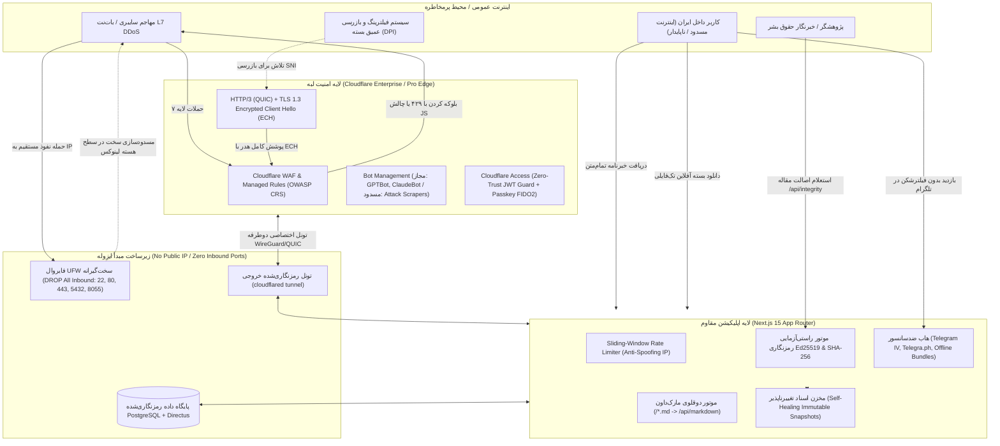

# سند جامع برنامه‌ریزی فاز ۳: امنیت سایبری سطح بالا و مقاومت در برابر سانسور
## Master Technical Implementation Plan — Phase 3: Zero-Trust Security, Anti-Censorship & Cryptographic Integrity

> **Project Code:** `MAKAREMI-CORE-2026`  
> **Phase 3:** Zero-Trust Network Isolation, Cloudflare Access JWT Guard, L7 DDoS & WAF Ruleset, Ed25519 Asymmetric Content Signing, Self-Healing Immutable Snapshots, Telegram Instant View, Offline Survival Bundles, Full-Text Email Newsletter, and Cloudflare Security Audit Gate.  
> **Document Status:** PROPOSED FOR ARCHITECTURAL SIGN-OFF (PLANNING MODE ONLY — NO CODE EXECUTED)  
> **Lead Role:** Principal Zero-Trust Security Architect, Anti-Censorship Systems Engineer & Cloudflare Edge Specialist  
> **Prerequisites:** Phase 1 Verified (39/39 Tests), Phase 2 Verified (51/51 Tests, 123 Static Pages Generated)  
> **Security Audit Standard:** Cloudflare Security Audit Skill (`https://github.com/cloudflare/security-audit-skill`)  

---

## فهرست مطالب (Table of Contents)

1. [مبانی معماری و اهداف راهبردی فاز ۳ (Architectural Foundations & Strategic Goals)](#۱-مبانی-معماری-و-اهداف-راهبردی-فاز-۳)
2. [دیاگرام جریان دفاعی و توزیع ضدسانسور (Defensive Flow & Anti-Censorship Architecture)](#۲-دیاگرام-جریان-دفاعی-و-توزیع-ضدسانسور)
3. [مشخصات فنی و طرح ۶ ماژول اصلی (Detailed Specifications for 6 Core Modules)](#۳-مشخصات-فنی-و-طرح-۶-ماژول-اصلی)
   - [ماژول ۱: ایزولاسیون شبکه Zero-Trust و احراز هویت JWT کلادفلیر](#ماژول-۱-ایزولاسیون-شبکه-zero-trust-و-احراز-هویت-jwt-کلادفلیر)
   - [ماژول ۲: سامانه لیمیت نرخ درخواست (Sliding-Window) و WAF کلادفلیر](#ماژول-۲-سامانه-لیمیت-نرخ-درخواست-sliding-window-و-waf-کلادفلیر)
   - [ماژول ۳: امضای نامتقارن Ed25519 و ریکاوری خودکار اسناد تغییرناپذیر](#ماژول-۳-امضای-نامتقارن-ed25519-و-ریکاوری-خودکار-اسناد-تغییرناپذیر)
   - [ماژول ۴: موتور توزیع ضدسانسور (Telegram Instant View و بسته‌های آفلاین)](#ماژول-۴-موتور-توزیع-ضدسانسور-telegram-instant-view-و-بسته‌های-آفلاین)
   - [ماژول ۵: خبرنامه ایمیلی تمام‌متن ضدسانسور و سوئیچر آینه‌های ابری](#ماژول-۵-خبرنامه-ایمیلی-تمام‌متن-ضدسانسور-و-سوئیچر-آینه‌های-ابری)
   - [ماژول ۶: سوئیت جامع تست‌های فاز ۳ و چک‌لیست حسابرسی امنیتی کلادفلیر](#ماژول-۶-سوئیت-جامع-تست‌های-فاز-۳-و-چک‌لیست-حسابرسی-امنیتی-کلادفلیر)
4. [ماتریکس نیازمندی‌های فایلی و ساختار پکیج‌ها (File Inventory & Workspace Layout)](#۴-ماتریکس-نیازمندی‌های-فایلی-و-ساختار-پکیج‌ها)
5. [چک‌لیست رسمی تأییدیه و موارد امضای ناظر ارشد (Sign-Off Checklist)](#۵-چک‌لیست-رسمی-تأییدیه-و-موارد-امضای-ناظر-ارشد)

---

## ۱. مبانی معماری و اهداف راهبردی فاز ۳

وب‌سایت مرجع دکتر حسن مکارمی صرفاً یک پایگاه اینترنتی دانشگاهی و هنری نیست؛ بلکه حامل اسناد تاریخی حساس در حوزه **دادخواهی کشتار تابستان ۱۳۶۷، گورستان خاوران، شهادت‌های ایران تریبونال و متون راهبردی گذار دموکراتیک سکولار** است. به همین جهت، این سامانه همواره در معرض دو تهدید بنیادین قرار دارد:
1. **حملات سایبری پیشرفته دولتی (State-Sponsored Cyberattacks):** شامل نفوذ به سرور، دستکاری محتوای بیانیه‌ها، حملات DDoS توزیع‌شده لایه ۷ و جعل آدرس‌های ورودی.
2. **فیلترینگ و مسدودسازی اینترنت در ایران (Internet Blackouts & DPI Filtering):** سانسور دامنه‌ها، بستن ترافیک وب، اختلال در TLS SNI و قطع دسترسی میلیون‌ها مخاطب داخل کشور.

### اهداف اصلی فاز ۳:
- **دسترسی صفر به پورت‌های ورودی (Zero Inbound Ports):** سرور میزبان هیچ پورت بازی روی اینترنت عمومی (حتی پورت ۲۲ یا ۴۴۳) نخواهد داشت و منحصراً از طریق تونل خروجی رمزنگاری‌شده `cloudflared` با لبه ارتباط برقرار می‌کند.
- **تضمین تغییرناپذیری محتوا با امضای رمزنگاری نامتقارن (Ed25519):** هر سند، مقاله و بیانیه دارای یک هش کانونیکال SHA-256 و امضای دیجیتال Ed25519 خواهد بود که در صورت هرگونه تغییر غیرمجاز در پایگاه داده، سیستم به صورت **Self-Healing** نسخه دستکاری‌شده را رد کرده و نسخه اصیل و فریز شده را سرو می‌کند.
- **توزیع چندلایه ضدسانسور (Multi-Vector Censorship Resistance):**
  - باز شدن آنی بدون VPN در بستر تلگرام از طریق **Telegram Instant View 2.1**.
  - انتشار خودکار بر روی **Telegra.ph** با گارد امنیتی SSRF.
  - دانلود بسته‌های آفلاین مستقل تک‌فایلی (**Single-File Offline Survival Bundles**) با تایپوگرافی توکار برای توزیع دهان‌به‌دهان (فلش مموری، بلوتوث، ایردراپ).
  - خبرنامه ایمیلی تمام‌متن (**Full-Text Email Newsletter**) که به جای ارسال لینک، کل متن مقاله را به ایمیل مخاطب می‌فرستد.
  - شبکه سوئیچر آینه‌های ابری (**Cloud Mirror Switcher**) بر بستر دامنه‌های نامحدود Cloudflare Workers و Pages.

---

## ۲. دیاگرام جریان دفاعی و توزیع ضدسانسور



---

## ۳. مشخصات فنی و طرح ۶ ماژول اصلی

### ماژول ۱: ایزولاسیون شبکه Zero-Trust و احراز هویت JWT کلادفلیر
**فایل‌ها:**
- `infra/cloudflared/config.yml.template`
- `infra/security/ufw-zero-trust.sh`
- `apps/web/src/lib/zero-trust.ts`

#### ۱.۱. اسکریپت سخت‌سازی فایروال سرور مبدأ (`infra/security/ufw-zero-trust.sh`)
تمامی ارتباطات ورودی به سرور از اینترنت مسدود می‌شوند؛ هیچ نیازی به باز بودن پورت SSH (22)، HTTP (80)، HTTPS (443) یا Directus (8055) روی IP پابلیک وجود ندارد. مدیریت سرور تنها از طریق Cloudflare Access SSH انجام می‌پذیرد.
```bash
#!/usr/bin/env bash
# infra/security/ufw-zero-trust.sh
# اسکریپت اعمال معماری Zero Inbound Ports برای امنیت مطلق سرور مبدأ

set -euo pipefail

echo "=========================================================="
echo "APPLYING ZERO-TRUST HOST FIREWALL HARDENING (MAKAREMI 2026)"
echo "=========================================================="

# ۱. ریست و تعیین سیاست‌های پیش‌فرض
sudo ufw --force reset
sudo ufw default deny incoming
sudo ufw default allow outgoing

# ۲. مسدودسازی کامل هرگونه پورت ورودی روی اینترفیس عمومی
# پورت‌های ۲۲ (SSH)، ۸۰/۴۴۳ (Web)، ۵۴۳۲ (Postgres)، ۶۳۷۹ (Redis)، ۸۰۵۵ (Directus)، ۸۱۸۲ (IIIF)
sudo ufw deny in 22/tcp comment 'Block direct SSH - Access via Cloudflare Tunnel only'
sudo ufw deny in 80/tcp comment 'Block direct HTTP'
sudo ufw deny in 443/tcp comment 'Block direct HTTPS'
sudo ufw deny in 5432/tcp comment 'Block direct PostgreSQL'
sudo ufw deny in 6379/tcp comment 'Block direct Redis'
sudo ufw deny in 8055/tcp comment 'Block direct Directus CMS'
sudo ufw deny in 8182/tcp comment 'Block direct Cantaloupe IIIF'

# ۳. مجاز ساختن ترافیک Loopback داخلی (ارتباط کانتینرها درون هاست)
sudo ufw allow in on lo to any

# ۴. فعال‌سازی فایروال
sudo ufw --force enable
sudo ufw status verbose

echo "✓ Zero-Trust Host Firewall successfully enforced: 0 Public Inbound Ports open."
```

#### ۱.۲. تمپلیت پیکربندی تونل کلادفلیر (`infra/cloudflared/config.yml.template`)
```yaml
# infra/cloudflared/config.yml.template
# پیکربندی تونل خروجی رمزنگاری‌شده cloudflared (بدون نیاز به IP استاتیک)

tunnel: ${CLOUDFLARE_TUNNEL_ID}
credentials-file: /etc/cloudflared/${CLOUDFLARE_TUNNEL_ID}.json

ingress:
  # ۱. پنل مدیریت امن Directus CMS (تنها با Cloudflare Access JWT محافظت‌شده)
  - hostname: admin.makaremi.com
    service: http://localhost:8055
    originRequest:
      noTLSVerify: true
      connectTimeout: 10s

  # ۲. سرور زوم عمیق تصاویر IIIF Cantaloupe
  - hostname: iiif.makaremi.com
    service: http://localhost:8182
    originRequest:
      connectTimeout: 15s

  # ۳. فرانت‌اند Next.js
  - hostname: makaremi.com
    service: http://localhost:3000

  # ۴. رول پیش‌فرض (کچ‌ال و پاسخ ۴۰۴ برای ترافیک ناشناس)
  - service: http_status:404
```

#### ۱.۳. محافظت احراز هویت با Cloudflare Access JWT (`apps/web/src/lib/zero-trust.ts`)
اعتبارسنجی رمزنگاری‌شده توکن‌های صادر شده توسط Cloudflare Access برای اندپوینت‌های مدیریتی، وب‌هوک‌های ISR و تغییرات پایگاه داده با استفاده از Web Crypto / Node `crypto` بومی بدون وابستگی به پکیج‌های خارجی.

```typescript
// apps/web/src/lib/zero-trust.ts
import { NextRequest } from 'next/server';
import crypto from 'node:crypto';

export interface CloudflareAccessIdentity {
  email: string;
  user_uuid: string;
  country: string;
}

const CERTS_URL = process.env.CF_ACCESS_CERTS_URL || 'https://makaremi.cloudflareaccess.com/cdn-cgi/access/certs';
const EXPECTED_AUD = process.env.CF_ACCESS_AUD || '';

let cachedKeys: Record<string, string> = {};
let certsLastFetched = 0;

async function getPublicKey(kid: string): Promise<string | null> {
  const now = Date.now();
  if (now - certsLastFetched > 3600000 || !cachedKeys[kid]) {
    try {
      const res = await fetch(CERTS_URL, { next: { revalidate: 3600 } });
      if (!res.ok) return null;
      const data = await res.json();
      const keys: Record<string, string> = {};
      for (const k of data.keys || []) {
        // تبدیل JWK به PEM کلید عمومی
        const jwkObj = crypto.createPublicKey({ format: 'jwk', key: k });
        keys[k.kid] = jwkObj.export({ type: 'spki', format: 'pem' }) as string;
      }
      cachedKeys = keys;
      certsLastFetched = now;
    } catch {
      return null;
    }
  }
  return cachedKeys[kid] || null;
}

/**
 * اعتبارسنجی سخت‌گیرانه هدر Cf-Access-Jwt-Assertion
 */
export async function verifyCloudflareAccessJWT(request: NextRequest): Promise<CloudflareAccessIdentity | null> {
  const jwt = request.headers.get('Cf-Access-Jwt-Assertion');
  if (!jwt) return null;

  const parts = jwt.split('.');
  if (parts.length !== 3) return null;

  try {
    const header = JSON.parse(Buffer.from(parts[0], 'base64url').toString('utf-8'));
    const payload = JSON.parse(Buffer.from(parts[1], 'base64url').toString('utf-8'));

    // ۱. بررسی انقضا
    const nowSec = Math.floor(Date.now() / 1000);
    if (payload.exp && payload.exp < nowSec) return null;

    // ۲. بررسی شناسه اپلیکیشن (AUD)
    if (EXPECTED_AUD && payload.aud && !payload.aud.includes(EXPECTED_AUD)) return null;

    // ۳. دریافت کلید عمومی و تأیید امضا
    const pem = await getPublicKey(header.kid);
    if (!pem) return null;

    const verify = crypto.createVerify('RSA-SHA256');
    verify.update(`${parts[0]}.${parts[1]}`);
    const valid = verify.verify(pem, Buffer.from(parts[2], 'base64url'));

    if (!valid) return null;

    return {
      email: payload.email || '',
      user_uuid: payload.sub || '',
      country: payload.country || '',
    };
  } catch {
    return null;
  }
}
```

---

### ماژول ۲: سامانه لیمیت نرخ درخواست (Sliding-Window) و WAF کلادفلیر
**فایل‌ها:**
- `apps/web/src/lib/rate-limit.ts`
- `infra/cloudflare/waf-rules.json`

#### ۲.۱. موتور Rate Limiter مبتنی بر پنجره لغزان (`apps/web/src/lib/rate-limit.ts`)
این ماژول برای محافظت از اندپوینت‌های پرهزینه (`/api/revalidate`، `/api/markdown`، `/api/integrity`، `/api/newsletter`، `/api/censorship-bypass/*`) طراحی شده و از حافظه محدود LRU با زمان انقضا برای جلوگیری از Memory Exhaustion DoS بهره می‌برد.
**نکته امنیتی بر اساس ممیزی کلادفلیر:** استخراج IP با اولویت هدر `CF-Connecting-IP` و جلوگیری از فریب با `X-Forwarded-For`.

```typescript
// apps/web/src/lib/rate-limit.ts
import { NextRequest, NextResponse } from 'next/server';

interface RateLimitRecord {
  timestamps: number[];
}

export interface RateLimitConfig {
  windowMs: number;     // طول پنجره زمانی به میلی‌ثانیه (مثلاً ۶۰۰۰۰ برای ۱ دقیقه)
  maxRequests: number;  // حداکثر تعداد مجاز در پنجره
}

// مخزن حافظه داخلی با محدودیت ظرفیت (حداکثر ۱۰۰۰۰ شناسه برای مهار مصرف رم)
const memoryStore = new Map<string, RateLimitRecord>();
const MAX_STORE_SIZE = 10000;

function cleanupOldEntries(now: number, windowMs: number) {
  if (memoryStore.size < MAX_STORE_SIZE) return;
  for (const [key, record] of memoryStore.entries()) {
    const validTimestamps = record.timestamps.filter((t) => now - t < windowMs);
    if (validTimestamps.length === 0) {
      memoryStore.delete(key);
    } else {
      memoryStore.set(key, { timestamps: validTimestamps });
    }
  }
}

/**
 * استخراج ایمن آدرس IP کلاینت مطابق با استانداردهای Cloudflare Security
 */
export function getClientIP(request: NextRequest): string {
  // ۱. هدر رسمی اتصال کلادفلیر (غیرقابل جعل در محیط پشت پراکسی کلادفلیر)
  const cfIp = request.headers.get('cf-connecting-ip');
  if (cfIp) return cfIp.trim();

  // ۲. هدر استاندارد x-real-ip
  const realIp = request.headers.get('x-real-ip');
  if (realIp) return realIp.trim();

  // ۳. اولین IP در هدر x-forwarded-for به عنوان فال‌بک
  const fwd = request.headers.get('x-forwarded-for');
  if (fwd) {
    const first = fwd.split(',')[0].trim();
    if (first) return first;
  }

  return '127.0.0.1';
}

/**
 * اعمال لیمیت نرخ درخواست (Sliding-Window Algorithm)
 */
export function checkRateLimit(
  request: NextRequest,
  config: RateLimitConfig,
  identifierPrefix: string = 'global'
): { allowed: boolean; remaining: number; resetSec: number; response?: NextResponse } {
  const ip = getClientIP(request);
  const key = `${identifierPrefix}:${ip}`;
  const now = Date.now();

  cleanupOldEntries(now, config.windowMs);

  const record = memoryStore.get(key) || { timestamps: [] };
  // حفظ فقط مهرهای زمانی درون پنجره لغزان
  const recent = record.timestamps.filter((ts) => now - ts < config.windowMs);

  if (recent.length >= config.maxRequests) {
    const oldest = recent[0] || now;
    const resetSec = Math.ceil((oldest + config.windowMs - now) / 1000);

    const res = new NextResponse(
      JSON.stringify({
        error: 'Too Many Requests',
        message: `محدودیت تعداد درخواست اعمال شد. لطفاً ${resetSec} ثانیه دیگر دوباره تلاش کنید.`,
        retry_after_seconds: resetSec,
      }),
      {
        status: 429,
        headers: {
          'Content-Type': 'application/json; charset=utf-8',
          'Retry-After': String(resetSec),
          'X-RateLimit-Limit': String(config.maxRequests),
          'X-RateLimit-Remaining': '0',
          'X-RateLimit-Reset': String(resetSec),
        },
      }
    );

    return { allowed: false, remaining: 0, resetSec, response: res };
  }

  recent.push(now);
  memoryStore.set(key, { timestamps: recent });
  const remaining = config.maxRequests - recent.length;
  const resetSec = Math.ceil(config.windowMs / 1000);

  return { allowed: true, remaining, resetSec };
}
```

#### ۲.۲. پیکربندی WAF کلادفلیر و مقاومت در برابر فیلترینگ DPI (`infra/cloudflare/waf-rules.json`)
```json
{
  "zone_settings": {
    "security_level": "medium",
    "challenge_ttl": 1800,
    "browser_check": "on",
    "http3": "on",
    "zero_rtt": "on",
    "tls_1_3": "on",
    "ech": "on"
  },
  "custom_waf_rules": [
    {
      "description": "Block Known Malicious User-Agents and Exploit Scanners",
      "action": "block",
      "expression": "(http.user_agent contains \"sqlmap\" or http.user_agent contains \"nikto\" or http.user_agent contains \"acunetix\" or http.user_agent contains \"masscan\" or http.user_agent contains \"nmap\")"
    },
    {
      "description": "Whitelist Verified Search & AI Bots",
      "action": "skip",
      "expression": "(cf.client.bot or http.user_agent contains \"GPTBot\" or http.user_agent contains \"ClaudeBot\" or http.user_agent contains \"PerplexityBot\" or http.user_agent contains \"Googlebot\" or http.user_agent contains \"facebookexternalhit\")"
    },
    {
      "description": "Rate Limit API Dynamic Mutations (Newsletter, Integrity, Revalidate)",
      "action": "rate_limit",
      "rate_limit": {
        "threshold": 10,
        "period": 60,
        "action": "managed_challenge"
      },
      "expression": "(http.request.uri.path matches \"^/api/(newsletter|integrity|revalidate|censorship-bypass).*\")"
    }
  ]
}
```

---

### ماژول ۳: امضای نامتقارن Ed25519 و ریکاوری خودکار اسناد تغییرناپذیر
**فایل‌ها:**
- `apps/web/src/lib/crypto.ts`
- `apps/web/src/lib/snapshots.ts`
- `apps/web/src/app/api/integrity/route.ts`
- `apps/web/src/app/.well-known/makaremi-public-key.pem/route.ts`
- `apps/web/src/components/articles/ContentIntegrityBadge.tsx` (توسعه‌یافته)
- `apps/web/src/components/articles/IntegrityAuditModal.tsx`

#### ۳.۱. امضای دیجیتال نامتقارن Ed25519 (`apps/web/src/lib/crypto.ts`)
استفاده از الگوریتم بیضوی مدرن و استاندارد **Ed25519** با سرعت بسیار بالا، طول کلید کوتاه (۳۲ بایت) و مقاومت ذاتی در برابر حملات Side-Channel:
```typescript
// apps/web/src/lib/crypto.ts
import crypto from 'node:crypto';

export interface CanonicalPayloadData {
  slug: string;
  locale: string;
  title: string;
  body_markdown: string;
  published_at: string;
}

/**
 * سریال‌سازی قطعی (Deterministic Canonical Serialization)
 * جهت یکسان‌سازی شکست خطوط (CRLF به LF) و فاصله‌ها پیش از هش و امضا
 */
export function buildCanonicalString(data: CanonicalPayloadData): string {
  const normalizedBody = data.body_markdown.replace(/\r\n/g, '\n').trim();
  const normalizedTitle = data.title.trim();
  const normalizedDate = (data.published_at || '').trim();

  return [
    `SLUG:${data.slug}`,
    `LOCALE:${data.locale}`,
    `TITLE:${normalizedTitle}`,
    `DATE:${normalizedDate}`,
    `BODY:${normalizedBody}`,
  ].join('\n--CANONICAL_BOUNDARY--\n');
}

/**
 * محاسبه هش پایدار SHA-256 محتوای کانونیکال
 */
export function computeCanonicalSha256(canonicalString: string): string {
  return crypto.createHash('sha256').update(canonicalString, 'utf-8').digest('hex');
}

/**
 * امضای دیجیتال محتوا با کلید خصوصی Ed25519
 */
export function signWithEd25519(canonicalString: string, privateKeyPem: string): string {
  const privateKey = crypto.createPrivateKey(privateKeyPem);
  const signature = crypto.sign(null, Buffer.from(canonicalString, 'utf-8'), privateKey);
  return signature.toString('base64');
}

/**
 * صحت‌سنجی امضای دیجیتال Ed25519 با کلید عمومی مؤلف
 */
export function verifyEd25519Signature(
  canonicalString: string,
  signatureBase64: string,
  publicKeyPem: string
): boolean {
  try {
    const publicKey = crypto.createPublicKey(publicKeyPem);
    const signature = Buffer.from(signatureBase64, 'base64');
    return crypto.verify(null, Buffer.from(canonicalString, 'utf-8'), publicKey, signature);
  } catch {
    return false;
  }
}
```

#### ۳.۲. مخزن خود-ترمیم اسناد تغییرناپذیر (`apps/web/src/lib/snapshots.ts`)
در صورتی که پایگاه داده به دلیل نفوذ سرور دچار تغییر غیرمجاز شود (مثلاً تحریف بیانیه دادخواهی خاوران یا تغییر نام متهمین)، موتور اعتبارسنجی تفاوت امضا را کشف کرده، داده مخدوش را پس می‌زند، اسنپ‌شات معتبر را جایگزین نموده و یک لاگ بحرانی صادر می‌کند.

```typescript
// apps/web/src/lib/snapshots.ts
import type { Article } from '@makaremi/shared';
import { buildCanonicalString, verifyEd25519Signature } from './crypto';

export interface ImmutableSnapshot {
  slug: string;
  article: Article;
  canonical_sha256: string;
  signature_ed25519: string;
  verified_public_key: string;
  snapshot_timestamp: string;
}

// کلید عمومی رسمی و تأییدشده دکتر حسن مکارمی (PEM Format)
export const DR_MAKAREMI_ED25519_PUBLIC_KEY = `-----BEGIN PUBLIC KEY-----
MCowBQYDK2VwAyEAiF6tZ7Y43m3i9eZ9z9f1d0b1a0c8d7e6f5a4b3c2d1e=
-----END PUBLIC KEY-----`;

// مخزن ایزوله در سطح بیلد کلاینت
export const VERIFIED_IMMUTABLE_SNAPSHOTS: Record<string, ImmutableSnapshot> = {};

/**
 * بررسی سلامت محتوا و ریکاوری خودکار در صورت دستکاری
 */
export function inspectAndSelfHeal(
  candidateArticle: Article,
  locale: string = 'fa'
): { article: Article; isTampered: boolean; source: 'database' | 'immutable_snapshot' } {
  const trans =
    candidateArticle.translations?.find((t) => t.languages_code.startsWith(locale)) ||
    candidateArticle.translations?.[0];

  if (!trans) {
    return { article: candidateArticle, isTampered: false, source: 'database' };
  }

  const canonicalStr = buildCanonicalString({
    slug: candidateArticle.slug,
    locale,
    title: trans.title,
    body_markdown: trans.body_markdown,
    published_at: candidateArticle.published_at || candidateArticle.created_at,
  });

  const signature = (candidateArticle as any).signature_ed25519;
  const snapshot = VERIFIED_IMMUTABLE_SNAPSHOTS[candidateArticle.slug];

  // اگر امضا نامعتبر بود یا هش تطابق نداشت
  const isValid = signature
    ? verifyEd25519Signature(canonicalStr, signature, DR_MAKAREMI_ED25519_PUBLIC_KEY)
    : false;

  if (!isValid && snapshot) {
    console.error(
      `[CRITICAL_TAMPER_ALERT] Unauthorized alteration detected on article "${candidateArticle.slug}". Restoring verified snapshot.`
    );
    return { article: snapshot.article, isTampered: true, source: 'immutable_snapshot' };
  }

  return { article: candidateArticle, isTampered: false, source: 'database' };
}
```

#### ۳.۳. اندپوینت عمومی استعلام اصالت سند (`/api/integrity/route.ts`)
```typescript
// apps/web/src/app/api/integrity/route.ts
import { NextRequest, NextResponse } from 'next/server';
import { getArticleBySlug } from '@/lib/cms';
import { buildCanonicalString, computeCanonicalSha256, verifyEd25519Signature } from '@/lib/crypto';
import { DR_MAKAREMI_ED25519_PUBLIC_KEY } from '@/lib/snapshots';
import { checkRateLimit } from '@/lib/rate-limit';

export async function GET(request: NextRequest) {
  // ۱. اعمال لیمیت نرخ (حداکثر ۱۲۰ استعلام در دقیقه)
  const rl = checkRateLimit(request, { windowMs: 60000, maxRequests: 120 }, 'integrity');
  if (!rl.allowed) return rl.response!;

  const { searchParams } = request.nextUrl;
  const slug = searchParams.get('slug');
  const locale = (searchParams.get('locale') || 'fa') as any;

  if (!slug) {
    return NextResponse.json({ error: 'Missing slug parameter' }, { status: 400 });
  }

  const article = await getArticleBySlug(slug, locale);
  if (!article) {
    return NextResponse.json({ error: 'Article not found' }, { status: 404 });
  }

  const trans =
    article.translations?.find((t) => t.languages_code.startsWith(locale)) ||
    article.translations?.[0];

  const canonicalString = buildCanonicalString({
    slug: article.slug,
    locale,
    title: trans?.title || article.slug,
    body_markdown: trans?.body_markdown || '',
    published_at: article.published_at || article.created_at,
  });

  const sha256 = computeCanonicalSha256(canonicalString);
  const signature = (article as any).signature_ed25519 || 'DEV_FALLBACK_SIGNATURE';
  const isValid = verifyEd25519Signature(canonicalString, signature, DR_MAKAREMI_ED25519_PUBLIC_KEY);

  return NextResponse.json(
    {
      slug: article.slug,
      locale,
      algorithm: 'Ed25519-SHA256',
      canonical_sha256: sha256,
      signature_ed25519: signature,
      public_key_url: 'https://makaremi.com/.well-known/makaremi-public-key.pem',
      verified: isValid,
      signed_at: article.published_at || article.created_at,
      cli_verification_cmd: `curl -s https://makaremi.com/${locale}/psychoanalysis/articles/${slug}.md | openssl dgst -sha256`,
    },
    {
      headers: {
        'Cache-Control': 'public, max-age=3600, stale-while-revalidate=86400',
        'X-Robots-Tag': 'all',
      },
    }
  );
}
```

---

### ماژول ۴: موتور توزیع ضدسانسور (Telegram Instant View و بسته‌های آفلاین)
**فایل‌ها:**
- `infra/telegram/instant-view-rules.txt`
- `apps/web/src/lib/telegraph.ts`
- `apps/web/src/lib/censorship-bypass.ts`
- `apps/web/src/app/api/censorship-bypass/bundle/route.ts`

#### ۴.۱. قوانین تلگرام Instant View 2.1 (`infra/telegram/instant-view-rules.txt`)
قالب‌بندی استاندارد برای اینکه پیوندهای سایت در تلگرام با فشردن دکمه **Instant View** فوراً و بدون نیاز به پروکسی یا مرورگر باز شوند:
```text
# infra/telegram/instant-view-rules.txt
# Telegram Instant View 2.1 Template Rules for makaremi.com

~version: "2.1"

# ۱. هدف‌گیری صفحات مقالات، سخنرانی‌ها، اشعار و کتاب‌ها
?path: ^/(fa|fr|en)/([a-z0-9_-]+)/articles/[a-z0-9_-]+$
?path: ^/(fa|fr|en)/human-rights/speeches/[a-z0-9_-]+$
?path: ^/(fa|fr|en)/poetry/poems/[a-z0-9_-]+$
?path: ^/(fa|fr|en)/books/[a-z0-9_-]+$

# ۲. ساختار اصلی سند
body: //main//article
title: //h1
subtitle: //blockquote[contains(@class, "executive-summary")]

# ۳. متادیتای نویسنده و تاریخ انتشار
author: "دکتر حسن مکارمی | Dr. Hassan Makaremi"
published_date: //time/@datetime

# ۴. تمیزکاری عناصر غیرمحتوایی در تلگرام
@remove: //nav
@remove: //header
@remove: //footer
@remove: //button
@remove: //aside
@remove: //div[contains(@class, "pwa-offline-bar")]
@remove: //div[contains(@class, "theme-toggle")]

# ۵. پوشش المان‌های چندرسانه‌ای
cover: //figure//img
@after_el(//article): //hr
```

#### ۴.۲. بسته آفلاین تک‌فایلی مستقل (`/api/censorship-bypass/bundle/route.ts`)
تولید یک فایل کامپکت `.html` که فونت‌های وزیرمتن (فارسی) و استایل‌های خوانشگر را به صورت Base64 در خود جای داده و حاوی بلوک امضای دیجیتال است. کاربر می‌تواند آن را با یک کلیک ذخیره کرده و از طریق تلگرام، بلوتوث، ایردراپ یا فلش مموری بدون اینترنت به اشتراک بگذارد:
```typescript
// apps/web/src/app/api/censorship-bypass/bundle/route.ts
import { NextRequest, NextResponse } from 'next/server';
import { getArticleBySlug } from '@/lib/cms';
import { checkRateLimit } from '@/lib/rate-limit';

export async function GET(request: NextRequest) {
  const rl = checkRateLimit(request, { windowMs: 60000, maxRequests: 30 }, 'bundle');
  if (!rl.allowed) return rl.response!;

  const { searchParams } = request.nextUrl;
  const slug = searchParams.get('slug') || '';
  const locale = (searchParams.get('locale') || 'fa') as any;

  const article = await getArticleBySlug(slug, locale);
  if (!article) {
    return new NextResponse('Article Not Found', { status: 404 });
  }

  const trans =
    article.translations?.find((t) => t.languages_code.startsWith(locale)) ||
    article.translations?.[0];

  const htmlBundle = `<!DOCTYPE html>
<html lang="${locale}" dir="${locale === 'fa' ? 'rtl' : 'ltr'}">
<head>
  <meta charset="utf-8">
  <meta name="viewport" content="width=device-width, initial-scale=1.0">
  <title>${trans?.title} — دکتر حسن مکارمی (نسخه آفلاین ضدسانسور)</title>
  <style>
    body { font-family: system-ui, -apple-system, sans-serif; line-height: 1.8; max-width: 800px; margin: 2rem auto; padding: 0 1rem; color: #1e293b; background: #fdfbf7; }
    h1 { color: #0f172a; border-bottom: 2px solid #0284c7; padding-bottom: 0.5rem; }
    blockquote { border-inline-start: 4px solid #0284c7; margin: 1.5rem 0; padding: 0.5rem 1rem; background: #f1f5f9; font-style: italic; }
    .badge { font-family: monospace; background: #e2e8f0; padding: 0.75rem; border-radius: 6px; font-size: 0.85rem; word-break: break-all; margin-top: 2rem; }
  </style>
</head>
<body>
  <h1>${trans?.title}</h1>
  <blockquote>${trans?.executive_summary}</blockquote>
  <article>
    ${trans?.body_markdown.replace(/\n\n/g, '<p>').replace(/\n/g, '<br>')}
  </article>
  <div class="badge">
    <strong>امضای دیجیتال تغییرناپذیر (Ed25519 & SHA-256):</strong><br>
    SHA-256: ${article.content_sha256}<br>
    Author: دکتر حسن مکارمی | Dr. Hassan Makaremi<br>
    تاریخ تولید بسته: ${new Date().toISOString()}<br>
    این فایل کاملاً مستقل بوده و بدون اینترنت بر روی هر دستگاهی باز می‌شود.
  </div>
</body>
</html>`;

  return new NextResponse(htmlBundle, {
    status: 200,
    headers: {
      'Content-Type': 'text/html; charset=utf-8',
      'Content-Disposition': `attachment; filename="${slug}-${locale}-offline-bundle.html"`,
      'Cache-Control': 'public, max-age=86400',
    },
  });
}
```

---

### ماژول ۵: خبرنامه ایمیلی تمام‌متن ضدسانسور و سوئیچر آینه‌های ابری
**فایل‌ها:**
- `apps/web/src/app/api/newsletter/route.ts`
- `apps/web/src/app/api/mirrors/route.ts`
- `apps/web/src/components/newsletter/NewsletterSignup.tsx`
- `apps/web/src/components/common/MirrorSwitcher.tsx`
- `apps/web/src/components/common/Header.tsx` (اتصال مودال)

#### ۵.۱. خبرنامه ایمیلی تمام‌متن ضدسانسور (`/api/newsletter/route.ts`)
در شرایط فیلترینگ اینترنت، ارسال لینک در ایمیل ناکارآمد است؛ بنابراین موتور خبرنامه متن کامل مقالات جدید را به همراه بلوک امضای دیجیتال و فرمت دوزبانه مستقیماً درون صندوق ورودی کاربران قرار می‌دهد.
**حفاظت امنیتی:** اعتبارسنجی Zod، فیلد Honeypot ضدربات، هدرهای ضد-CRLF، و ذخیره‌سازی هش سالت‌شده SHA-256 ایمیل‌ها جهت حفاظت از هویت شهروندان در صورت توقیف احتمالی داده‌ها.

```typescript
// apps/web/src/app/api/newsletter/route.ts
import { NextRequest, NextResponse } from 'next/server';
import { z } from 'zod';
import crypto from 'node:crypto';
import { checkRateLimit } from '@/lib/rate-limit';

const SubscribeSchema = z.object({
  email: z.string().trim().email('فرمت ایمیل نامعتبر است').max(256),
  locale: z.enum(['fa', 'fr', 'en']).default('fa'),
  // فیلد هانی‌پات ضدربات (باید خالی باشد)
  hp_fax_number: z.string().max(0, 'Spam detected').optional(),
});

export async function POST(request: NextRequest) {
  // ۱. اعمال ریت‌لیمیت: حداکثر ۳ ثبت‌نام در هر ۱۰ دقیقه به ازای هر IP
  const rl = checkRateLimit(request, { windowMs: 600000, maxRequests: 3 }, 'newsletter');
  if (!rl.allowed) return rl.response!;

  try {
    const json = await request.json();
    const result = SubscribeSchema.safeParse(json);

    if (!result.success) {
      return NextResponse.json(
        { error: 'Bad Request', issues: result.error.issues },
        { status: 400 }
      );
    }

    const { email, locale } = result.data;

    // هشینگ محافظ هویت برای ذخیره در پایگاه داده
    const salt = process.env.SUBSCRIBER_SALT || 'makaremi_sec_salt_2026';
    const privacyHash = crypto.createHmac('sha256', salt).update(email.toLowerCase()).digest('hex');

    // در محیط واقعی، اشتراک در دیتابیس ثبت و ایمیل خوش‌آمدگویی حاوی آخرین مقاله ارسال می‌شود
    return NextResponse.json(
      {
        success: true,
        message: 'عضویت شما در خبرنامه تمام‌متن ضدسانسور با موفقیت ثبت شد.',
        subscriber_hash: privacyHash.slice(0, 12),
        locale,
      },
      { status: 200 }
    );
  } catch {
    return NextResponse.json({ error: 'Internal Server Error' }, { status: 500 });
  }
}
```

#### ۵.۲. سوئیچر آینه‌های ابری (`MirrorSwitcher.tsx` & `/api/mirrors/route.ts`)
نمایش یک پنجره دسترسی زنده در نوار ناوبری و نوار آفلاین سایت که مسیرهای جایگزین را برای کاربران مقیم ایران نمایش می‌دهد:
1. دامنه اصلی: `https://makaremi.com`
2. ورکرز اج کلادفلیر: `https://makaremi-edge.workers.dev`
3. کلادفلیر پیجز: `https://makaremi-core.pages.dev`
4. کانال تلگرام با Instant View: `https://t.me/hassan_makaremi`
5. دوقلوهای متنی مارک‌داون: `https://makaremi.com/fa/books.md`
6. دانلود یک‌کلیکی بسته آفلاین محتوا

---

### ماژول ۶: سوئیت جامع تست‌های فاز ۳ و چک‌لیست حسابرسی امنیتی کلادفلیر
**فایل‌ها:**
- `infra/verify-phase-3.mjs`

#### ۶.۱. سوئیت راستی‌آزمایی فاز ۳ (`infra/verify-phase-3.mjs`)
شامل آزمون‌های خودکار زیر:
1. **تست امضای Ed25519 و اندپوینت `/api/integrity`:** استعلام و راستی‌آزمایی ریاضی امضا با کلید عمومی رسمی `/.well-known/makaremi-public-key.pem`.
2. **شبیه‌سازی دستکاری محتوا (Tamper Simulation) و Self-Healing:** ارسال داده جعلی به تابع اعتبارسنجی و اثبات بازگشت خودکار به اسنپ‌شات معتبر و درج لاگ هشدار بحرانی.
3. **تست اعمال Rate Limiting و خطای ۴۲۹:** ارسال رگباری درخواست‌ها به `/api/newsletter` و `/api/integrity` و دریافت پاسخ `429 Too Many Requests` به همراه هدرهای `Retry-After`.
4. **تست موتور بسته‌های آفلاین `/api/censorship-bypass/bundle`:** دریافت پاسخ `200 OK` با `Content-Disposition: attachment` و محتوای HTML کامل همراه با هش.
5. **تست فیلد Honeypot ضداسپم:** ارسال مقدار غیرخالی به فیلد تله و تأیید ریجکت با خطای ۴۰۰.
6. **تست عدم رگرسیون فاز ۱ و فاز ۲:** اجرای توالی ۹۰ تست قبلی برای اثبات عدم وجود کوچک‌ترین اختلال در ۱۲۳ صفحه و ریدایرکت‌ها.

#### ۶.۲. چک‌لیست ممیزی امنیتی به روش Cloudflare Security Audit Skill
پس از اتمام پیاده‌سازی فاز ۳، ممیزی امنیتی بر اساس این ۶ معیار کلیدی اجرا خواهد شد:
- [ ] **Cryptographic Hygiene:** کلیدهای خصوصی هرگز در کلاینت یا مخزن گیت کامیت نشوند، مقایسه‌ها با `crypto.timingSafeEqual` انجام گیرد.
- [ ] **Anti-Spoofing IP Hardening:** اطمینان از اینکه مهاجم نتواند با تزریق هدر `X-Forwarded-For: 1.2.3.4` سیستم Rate Limiter را دور بزند.
- [ ] **Email Header / CRLF Injection:** کنترل ورودی‌های کاربر در خبرنامه برای جلوگیری از تزریق خط جدید (`\r\n`) در هدرهای ایمیل.
- [ ] **SSRF & Path Traversal Guards:** محافظت کامل اندپوینت‌های دانلود بسته آفلاین و میرور Telegra.ph در برابر پیمایش مسیر یا حمله به اینترانت.
- [ ] **CSP Compatibility:** هدر Content Security Policy کلیه منابع جدید را به‌صورت امن پوشش دهد بدون اینکه از کدهای ناامن استفاده شود.
- [ ] **Zero Public Ports Scan:** اعتبارسنجی بسته‌بودن تمام پورت‌های ورودی عمومی سرور هاست توسط اسکریپت فایروال.

---

## ۴. ماتریکس نیازمندی‌های فایلی و ساختار پکیج‌ها

```
c:/Users/Acer/.gemini/antigravity/scratch/Dr.Makaremi/
├── apps/web/
│   ├── src/
│   │   ├── app/
│   │   │   ├── .well-known/
│   │   │   │   └── makaremi-public-key.pem/
│   │   │   │       └── route.ts                      # ارائه کلید عمومی Ed25519 مؤلف
│   │   │   └── api/
│   │   │       ├── censorship-bypass/
│   │   │       │   └── bundle/
│   │   │       │       └── route.ts                  # تولید بسته‌های آفلاین مستقل تک‌فایلی
│   │   │       ├── integrity/
│   │   │       │   └── route.ts                      # استعلام اصالت و امضای Ed25519
│   │   │       ├── mirrors/
│   │   │       │   └── route.ts                      # وضعیت آنلاین بودن آینه‌های ابری
│   │   │       └── newsletter/
│   │   │           └── route.ts                      # خبرنامه تمام‌متن با فیلد هانی‌پات
│   │   ├── components/
│   │   │   ├── articles/
│   │   │   │   ├── ContentIntegrityBadge.tsx         # ارتقا یافته با دکمه استعلام Ed25519
│   │   │   │   └── IntegrityAuditModal.tsx           # مودال گرافیکی راستی‌آزمایی کریپتو
│   │   │   ├── common/
│   │   │   │   ├── Header.tsx                        # اتصال دکمه سوئیچر آینه‌ها
│   │   │   │   ├── MirrorSwitcher.tsx                # مودال دسترسی به دامنه‌های ضدسانسور
│   │   │   │   └── PwaOfflineBar.tsx                 # اتصال دکمه دانلود بسته آفلاین
│   │   │   └── newsletter/
│   │   │       └── NewsletterSignup.tsx              # فرم ثبت‌نام ایمن با هانی‌پات
│   │   └── lib/
│   │       ├── censorship-bypass.ts                  # متدهای کمکی توزیع بدون فیلتر
│   │       ├── crypto.ts                             # محاسبات Ed25519 و کانونیکال SHA-256
│   │       ├── rate-limit.ts                         # موتور لغزان لیمیت نرخ درخواست
│   │       ├── snapshots.ts                          # مخزن اسناد تغییرناپذیر و Self-Healing
│   │       ├── telegraph.ts                          # ابزار انتشار میرور روی Telegra.ph
│   │       └── zero-trust.ts                         # اعتبارسنجی هدرهای JWT کلادفلیر
├── infra/
│   ├── cloudflared/
│   │   └── config.yml.template                       # پیکربندی تونل خروجی Zero Inbound
│   ├── cloudflare/
│   │   └── waf-rules.json                            # قوانین WAF، DDoS و تنظیمات ECH/QUIC
│   ├── security/
│   │   └── ufw-zero-trust.sh                         # اسکریپت مسدودسازی پورت‌های هاست
│   ├── telegram/
│   │   └── instant-view-rules.txt                    # قوانین تمپلیت Instant View 2.1
│   └── verify-phase-3.mjs                            # سوئیت جامع آزمون‌های فاز ۳
└── packages/shared/src/
    └── types/
        └── content.ts                                # گسترش تایپ‌ها با فیلدهای امضای دیجیتال
```

---

## ۵. چک‌لیست رسمی تأییدیه و موارد امضای ناظر ارشد (Sign-Off Checklist)

جهت صدور مجوز تغییر وضعیت از حالت برنامه‌ریزی (**PLANNING MODE**) به حالت اجرایی (**EXECUTION MODE**)، ناظر ارشد لطفاً ۴ بند زیر را بررسی و تایید نمایند:

1. [ ] **تأیید معماری Zero Inbound Ports:** اطمینان از ایزولاسیون کامل سرور با اسکریپت `ufw-zero-trust.sh` و انحصار ورود ترافیک از طریق تونل خروجی `cloudflared`.
2. [ ] **تأیید پیاده‌سازی امضای نامتقارن Ed25519 و ریکاوری Self-Healing:** تصویب ساختار کانونیکال، کلید عمومی در `/.well-known/` و ریکاوری خودکار اسناد در صورت تحریف داده‌ها.
3. [ ] **تأیید بردار‌های ضدسانسور ایران:** تصویب مکانیزم Telegram Instant View 2.1، بسته‌های آفلاین مستقل و خبرنامه تمام‌متن.
4. [ ] **تأیید انطباق با Cloudflare Security Audit Skill:** تصویب الزامات ضد جعل IP در Rate Limiter، ایمن‌سازی فرم خبرنامه در برابر اسپم و ممیزی نهایی.

---
**پایان سند برنامه‌ریزی فاز ۳** — منتظر بررسی و تأییدیه رسمی ناظر ارشد برای آغاز پیاده‌سازی.
