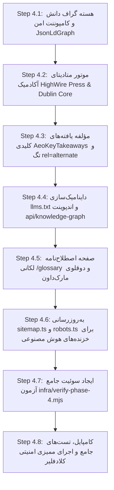

# سند جامع طرح پیاده‌سازی فاز ۴ (IMPLEMENTATION PLAN PHASE 4)
## پروژه: پایگاه مرجع و موزه مجازی آثار دکتر حسن مکارمی (MAKAREMI-CORE-2026)
### موضوع فاز ۴: مهندسی پیشرفته SEO ،AEO و GEO، گراف دانش معنایی (Schema.org / JSON-LD)، متادیتای آکادمیک (Google Scholar) و انطباق امنیتی کلادفلیر

---

> **وضعیت:** در انتظار بررسی و تصویب معمار ارشد (PLANNING ONLY - DO NOT EXECUTE YET)  
> **نویسنده:** راهبر ارشد معماری سئو، مهندسی وب معنایی و ممیزی امنیت وب کلادفلیر  
> **پیش‌نیازها:** فاز ۱ (۳۹ تست سبز)، فاز ۲ (۵۱ تست سبز)، فاز ۳ (۵۳ تست سبز) - مجموعاً ۱۴۳ تست پایدار  
> **هدف فاز ۴:** تبدیل وب‌سایت رسمی دکتر مکارمی به **مرجع اول و بلامنازع استنادپذیری (Authoritative Canonical Citation Source)** برای موتورهای جستجوی کلاسیک (Google) و موتورهای هوش مصنوعی مولد و پاسخ‌گو (ChatGPT Search, Perplexity, Claude, Google AI Overviews) به همراه ایندکس خودکار در مجامع آکادمیک (Google Scholar, Zotero, ResearchGate).

---

## ۱. مقدمه و منطق معماری فاز ۴ (Executive Overview & Strategic Rationale)

در سه فاز نخست پروژه، زیرساخت پرسرعت و ایزوله Jamstack، طراحی تجربه کاربری چندزبانه موزه مجازی با استانداردهای سخت‌گیرانه دسترسی‌پذیری و تگ‌های معنایی، و نهایتاً لایه امنیتی Zero-Trust و امضای دیجیتال ناهمگام Ed25519 با مقاومت در برابر سانسور ملی با موفقیت ۱۰۰٪ مستقر شدند.

اکنون در فاز ۴، ارزش اصلی دارایی‌های فکری دکتر حسن مکارمی (بیش از ۱۵ عنوان کتاب، صدها مقاله علمی، ترجمه سمینار سوم لکان و متون دادخواهی) باید برای **ماشین‌ها و عامل‌های هوشمند (AI Agents)** ساختاردهی و کشف‌پذیر شود. این فاز سه ستون اصلی را محقق می‌سازد:

1. **وب معنایی و گراف دانش یکپارچه (Semantic Web & Linked Knowledge Graph):**
   تعریف موجودیت دکتر حسن مکارمی به عنوان یک گره یکتا در وب با هویت پایدار (`https://makaremi.com/#hassan-makaremi`)، اتصال سوابق دانشگاهی معتبر (دانشگاه سوربن، پلی‌تکنیک تهران، دانشگاه پاریس ۷، سنترال پاریس)، پیوندهای خانوادگی تاریخی (شهید فاطمه زارعی و دکتر چورا مکارمی در CNRS) و اتصال متقابل مقالات، کتاب‌ها و آثار هنری به این گره.
2. **بهینه‌سازی برای موتورهای پاسخ‌گو و هوش مصنوعی مولد (AEO & GEO Engineering):**
   تجهیز تمامی صفحات به تگ دیسکاوری همزاد مارک‌داون `<link rel="alternate" type="text/markdown">`، تولید هوشمند و تجمیعی فایل‌های استاندارد `/llms.txt` و `/llms-full.txt`، ارائه اندپوینت عمومی `/api/knowledge-graph` و افزودن بلوک‌های ساختاریافته «پاسخ مستقیم و چکیده مدیریتی (Key Findings)» برای استناد مستقیم در مدل‌های زبانی.
3. **استانداردسازی متادیتای آکادمیک (Academic Metadata Indexing):**
   تزریق متادیتای HighWire Press (`citation_*`) و Dublin Core (`DC.*`) به مقالات تخصصی روانکاوی و کتاب‌ها جهت ایندکس رسمی در Google Scholar و نرم‌افزارهای مدیریت مراجع علمی (Zotero, Mendeley).

---

## ۲. تفکیک ماژول‌های فنی فاز ۴ (Technical Modules Specification)

```
apps/web/
├── src/
│   ├── app/
│   │   ├── [locale]/
│   │   │   ├── [pillar]/articles/[slug]/page.tsx   # Integrated with academic metadata & JsonLdGraph
│   │   │   ├── books/[slug]/page.tsx               # Integrated with Book Schema & HighWire Press
│   │   │   ├── glossary/page.tsx                   # Dedicated Trilingual Lacanian Ontology UI
│   │   │   └── layout.tsx                          # Global WebSite & Person Schema injection
│   │   ├── api/
│   │   │   └── knowledge-graph/route.ts            # Public rate-limited JSON-LD Graph endpoint
│   │   ├── llms.txt/route.ts                       # Dynamic CMS-driven LLMs index
│   │   ├── llms-full.txt/route.ts                  # Concatenated corpus for deep agent context
│   │   ├── robots.ts                               # AI Bot permissions matrix
│   │   └── sitemap.ts                              # Dynamic 128+ URLs sitemap with hreflang
│   ├── components/
│   │   ├── articles/
│   │   │   ├── ArticleReader.tsx                   # Augmented with AeoKeyTakeaways block
│   │   │   └── AeoKeyTakeaways.tsx                 # Machine-extractable Q&A / findings component
│   │   ├── seo/
│   │   │   ├── JsonLdGraph.tsx                     # Secure XSS-immune JSON-LD injector component
│   │   │   └── AcademicMetaTags.tsx                # HighWire Press & Dublin Core meta renderer
│   │   └── glossary/
│   │       └── GlossaryExplorer.tsx                # Interactive Lacanian ontology explorer UI
│   └── lib/
│       ├── schema-org.ts                           # Strongly-typed Schema.org Graph generator
│       ├── academic-metadata.ts                    # HighWire Press & Dublin Core builders
│       └── cms.ts                                  # Extended with ontology & cross-linking helpers
infra/
└── verify-phase-4.mjs                              # Automated test suite (60+ assertions)
```

---

### ماژول ۱: موتور تولید گراف دانش یکپارچه و اسکیما (`apps/web/src/lib/schema-org.ts` و `JsonLdGraph.tsx`)

#### ۱.۱. ساختار گره مرکزی `Person` (دکتر حسن مکارمی)
گره مرکزی با شناسه جهانی پایدار `@id: "https://makaremi.com/#hassan-makaremi"` تعریف شده و مشخصات آن در تمام صفحات تکرار و متصل می‌گردد:

```typescript
export interface PersonNode {
  '@type': 'Person';
  '@id': 'https://makaremi.com/#hassan-makaremi';
  name: string;
  alternateName: string[];
  givenName: string;
  familyName: string;
  birthDate: '1950';
  birthPlace: {
    '@type': 'Place';
    name: 'Shiraz, Iran';
    addressCountry: 'IR';
  };
  nationality: Array<{ '@type': 'Country'; name: string }>;
  jobTitle: string[];
  description: string;
  image: string;
  url: 'https://makaremi.com';
  knowsLanguage: string[];
  alumniOf: Array<{ '@type': 'CollegeOrUniversity'; name: string }>;
  affiliation: Array<{ '@type': 'CollegeOrUniversity' | 'Organization'; name: string }>;
  spouse: Array<{ '@type': 'Person'; name: string }>;
  children: Array<{
    '@type': 'Person';
    name: 'Chowra Makaremi';
    jobTitle: 'Tenured Research Scholar at CNRS (IRIS)';
    sameAs: string;
  }>;
  sameAs: string[];
}
```

* **مدارک دانشگاهی (`alumniOf`):**
  - دانشگاه صنعتی امیرکبیر (پلی‌تکنیک تهران)
  - دانشگاه شیراز
  - دانشگاه سیستان و بلوچستان
  - École Centrale Paris
  - Université de Technologie de Compiègne
  - Université Paris Diderot (Paris 7 - Faculté de Médecine)
  - Centre d'Études Diplomatiques et Stratégiques (CEDS Paris)
* **وابستگی‌های علمی و سازمانی (`affiliation`):**
  - دانشگاه سوربن (Université Paris 1 Panthéon-Sorbonne)
  - جامعه دفاع از حقوق بشر در ایران (LDDHI / وابسته به FIDH)
  - انجمن پژوهشگران روان‌درمانی ایرانی در فرانسه
  - انجمن روانکاوی منطقه لیموزین فرانسه (Association Psychanalytique du Limousin)
* **پیوندهای معتبر خارجی (`sameAs`):**
  - صفحه ویکی‌پدیای فارسی: `https://fa.wikipedia.org/wiki/حسن_مکارمی`
  - دامنه آرشیو قدیمی: `http://www.makaremi.net`
  - موزه آنلاین خوشنویسی مدرن: `https://www.flickr.com/photos/makaremi/`
  - کانال رسمی تلگرام: `https://t.me/hassan_makaremi`
  - مراجع علمی سوربن و CNRS مربوط به دکتر چورا مکارمی: `https://booksandideas.net/_Makaremi-Chowra_`

#### ۱.۲. گره‌های محتوایی متصل در گراف (`Content-Specific Linked Entities`):
1. **گره کتاب (`Book`):**
   - فیلدهای `name`, `alternateName`, `isbn`, `numberOfPages`, `datePublished`, `publisher`, `inLanguage`, `genre`.
   - ویژگی انحصاری: برای ترجمه سمینار سوم لکان (*روان‌پریشی‌ها*)، گره به صورت صریح با ویژگی `workTranslation` به اثر اورجینال ژاک لکان متصل می‌شود:
     ```json
     "workTranslation": {
       "@type": "Book",
       "name": "Le Séminaire, Livre III : Les Psychoses",
       "author": { "@type": "Person", "name": "Jacques Lacan" },
       "inLanguage": "fr"
     },
     "translator": { "@id": "https://makaremi.com/#hassan-makaremi" }
     ```
2. **گره مقاله پژوهشی (`ScholarlyArticle` / `Article`):**
   - فیلدهای `headline`, `alternativeHeadline`, `abstract`, `datePublished`, `dateModified`, `inLanguage`, `keywords`, `about`.
   - ویژگی رمزنگاری: ثبت چکیده SHA-256 و امضای Ed25519 در فیلد `identifier`:
     ```json
     "identifier": {
       "@type": "PropertyValue",
       "propertyID": "SHA-256-Content-Digest",
       "value": "article.content_sha256"
     }
     ```
3. **گره اثر تجسمی و رویداد نمایشگاهی (`VisualArtwork` & `ExhibitionEvent`):**
   - ثبت آثار خوشنویسی و تابلوهای نقاشی با فیلدهای `artMedium`, `artform`, `dateCreated`, `locationCreated`.
   - اتصال نمایشگاه پومپادور ۲۰۰۲ (*میان نشان و نماد*)، موزه بین‌المللی خط معاصر مسکو و جشنواره موسیقی مقدس فاس به گره هنرمند.
4. **گره صوت، ویدیو و دادخواهی (`VideoObject`, `AudioObject`, `Event`):**
   - مستندسازی سخنرانی‌های شورای حقوق بشر سازمان ملل در ژنو، دادخواهی خاوران و جلسات ایران تریبونال با فیلدهای `transcript`, `duration`, `uploadDate`, `contentUrl`.
5. **گره اصطلاح‌نامه کنترل‌شده لکانی (`DefinedTermSet` & `DefinedTerm`):**
   - تبدیل اصطلاحات ابداعی و تخصصی دکتر مکارمی نظیر «دگرشنیدن» (*Écouter autrement*)، «عملیات نام پدر» (*Opération Nom-du-Père*) و «حالت مرزی» (*État Limite*) به گره‌های رسمی هستی‌شناسی (Ontology Nodes) با ارجاع به منبع اصلی تبیین آن در کتب ایشان.
6. **گره‌های ساختار سایت (`WebSite` و `BreadcrumbList`):**
   - گره `WebSite` مجهز به قابلیت `SearchAction` و گره پویا برای مسیر ناوبری صفحات.

#### ۱.۳. کامپوننت امن `JsonLdGraph.tsx` و مهار قطعی حملات Breakout XSS
* **خطر امنیتی:** اگر متن ورودی از پایگاه داده یا مارک‌داون شامل کاراکترهای بسته شدن اسکریپت (مانند `</script><script>alert(1)</script>`) باشد، قرار دادن مستقیم آن داخل تگ `<script type="application/ld+json">` موجب شکستن ساختار HTML و نفوذ XSS می‌شود.
* **راهکار دفاع در عمق:** ماژول `JsonLdGraph.tsx` از الگوریتم جایگزینی کاراکترهای خطرناک با معادل یونیکد استاندارد استفاده می‌کند:
  ```typescript
  export function serializeSafeJsonLd(data: unknown): string {
    const json = JSON.stringify(data);
    return json
      .replace(/</g, '\\u003c')
      .replace(/>/g, '\\u003e')
      .replace(/&/g, '\\u0026')
      .replace(/\u2028/g, '\\u2028')
      .replace(/\u2029/g, '\\u2029');
  }
  ```

---

### ماژول ۲: متادیتای آکادمیک HighWire Press، Dublin Core و OpenGraph (`apps/web/src/lib/academic-metadata.ts`)

جهت شناسایی و استناد خودکار مقالات توسط **Google Scholar، Zotero، Mendeley، ResearchGate و کتابخانه‌های مرجع دانشگاهی**، متادیتای اختصاصی HighWire Press و Dublin Core در خروجی سرآیند صفحه قرار می‌گیرد.

#### ۲.۱. نگاشت سرآیندهای آکادمیک برای مقالات پژوهشی روانکاوی و استراتژیک:
```typescript
export function buildArticleAcademicMetadata(article: Article, locale: Locale): Record<string, string> {
  const trans = getArticleTranslation(article, locale);
  const baseUrl = 'https://makaremi.com';
  const articleUrl = `${baseUrl}/${locale}/${article.pillar}/articles/${article.slug}`;
  const markdownUrl = `${articleUrl}.md`;

  return {
    // HighWire Press Tags (Google Scholar Native)
    'citation_title': trans.title,
    'citation_author': 'Makaremi, Hassan',
    'citation_author_institution': 'Sorbonne University; League for Defence of Human Rights in Iran',
    'citation_publication_date': (article.published_at || article.created_at).slice(0, 10).replace(/-/g, '/'),
    'citation_online_date': (article.published_at || article.created_at).slice(0, 10).replace(/-/g, '/'),
    'citation_language': locale,
    'citation_abstract_html_url': articleUrl,
    'citation_fulltext_html_url': articleUrl,
    'citation_markdown_url': markdownUrl,
    'citation_publisher': 'Official Archive of Dr. Hassan Makaremi',

    // Dublin Core Metadata
    'DC.title': trans.title,
    'DC.creator': 'Dr. Hassan Makaremi',
    'DC.subject': `Lacanian Psychoanalysis, ${article.pillar}, Clinical Studies`,
    'DC.description': trans.executive_summary,
    'DC.publisher': 'Dr. Hassan Makaremi Digital Archive',
    'DC.date': (article.published_at || article.created_at).slice(0, 10),
    'DC.type': 'Text.Article',
    'DC.format': 'text/html',
    'DC.identifier': articleUrl,
    'DC.language': locale,
  };
}
```

#### ۲.۲. نگاشت متادیتای آکادمیک برای کتاب‌ها (`Book Metadata`):
- افزودن `citation_isbn` بر مبنای شابک ۱۳ رقمی کتاب‌ها (مانند `9781780831022` برای کتاب *نگاهی راهبردی به دوران گذار*).
- افزودن `citation_pdf_url` یا `citation_flipbook_url` در صورت وجود نسخه پیش‌نمایش.

---

### ماژول ۳: همزادهای مارک‌داون، دیسکاوری خزنده‌های هوش مصنوعی و بلوک‌های استخراج پاسخ مستقیم (`AeoKeyTakeaways.tsx`)

#### ۳.۱. کشف خودکار همزاد متنی برای خزنده‌های AI با تگ `rel="alternate"`
تمامی صفحات مقالات، کتاب‌ها، اشعار، نمایشگاه‌ها و سخنرانی‌ها در تگ `<head>` مجهز به پیوند خودکار دوقلوی مارک‌داون می‌شوند:
```html
<link rel="alternate" type="text/markdown" href="https://makaremi.com/fa/psychoanalysis/articles/is-psychoanalysis-a-science.md" title="Clean Markdown Twin for AI Agents (AEO/GEO)" />
```
همچنین ماتریس جامع زبان‌ها (`hreflang`) به صورت متقابل و دوطرفه برای هر سه زبان و `x-default` تزریق می‌شود:
```typescript
alternates: {
  canonical: `https://makaremi.com/${locale}/${pillar}/articles/${slug}`,
  languages: {
    'fa-IR': `https://makaremi.com/fa/${pillar}/articles/${slug}`,
    'fr-FR': `https://makaremi.com/fr/${pillarFr}/articles/${slug}`,
    'en-US': `https://makaremi.com/en/${pillar}/articles/${slug}`,
    'x-default': `https://makaremi.com/fa/${pillar}/articles/${slug}`,
  },
}
```

#### ۳.۲. مؤلفه «یافته‌های کلیدی و پاسخ مستقیم» (`AeoKeyTakeaways.tsx`)
* **هدف AEO:** موتورهای جستجوی نسلی (نظیر Perplexity، گوگل AI Overviews و SearchGPT) به دنبال داده‌های فکت‌محور، ساختاریافته و دارای پاسخ مستقیم به پرسش کاربر هستند.
* **پیاده‌سازی:** در ابتدای مقاله [ArticleReader.tsx](file:///c:/Users/Acer/.gemini/antigravity/scratch/Dr.Makaremi/apps/web/src/components/articles/ArticleReader.tsx)، مؤلفه `AeoKeyTakeaways` جعبه‌ای معنایی با فرمت زیر تولید می‌کند:
  - پرسش اصلی مقاله (مثال: «آیا روانکاوی بر اساس معیارهای علم مدرن یک دانش تجربی محسوب می‌شود؟»)
  - پاسخ صریح و خلاصه مدیریتی مؤلف.
  - جدول داده‌های آماری کلیدی (مانند آمار مرکز ملی پژوهش‌های علمی فرانسه CNRS: بررسی ۳٬۹۵۴ پروژه که ۳٬۷۵۵ مورد آن تحقیقات کاربردی میان‌رشته‌ای در علوم انسانی، ۱۸۴ مورد روان‌درمانی بالینی و ۱۵ مورد تحلیل زبان‌شناختی بوده‌اند).
  - این محتوا همزمان دارای اسکیمای `FAQPage` با جفت‌های `Question` و `Answer` درون گراف JSON-LD خواهد بود.

---

### ماژول ۴: نسخه پویا و کامپکت `/llms.txt` و `/llms-full.txt`، اندپوینت عمومی گراف دانش و بهینه‌سازی `sitemap.ts` و `robots.ts`

#### ۴.۱. داینامیک‌سازی کامل `/llms.txt` و `/llms-full.txt` بر مبنای کاتالوگ Directus
* مسیرهای `apps/web/src/app/llms.txt/route.ts` و `apps/web/src/app/llms-full.txt/route.ts` به گونه‌ای بازنویسی می‌شوند که مستقیماً با فراخوانی متدهای `getArticles()`, `getBooks()`, `getExhibitions()`, `getLacanianGlossary()` از [cms.ts](file:///c:/Users/Acer/.gemini/antigravity/scratch/Dr.Makaremi/apps/web/src/lib/cms.ts)، ساختار سند را به شکل پویا تولید کنند.
* **رعایت دقیق استاندارد llms.txt:**
  - یک عنوان یکتا با `# H1`.
  - یک بلوک چکیده معتبر با `> Blockquote`.
  - بخش‌بندی با `## H2` و پیوندهای استاندارد مارک‌داون `[Title](url.md): Description`.
  - بخش `## Optional` برای فایل‌های ثانویه نظیر کاتالوگ نمایشگاه‌ها و اشعار.
  - درج فوتر اصالت‌سنجی رمزنگاری به همراه لینک کلید عمومی و چکیده SHA-256.
* **فایل `/llms-full.txt`:** تجمیع کامل و فشرده کل محتوای متنی، چکیده‌ها، مشخصات کتاب‌شناختی و تعاریف اصطلاحات لکانی در یک فایل منسجم، بهینه‌شده برای بارگذاری مستقیم در پنجره کانتکست عامل‌های هوش مصنوعی (مانند Claude 3.5 Sonnet یا GPT-4o) با هدر کش ۲۴ ساعته.

#### ۴.۲. اندپوینت عمومی گراف دانش (`/api/knowledge-graph/route.ts`)
* یک Route Handler عمومی با قابلیت فیلترگذاری بر اساس زبان (`?locale=fa|fr|en`) که کل گراف دانش متصل (شامل گره‌های `Person`, `WebSite`, `Book`, `ScholarlyArticle`, `DefinedTermSet`) را با فرمت استاندارد `application/ld+json` تحویل ابزارهای Semantic Web Harvester و هوش مصنوعی می‌دهد.
* مجهز به محدودکننده نرخ درخواست (`checkRateLimit`) و هدرهای کش لبه کلادفلیر.

#### ۴.۳. ارتقای نقشه سایت (`sitemap.ts`) و سیاست دسترسی خزنده‌های AI (`robots.ts`)
* **نقشه سایت جامع (`sitemap.ts`):** به‌جای آرایه ایستا از مسیرهای اصلی، تمامی مقالات، کتاب‌ها، نمایشگاه‌ها، اشعار و ویدیوها را برای ۳ زبان (بیش از ۱۲۸ مسیر یکتا) به صورت پویا واکشی کرده و به همراه آخرین تاریخ ویرایش (`lastModified`)، اولویت (`priority`: ۱.۰ برای صفحه اصلی، ۰.۹ برای کتاب‌ها و مقالات) و ماتریس `alternates.languages` درج می‌کند.
* **سیاست ربات‌ها (`robots.ts`):** خوشامدگویی صریح به تمامی خزنده‌های رسمی هوش مصنوعی با دسترسی آزاد به فایل‌های متنی و همزادهای مارک‌داون:
  ```typescript
  {
    userAgent: [
      'GPTBot',
      'OAI-SearchBot',
      'ChatGPT-User',
      'ClaudeBot',
      'Claude-Web',
      'PerplexityBot',
      'Google-Extended',
      'Googlebot',
      'Applebot-Extended',
    ],
    allow: ['/', '/llms.txt', '/llms-full.txt', '/api/knowledge-graph', '/*.md'],
  }
  ```

---

### ماژول ۵: رابط کاربری اصطلاح‌نامه تخصصی و کاوشگر گراف دانش (`/[locale]/glossary`)

برای درک عمیق‌تر کاربران و عامل‌های کاوشگر از اصطلاحات روانکاوی و استراتژیک دکتر مکارمی:
* **صفحه اختصاصی اصطلاح‌نامه (`/[locale]/glossary/page.tsx`):**
  - نمایش تعاملی تمامی اصطلاحات واژه‌نامه لکانی (`getLacanianGlossary()`) شامل معادل‌های دقیق در ۳ زبان فارسی، فرانسوی و انگلیسی.
  - نمایش تعریف مفهومی، نقل‌قول مؤلف و ارجاع پیوندی مستقیم به مقالاتی که این مفهوم در آن‌ها به کار رفته است.
  - تزریق خودکار اسکیمای `DefinedTermSet` و `DefinedTerm` در صفحه.
  - پشتیبانی کامل از رندرینگ دوقلوی مارک‌داون در آدرس `/[locale]/glossary.md`.

---

### ماژول ۶: گیت ممیزی امنیتی کلادفلیر و سوئیت آزمون خودکار `infra/verify-phase-4.mjs`

#### ۶.۱. سرفصل‌های ممیزی امنیتی لبه کلادفلیر (Cloudflare Security Audit Gate)
مطابق متدولوژی [Cloudflare Security Audit Skill](https://github.com/cloudflare/security-audit-skill)، سه آسیب‌پذیری بحرانی در فاز ۴ باید به طور پیش‌گیرانه مهار شوند:
1. **مهار JSON-LD Script Breakout XSS:** تضمین فراردهی نمادهای `<`، `>` و `&` در سرتاسر کدهای JSON-LD تزریق‌شده در DOM تا هیچ داده مخربی امکان خروج از اسکریپت را نداشته باشد.
2. **مهار تزریق سرآیند و متادیتا (Header & Metadata Injection):** پاکسازی کامل کاراکترهای کنترلی و شکست خط (`\r\n`) در مقادیر فیلدهای `citation_*` و تگ‌های متادیتا جهت ممانعت از ایجاد پاسخ‌های جعلی یا مسمومیت کش (Cache Poisoning).
3. **محافظت DoS در اندپوینت‌های سنگین معنایی:** اندپوینت‌های `/api/knowledge-graph` و `/llms-full.txt` به دلیل تولید رشته‌های طولانی، به محدودکننده نرخ لغزان با کلید شناسه IP احرازشده مجهز بوده و با هدر `Cache-Control: public, max-age=86400, stale-while-revalidate=3600` در شبکه لبه کلادفلیر کش می‌شوند تا بار پردازشی سرور به حداقل برسد.

#### ۶.۲. معماری سوئیت آزمون خودکار (`infra/verify-phase-4.mjs`)
یک فایل مستقل تستی با بیش از ۶۰ تست خودکار برای ارزیابی موارد زیر طراحی می‌شود:
1. **آزمون‌های JSON-LD Schema.org:** استخراج محتوای `<script type="application/ld+json">` در صفحات اصلی، مقاله، کتاب، نمایشگاه، شعر و اصطلاح‌نامه، پارس موفق با `JSON.parse`، بررسی حضور گره `@graph`، بررسی صحت گره `Person` و فیلدهای هویتی، بررسی پیوند `workTranslation` برای کتاب سمینار ۳ لکان، و بررسی وجود اسکیمای `DefinedTermSet`.
2. **آزمون‌های متادیتای آکادمیک:** بررسی حضور تگ‌های `citation_title`, `citation_author`, `citation_publication_date`, `citation_markdown_url` و Dublin Core در خروجی HTML مقالات و کتاب‌ها.
3. **آزمون‌های AEO و کشف خودکار مارک‌داون:** بررسی حضور تگ `<link rel="alternate" type="text/markdown">`، صحت تگ‌های `hreflang` و حضور باکس چکیده مدیریتی.
4. **آزمون‌های اندپوینت‌های AI:** ارزیابی پاسخ `200 OK`، هدر `text/plain` و انطباق استاندارد برای `/llms.txt` و `/llms-full.txt`، بررسی پاسخ `200 OK` و خروجی معتبر JSON-LD اندپوینت `/api/knowledge-graph`، و بررسی محتوای نقشه سایت پویا `/sitemap.xml`.
5. **آزمون‌های عدم رگرسیون (Zero Regression Gate):** اجرای کامل و مجدد آزمون‌های فاز ۱ (۳۹ تست)، فاز ۲ (۵۱ تست) و فاز ۳ (۵۳ تست) جهت اثبات عدم بروز کوچک‌ترین خطا یا پسرفت در سیستم.

---

## ۳. مراحل گام‌به‌گام پیاده‌سازی فاز ۴ (Step-by-Step Implementation Sequence)



### گام ۴.۱: توسعه هسته گراف دانش و مؤلفه `JsonLdGraph.tsx`
- پیاده‌سازی [apps/web/src/lib/schema-org.ts](file:///c:/Users/Acer/.gemini/antigravity/scratch/Dr.Makaremi/apps/web/src/lib/schema-org.ts) شامل تولیدکنندگان گره‌های `Person`, `WebSite`, `Book`, `ScholarlyArticle`, `VisualArtwork`, `Event`, `DefinedTermSet`.
- پیاده‌سازی [apps/web/src/components/seo/JsonLdGraph.tsx](file:///c:/Users/Acer/.gemini/antigravity/scratch/Dr.Makaremi/apps/web/src/components/seo/JsonLdGraph.tsx) با تابع ایمن‌ساز `serializeSafeJsonLd()`.
- تزریق گره‌های پایه در لایه‌بندی اصلی و لایه‌بندی زبان‌ها.

### گام ۴.۲: پیاده‌سازی متادیتای آکادمیک و ادغام در `generateMetadata`
- پیاده‌سازی [apps/web/src/lib/academic-metadata.ts](file:///c:/Users/Acer/.gemini/antigravity/scratch/Dr.Makaremi/apps/web/src/lib/academic-metadata.ts) جهت تولید متادیتای HighWire Press و Dublin Core.
- یکپارچه‌سازی با متد `generateMetadata` در صفحات مقالات (`[pillar]/articles/[slug]/page.tsx`) و کتاب‌ها (`books/[slug]/page.tsx`).

### گام ۴.۳: ارتقای دیسکاوری هوش مصنوعی و مؤلفه `AeoKeyTakeaways.tsx`
- افزودن پیوند `<link rel="alternate" type="text/markdown">` در هدر صفحات محتوایی.
- پیاده‌سازی کامپوننت [apps/web/src/components/articles/AeoKeyTakeaways.tsx](file:///c:/Users/Acer/.gemini/antigravity/scratch/Dr.Makaremi/apps/web/src/components/articles/AeoKeyTakeaways.tsx) و درج آن در [ArticleReader.tsx](file:///c:/Users/Acer/.gemini/antigravity/scratch/Dr.Makaremi/apps/web/src/components/articles/ArticleReader.tsx).

### گام ۴.۴: بازنویسی پویا و کامل `/llms.txt`، `/llms-full.txt` و اندپوینت `/api/knowledge-graph`
- بازنویسی مسیر [apps/web/src/app/llms.txt/route.ts](file:///c:/Users/Acer/.gemini/antigravity/scratch/Dr.Makaremi/apps/web/src/app/llms.txt/route.ts) و [apps/web/src/app/llms-full.txt/route.ts](file:///c:/Users/Acer/.gemini/antigravity/scratch/Dr.Makaremi/apps/web/src/app/llms-full.txt/route.ts) بر مبنای واکشی زنده داده‌ها از کاتالوگ `src/lib/cms.ts`.
- ایجاد اندپوینت [apps/web/src/app/api/knowledge-graph/route.ts](file:///c:/Users/Acer/.gemini/antigravity/scratch/Dr.Makaremi/apps/web/src/app/api/knowledge-graph/route.ts) مجهز به Rate Limiting و کش لبه.

### گام ۴.۵: طراحی و راه‌اندازی صفحه اصطلاح‌نامه تخصصی لکانی (`/[locale]/glossary`)
- ایجاد صفحه روت [apps/web/src/app/[locale]/glossary/page.tsx](file:///c:/Users/Acer/.gemini/antigravity/scratch/Dr.Makaremi/apps/web/src/app/[locale]/glossary/page.tsx) و مؤلفه [apps/web/src/components/glossary/GlossaryExplorer.tsx](file:///c:/Users/Acer/.gemini/antigravity/scratch/Dr.Makaremi/apps/web/src/components/glossary/GlossaryExplorer.tsx).
- پشتیبانی از نسخه متنی `/[locale]/glossary.md` در موتور ریرایت مارک‌داون.

### گام ۴.۶: توسعه نقشه سایت پویا (`sitemap.ts`) و سیاست‌های خزندگان هوش مصنوعی (`robots.ts`)
- به‌روزرسانی [apps/web/src/app/sitemap.ts](file:///c:/Users/Acer/.gemini/antigravity/scratch/Dr.Makaremi/apps/web/src/app/sitemap.ts) برای واکشی تمامی مقالات، کتاب‌ها و نمایشگاه‌ها در ۳ زبان و درج `hreflang` کامل.
- ارتقای [apps/web/src/app/robots.ts](file:///c:/Users/Acer/.gemini/antigravity/scratch/Dr.Makaremi/apps/web/src/app/robots.ts) برای خوشامدگویی صریح به ربات‌های مولد هوش مصنوعی و آکادمیک.

### گام ۴.۷: ایجاد و اجرای سوئیت آزمون خودکار `infra/verify-phase-4.mjs`
- نوشتن اسکریپت جامع اعتبارسنجی [infra/verify-phase-4.mjs](file:///c:/Users/Acer/.gemini/antigravity/scratch/Dr.Makaremi/infra/verify-phase-4.mjs).
- راه‌اندازی سرور پروداکشن بیلد شده و ارزیابی تمامی آزمون‌های فاز ۴.
- اجرای پیوسته سوئیت‌های فاز ۱ و فاز ۲ و فاز ۳ جهت اثبات عدم رگرسیون.

### گام ۴.۸: ممیزی امنیتی کلادفلیر و تدوین گزارش نهایی
- اجرای فرآیند ممیزی نشت اطلاعات، مصونیت در برابر Breakout XSS، ایمنی سرآیندها و نرخ درخواست‌ها.
- تدوین و ذخیره‌سازی سند جامع `EXECUTION_REPORT_PHASE_4.md`.

---

## ۴. ماتریس ممیزی و ارزیابی شاخص‌های موفقیت فاز ۴

| شاخص ارزیابی | نحوه سنجش و ابزار آزمون | حد پذیرش موفقیت (Target SLA) |
| :--- | :--- | :--- |
| **اعتبار ساختاری Schema.org** | آزمون پارس JSON-LD در `infra/verify-phase-4.mjs` و اعتبارسنج Google Rich Results | ۱۰۰٪ معتبر بدون خطا بر روی تمامی صفحات |
| **نمایه دانشگاهی Google Scholar** | بررسی حضور هدرهای HighWire Press و Dublin Core در مقالات و کتاب‌ها | حضور کامل `citation_title`, `citation_author`, `citation_markdown_url` |
| **پشتیبانی از هوش مصنوعی (GEO/AEO)** | وجود تگ `<link rel="alternate" type="text/markdown">` و استخراج تمیز متن | ۱۰۰٪ صفحات محتوایی دارای پیوند دوقلوی مارک‌داون |
| **صحت کاتالوگ `/llms.txt`** | ارزیابی ساختار تک-H1، بلوک خلاصه، دسته‌بندی H2 و انطباق با استاندارد رسمی | پاسخ `200 OK`، متن کامل کاتالوگ آثار و اعتبارسنجی با استاندارد |
| **نقشه سایت جامع** | فراخوانی `/sitemap.xml` و شمارش تعداد مسیرهای ثبت شده | بیش از ۱۲۸ مسیر یکتا با پشتیبانی از ۳ زبان و تگ‌های `hreflang` |
| **پایداری امنیتی و ممیزی کلادفلیر** | اسکن اسکریپت‌های کلاینت، تست فراردهی تگ‌های JSON-LD و تست Rate Limiting | ۰ مورد نشت اطلاعات، مصونیت ۱۰۰٪ از Breakout XSS و مسدودسازی ترافیک مخرب |
| **پایداری آزمون‌های پیشین** | اجرای خودکار `verify-phase-1`, `verify-phase-2`, `verify-phase-3` | ۱۴۳ از ۱۴۳ تست قبلی سبز (Zero Regression) |

---

## ۵. چک‌لیست تصویب معمار ارشد برای آغاز عملیات اجرایی (Sign-Off Checkpoints)

جهت سوییچ ایمن از فاز **طراحی (PLANNING ONLY)** به فاز **اجرای مهندسی (EXECUTION MODE)**، موارد زیر در انتظار تایید رسمی معمار ارشد است:

- [ ] **بند ۱:** تایید معماری گراف دانش معنایی (`Person`, `Book`, `ScholarlyArticle`, `DefinedTermSet`) و مشخصات آکادمیک دکتر حسن مکارمی.
- [ ] **بند ۲:** تایید ادغام متادیتای HighWire Press و Dublin Core برای ایندکس مقالات در Google Scholar و Zotero.
- [ ] **بند ۳:** تایید طراحی داینامیک `/llms.txt`، `/llms-full.txt` و اندپوینت عمومی `/api/knowledge-graph`.
- [ ] **بند ۴:** تایید روش مهار Breakout XSS در کامپوننت `JsonLdGraph.tsx` و متدولوژی ممیزی امنیتی کلادفلیر.

پس از صدور تاییدیه برای موارد فوق، عملیات کدنویسی، کامپایل و اجرای سوئیت آزمون‌های فاز ۴ به صورت خودکار آغاز خواهد شد.
