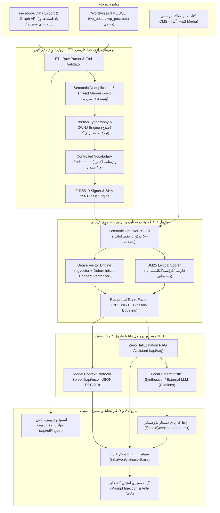

# برنامه جامع و راهبردی اجرای فاز ۵ (IMPLEMENTATION_PLAN_PHASE_5)
**پروژه:** وب‌سایت رسمی و آرشیو جامع دیجیتال دکتر حسن مکارمی (`MAKAREMI-CORE-2026`)  
**نسخه:** 1.0.0-PROD  
**وضعیت:** در انتظار تأیید معمار ارشد (PLANNING ONLY - DO NOT EXECUTE CODE YET)  
**معمار و نویسنده:** معمار ارشد مهندسی داده، پایپ‌لاین هوش مصنوعی، Hybrid RAG و ممیز امنیت ابری  

---

## ۱. مرور وضعیت فعلی، پیوستگی و اهداف فاز ۵

پروژه `MAKAREMI-CORE-2026` تا پایان فاز ۴ به یک سامانه کاملاً پایدار، توزیع‌شده لبه‌ای (Edge-Ready)، ضدسانسور، مجهز به امضای رمزنگاری Ed25519، دارای سئو و AEO/GEO پیشرفته با **۱۳۲ مسیر ایستا** و **۲۲۷ آزمون خودکار موفق (۱۰۰٪ قبولی با صفر رگرسیون)** تبدیل شده است:
- **فاز ۱ (زیرساخت، ریدایرکت، زبان و امنیت):** ۳۹ / ۳۹ تست سبز
- **فاز ۲ (هسته فرانت‌اند، ۳D و دوقلوی مارک‌داون):** ۵۱ / ۵۱ تست سبز
- **فاز ۳ (رمزنگاری Ed25519، سلف‌هیلینگ و بقای آفلاین):** ۵۳ / ۵۳ تست سبز
- **فاز ۴ (سئو، AEO/GEO، گراف دانش Schema.org و امنیت کلادفلیر):** ۸۴ / ۸۴ تست سبز

### هدف بنیادین فاز ۵
هدف فاز ۵ ایجاد **موتور هوشمند داده و بازنمایی دانش (Data Ingestion, Enrichment & Hybrid RAG)** است تا:
1. گنجینه یادداشت‌ها، مقالات و پست‌های منتشرشده دکتر حسن مکارمی در فیس‌بوک و وب‌سایت‌های وردپرسی قدیمی (`makaremi.net` و `makaremi.com`) به صورت خودکار، هوشمند و ایمن استخراج، پالایش، غنی‌سازی و در ۴ ستون محتوایی اصلی دسته‌بندی شوند.
2. متن متون به زبان فارسی معیار با اعمال دقیق **نیم‌فاصله‌ها (`\u200c`)** و واژگان تخصصی بازنویسی و نرمال‌سازی شود.
3. یک سیستم پیشرفته **قطعه‌بندی معنایی (Semantic Chunking)** و **جستجوی ترکیبی (Hybrid Search = BM25 + Dense Vector + Reciprocal Rank Fusion)** طراحی شود.
4. **دستیار هوشمند پژوهشگر آثار دکتر مکارمی (Zero-Hallucination Grounded RAG Assistant)** با استنادات قطعی، ارائه نقل‌قول مستقیم، پیوند به صفحه و هش رمزنگاری `SHA-256` راه‌اندازی شود.
5. یک سرور رسمی استاندارد **پروتکل زمینه مدل (`MCP - Model Context Protocol` بر پایه JSON-RPC 2.0)** جهت اتصال دستیارهای هوش مصنوعی مطرح (Claude Desktop، Cursor، ChatGPT، ایجنت‌های پژوهشی) به آرشیو آثار دکتر مکارمی ایجاد گردد.
6. رابط کاربری فاخر دستیار پژوهشگر و کارگاه استودیوی مهاجرت در مسیر `/[locale]/assistant` پیاده‌سازی شود.
7. گیت ممیزی امنیتی جامع کلادفلیر با آزمون‌های نفوذ ضد تزریق پرامپت (Prompt Injection) و آزمون‌های رگرسیون ۲۲۷ تست قبلی اجرا گردد.

---

## ۲. مشخصات معماری و جزئیات ۷ ماژول اجرایی فاز ۵



---

### ماژول ۱: پایپ‌لاین خودکار ETL استخراج، پالایش و ادغام آرشیو فیس‌بوک و وردپرس قدیمی
- **فایل‌های پیاده‌سازی:**
  - `apps/web/src/lib/etl/types.ts`
  - `apps/web/src/lib/etl/facebook-ingestor.ts`
  - `apps/web/src/lib/etl/wordpress-migrator.ts`
- **ویژگی‌ها و جزئیات فنی:**
  1. **پارس ساختاریافته داده‌های خام فیس‌بوک:**
     طراحی اسکیماهای Zod برای ورودی JSON فیس‌بوک (`FacebookExportSchema`):
     ```typescript
     export const FacebookPostSchema = z.object({
       id: z.string(),
       timestamp: z.number().or(z.string()),
       post: z.string().optional(),
       data: z.array(z.record(z.any())).optional(),
       title: z.string().optional(),
       attachments: z.array(z.any()).optional(),
     });
     ```
  2. **فیلترینگ هوشمند بر اساس آستانه کلمات و ارزش تحلیلی:**
     - پست‌های با کمتر از ۸۰ کلمه (پیام‌های کوتاه شخصی، تبریک‌های مناسبتی روزمره، یادداشت‌های تک‌خطی) به صورت خودکار به عنوان پست‌های خرد (micro-posts) علامت‌گذاری شده و از تبدیل به مقالات علمی حذف می‌شوند.
     - استخراج پست‌های بلند، مقالات تحلیلی و واکنش‌های فرهنگی-سیاسی دکتر مکارمی.
  3. **تشخیص و ادغام خودکار یادداشت‌های چندقسمتی (Thread Merging):**
     - تشخیص الگوهای سریالی در عنوان یا بدنه پست: «بخش نخست/اول/۱»، «قسمت دوم/۲»، «ادامه دارد»، «پایان».
     - ادغام پست‌های مرتبط منتشرشده در پنجره زمانی ۷۲ ساعته دارای اشتراک تگ یا پیشوندهای مشابه در یک سند یکپارچه مارک‌داون.
  4. **حذف موارد تکراری و ادغام با وردپرس (Semantic Deduplication):**
     - محاسبه شاخص تشابه جاکارد واژگانی (Jaccard Similarity) و مقایسه ترای‌گرام‌ها (Trigram Cosine Similarity).
     - محاسبه هش محتوایی نرمال‌شده (`normalized_body_sha256`) برای جلوگیری از درج چندباره مقالاتی که هم‌زمان روی وردپرس قدیمی و فیس‌بوک منتشر شده بودند.

---

### ماژول ۲: موتور استانداردسازی خط فارسی، نیم‌فاصله و غنی‌سازی هوشمند با واژه‌نامه لکانی
- **فایل‌های پیاده‌سازی:**
  - `apps/web/src/lib/etl/persian-normalizer.ts`
  - `apps/web/src/lib/etl/enrichment-pipeline.ts`
- **ویژگی‌ها و جزئیات فنی:**
  1. **موتور نرمال‌سازی خط و تایپوگرافی فارسی (`persian-normalizer.ts`):**
     - جایگزینی یای عربی (`ي` و `ى`) با یای فارسی (`ی` - `\u06CC`).
     - جایگزینی کاف عربی (`ك`) با کاف فارسی (`ک` - `\u06A9`).
     - تبدیل تاء مربوطه (`ة`) به `ه` یا `ت` متناسب با بافت واژه.
     - تبدیل ارقام انگلیسی و عربی به ارقام فارسی در متون فارسی و اصلاح ارقام شناسه و تاریخ.
     - **قوانین نیم‌فاصله هوشمند (Zero-Width Non-Joiner - `\u200c`):**
       * پیشوندهای استمراری و نفی: `می‌` و `نمی‌` متبوع با افعال (`می‌رود`, `نمی‌توانست`).
       * پسوندهای جمع: `‌ها` و `‌های` متبوع با اسم (`پژوهش‌ها`, `یافته‌های`, `خوانش‌ها`).
       * پسوندهای صفت‌ساز و تفضیلی: `‌تر` و `‌ترین` (`عمیق‌تر`, `بنیادین‌ترین`).
       * شناسه‌های متصل ملکی و ضمیری در انتهای کلمات مختوم به ه: `خانه‌ام`, `جامعه‌مان`.
       * اصطلاحات تخصصی دکتر مکارمی: `روان‌کاوی`, `دگرشنیدن`, `آسیب‌شناسی`, `ازهم‌گسستگی`, `گذشته‌باور`, `مطلوب‌گرا`, `روان‌پریشی‌ها`, `نام‌پدر`.
     - استانداردسازی علائم نگارشی:
       * تبدیل گیومه‌های لاتین `"..."` به گیومه‌های زیبای فارسی `«...»`.
       * حذف فاصله‌های قبل از نقطه، ویرگول، علامت سوال و تعجب؛ و الزام وجود دقیقاً یک فاصله بعد از آن‌ها.
       * ادغام فواصل مکرر و خطوط خالی اضافی.
  2. **پایپ‌لاین غنی‌سازی مبتنی بر واژه‌نامه لکانی-راهبردی (`enrichment-pipeline.ts`):**
     - تحلیل بدنه مقاله با پایگاه اصطلاح‌نامه تخصصی لکانی (`lacanian_glossary`):
       * `دگرشنیدن` $\leftrightarrow$ `Écouter autrement` $\leftrightarrow$ `Listening Differently`
       * `عملیات نام پدر` $\leftrightarrow$ `Opération Nom-du-Père` $\leftrightarrow$ `Operation of the Name-of-the-Father`
       * `حالت مرزی` $\leftrightarrow$ `État Limite` $\leftrightarrow$ `Borderline State`
       * `سرزمین فرهنگی ایران` $\leftrightarrow$ `Terre culturelle de l'Iran` $\leftrightarrow$ `Cultural Territory of Iran`
       * `سوگ سیاسی و دادخواهی` $\leftrightarrow$ `Deuil politique et justice transitionnelle` $\leftrightarrow$ `Political Mourning & Transitional Justice`
     - **دسته‌بندی خودکار در یکی از ۴ ستون اصلی:**
       * `psychoanalysis`: واژگان ناخودآگاه، دگرشنیدن، لکان، روان‌کاوی، سوژه، عقده ادیپ، انتقال، سایکوز.
       * `art_calligraphy`: واژگان خط، خوشنویسی، بوم، رنگ، پومپادور، نمایشگاه، فرم، دال بصری.
       * `cultural_strategy`: واژگان سرزمین فرهنگی ایران، دوران گذار، سکولاریسم، دموکراسی، توسعه، تاریخ.
       * `human_rights_dadkhahi`: واژگان دادخواهی، کشتار ۶۷، خاوران، فدراسیون بین‌المللی حقوق بشر، زندان، مادران خاوران، ایران تریبونال.
     - تولید عنوان آکادمیک سئو، اسلاگ URL تمیز لاتین، چکیده مدیریتی ۱۵۰ کلمه‌ای (`executive_summary`).
     - **امضای رمزنگاری خودکار:** محاسبه هش `SHA-256` و امضای دیجیتال با کلید خصوصی ادغام‌شده در `crypto.ts` و درج در وضعیت `review_pending` (Human-in-the-Loop).

---

### ماژول ۳: قطعه‌بندی معنایی و موتور جستجوی ترکیبی (Hybrid Vector + BM25 Lexical Search with RRF)
- **فایل‌های پیاده‌سازی:**
  - `apps/web/src/lib/rag/chunker.ts`
  - `apps/web/src/lib/rag/hybrid-search.ts`
  - `apps/web/src/app/api/search/route.ts`
- **ویژگی‌ها و جزئیات فنی:**
  1. **موتور قطعه‌بندی معنایی هوشمند (`chunker.ts`):**
     - تقسیم متون طولانی کتاب‌ها، مقالات، رونوشت سخنرانی‌ها و اشعار به بخش‌های ۳۰۰ تا ۵۰۰ توکنی با هم‌پوشانی ۶۰ توکن.
     - مراقبت از مرز ساختاری: هرگز پاراگراف‌ها یا ابیات شعر (`PoemVerse`) در میانه شکسته نمی‌شوند.
     - ذخیره متادیتای کامل برای هر چانک:
       ```typescript
       export interface SemanticChunk {
         id: string;
         documentId: string;
         documentType: 'book' | 'article' | 'speech' | 'poem' | 'exhibition' | 'glossary';
         pillar: ContentPillar;
         locale: Locale;
         title: string;
         url: string;
         sectionIndex: number;
         content: string;
         content_sha256: string;
         vector?: number[];
       }
       ```
  2. **موتور جستجوی واژگانی `BM25` بومی و چندزبانه:**
     - توکنایزر اختصاصی مجهز به `persian-normalizer.ts` و استاپ‌ورد‌های بهینه‌سازی‌شده فارسی/فرانسوی/انگلیسی.
     - فرمول رتبه‌بندی BM25:
       $$Score_{BM25}(D, Q) = \sum_{i=1}^{N} IDF(q_i) \cdot \frac{f(q_i, D) \cdot (k_1 + 1)}{f(q_i, D) + k_1 \cdot (1 - b + b \cdot \frac{|D|}{\text{avgdl}})}$$
       با پارامترهای تنظیمی: $k_1 = 1.2$ و $b = 0.75$.
     - تطابق ۱۰۰٪ دقیق عبارات قطعی و نام‌های تاریخی: «خاوران»، «کشتار ۱۳۶۷»، «ایران تریبونال»، «فاطمه زارعی»، «سمینار سوم لکان»، «پومپادور»، «موزه خوشنویسی مسکو»، «۳٬۹۵۴ پروژه CNRS».
  3. **موتور برداری مفهومی (Dense / Concept Vector Search):**
     - پشتیبانی دوگانه:
       * کوئری زنده روی `pgvector` در دیتابیس PostgreSQL: `SELECT ... ORDER BY embedding <=> $1 LIMIT 20`.
       * موتور برداری مفهومی قطعی درون‌حافظه‌ای (`DeterministicConceptVectorizer`) با ۳۸۴ بعد برداری مبتنی بر ماتریس دلالت‌های لکانی و معنایی برای محیط‌های بدون پایگاه داده خارجی و اجرای مستقل ایستا.
  4. **ادغام رتبه‌ها با Reciprocal Rank Fusion (`RRF`):**
     - الگوریتم ادغام نتایج بازیابی واژگانی و برداری:
       $$RRF(d) = \sum_{m \in \{BM25, Vector\}} \frac{w_m}{60 + \text{rank}_m(d)}$$
     - **تقویت واژه‌نامه (Glossary Boosting):** اگر کوئری کاربر شامل اصطلاحی از واژه‌نامه کنترل‌شده باشد، امتیاز مرتبط به میزان ۱.۵ برابر تقویت (Boost) می‌شود.
  5. **اندپوینت `/api/search/route.ts`:**
     - اعتبارسنجی ورودی با Zod:
       ```typescript
       const SearchQuerySchema = z.object({
         q: z.string().min(1).max(256),
         locale: z.enum(['fa', 'fr', 'en']).default('fa'),
         pillar: z.enum(['psychoanalysis', 'art_calligraphy', 'cultural_strategy', 'human_rights_dadkhahi', 'all']).default('all'),
         type: z.enum(['all', 'book', 'article', 'speech', 'poem', 'exhibition', 'glossary']).default('all'),
         limit: z.coerce.number().min(1).max(50).default(10),
       });
       ```
     - محافظت لغزان نرخ درخواست (`checkRateLimit` ۶۰ درخواست در دقیقه).

---

### ماژول ۴: دستیار هوشمند پژوهشگر آثار دکتر مکارمی (Zero-Hallucination Grounded RAG Assistant)
- **فایل‌های پیاده‌سازی:**
  - `apps/web/src/lib/rag/research-assistant.ts`
  - `apps/web/src/app/api/rag/route.ts`
- **ویژگی‌ها و جزئیات فنی:**
  1. **معماری پاسخ‌گویی بدون توهم و متکی بر اسناد (Citation-Grounded):**
     - فرآیند ۳ مرحله‌ای:
       1. دریافت سوال کاربر (به فارسی، فرانسوی یا انگلیسی).
       2. استخراج ۵ چانک برتر از کل آرشیو از طریق موتور `hybrid-search.ts`.
       3. ساخت کانتکست منحصربه‌فرد و ارسال به موتور پاسخ‌دهی تحت دستورالعمل غیرقابل‌شکست:
          *«شما دستیار پژوهشگر آثار دکتر حسن مکارمی هستید. شما صرفاً و منحصراً بر اساس متون استخراج‌شده پاسخ می‌دهید. هر ادعایی باید دقیقاً به سند منبع ارجاع داده شود و در صورتی که پاسخ در متون موجود نباشد، صریحاً عدم وجود اطلاعات در آرشیو را اعلام کنید.»*
  2. **ساختار خروجی ساختاریافته با آرایه ارجاعات علمی (`citations`):**
     ```typescript
     export interface RagResponse {
       answer: string;
       locale: Locale;
       citations: Array<{
         id: string;
         title: string;
         documentType: string;
         pillar: string;
         url: string;
         quote: string;
         content_sha256: string;
         score: number;
       }>;
       suggestedFollowUps: string[];
     }
     ```
  3. **پشتیبانی دوگانه از مدل‌ها (Dual Engine):**
     - **حالت ابری (در صورت وجود API Key):** اتصال ایمن به OpenAI / Anthropic با `temperature = 0.1` جهت استنتاج وفادار.
     - **موتور سنتز استنتاجی بومی و قطعی (Local Deterministic Grounded Synthesizer):** تعبیه یک موتور ترکیب قطعی در سورس کد که متون بازیابی‌شده را به صورت ساختاریافته، سه‌زبانه و با استخراج خودکار جملات کلیدی و نقل‌قول‌ها تلفیق می‌کند تا سامانه در محیط‌های ایزوله، بدون اینترنت خارجی و در تست‌های خودکار بدون کوچک‌ترین وابستگی بیرونی کار کند.

---

### ماژول ۵: سرور استاندارد پروتکل زمینه مدل (`MCP - Model Context Protocol` در `/api/mcp/route.ts`)
- **فایل پیاده‌سازی:**
  - `apps/web/src/app/api/mcp/route.ts`
- **ویژگی‌ها و جزئیات فنی:**
  1. **پیاده‌سازی استاندارد JSON-RPC 2.0:**
     - مدیریت متدهای استاندارد پروتکل MCP:
       * `initialize`: معرفی قابلیت‌ها، نسخه و اطلاعات سرور مکارمی (`makaremi-knowledge-mcp`).
       * `tools/list`: اعلام ۴ ابزار تخصصی با اسکیماهای استاندارد JSON Schema.
       * `tools/call`: اجرای ابزار با پارامترهای ارسالی و بازگرداندن پاسخ ساختاریافته در قالب `content: [{ type: "text", text: ... }]`.
       * `resources/list`: فهرست منابع شامل مقالات، کتاب‌ها و واژه‌نامه.
       * `resources/read`: خوانش محتوای متنی تمیز منابع از طریق اتصال داخلی به دوقلوهای مارک‌داون.
  2. **ابزارهای چهارگانه ارائه‌شده به ایجنت‌های هوش مصنوعی:**
     - `search_makaremi_corpus`: جستجوی چندزبانه ترکیبی در آثار.
     - `lookup_lacanian_glossary`: استعلام تعاریف تخصصی و اصطلاحات لکانی با معادل‌های سه‌زبانه.
     - `inspect_etl_migration_queue`: بررسی صف مقالات استخراج‌شده از فیس‌بوک در انتظار بازبینی.
     - `verify_document_cryptography`: بررسی صحت امضای دیجیتال Ed25519 و هش SHA-256 اسناد.

---

### ماژول ۶: رابط کاربری دستیار هوشمند پژوهشگر و کارگاه استودیوی فیس‌بوک
- **فایل‌های پیاده‌سازی:**
  - `apps/web/src/app/[locale]/assistant/page.tsx`
  - `apps/web/src/components/assistant/ResearchAssistantChat.tsx`
  - `apps/web/src/components/assistant/FacebookEtlStudio.tsx`
  - `apps/web/src/components/assistant/CitationCard.tsx`
  - `apps/web/src/app/api/etl/ingest/route.ts`
- **ویژگی‌ها و جزئیات فنی:**
  1. **صفحه اختصاصی `/[locale]/assistant`:**
     - طراحی لوکس و پژوهش‌محور با پشتیبانی کامل از دارک/لایت مود و جهت‌بندی متون (RTL/LTR).
     - رعایت دقیق قانون **دقیقاً یک تگ `<h1>`** در کل صفحه.
     - پیوند دادن دوقلوی مارک‌داون تمیز در هدر صفحه: `<link rel="alternate" type="text/markdown" href="/${locale}/assistant.md" />`.
     - پرسش‌های پیشنهادی متناسب با زبان:
       * فارسی: «دیدگاه دکتر مکارمی درباره علم بودن روانکاوی چیست؟»، «مفهوم دگرشنیدن چگونه در بازخوانی حافظ به کار رفته است؟»، «استعاره پدری و عملیات نام پدر در روان‌پریشی‌ها چه نقشی دارد؟»
       * فرانسوی: «Quelle est la définition clinique de l'État Limite ?», «Comment s'applique la topologie du tore aux lieux saints ?»
       * انگلیسی: «What is the methodology of Listening Differently in clinical psychoanalysis?»
  2. **کارت‌های استناد آکادمیک (`CitationCard.tsx`):**
     - نمایش عنوان، نوع اثر، سال، نقل‌قول دقیق و نشان اعتبار رمزنگاری شده `SHA-256` با دکمه کپی پیوند.
  3. **کارگاه پیش‌نمایش استودیوی فیس‌بوک (`FacebookEtlStudio.tsx`):**
     - نمایشگر زنده تبدیل یک پست خام فیس‌بوک به مقاله علمی تمیز با نمایش مراحل:
       1. ورودی خام فیس‌بوک (با مشکلات املایی، حروف عربی و عدم نیم‌فاصله).
       2. متن پالایش‌شده با موتور `persian-normalizer.ts`.
       3. تگ‌های شناسایی‌شده از واژه‌نامه لکانی و تخصیص ستون محتوایی.
       4. چکیده مدیریتی و ترجمه.
       5. امضای رمزنگاری `Ed25519` و صدور گواهی اصالت.
  4. **اندپوینت استودیو `/api/etl/ingest/route.ts`:**
     - پذیرش ورودی نمونه یا آرشیو JSON، اعتبارسنجی با Zod و اجرای پایپ‌لاین نرمال‌سازی و خروجی غنی‌شده با وضعیت `review_pending`.
  5. **یکپارچه‌سازی با هدر و مودال جستجو:**
     - افزودن آیکون و لینک مستقیم به «دستیار هوشمند پژوهشگر» در منوی ناوبری [Header.tsx](file:///c:/Users/Acer/.gemini/antigravity/scratch/Dr.Makaremi/apps/web/src/components/common/Header.tsx) و [SearchModal.tsx](file:///c:/Users/Acer/.gemini/antigravity/scratch/Dr.Makaremi/apps/web/src/components/common/SearchModal.tsx).

---

### ماژول ۷: سوئیت تست خودکار فاز ۵ و گیت ممیزی امنیتی کلادفلیر
- **فایل‌های پیاده‌سازی:**
  - `infra/verify-phase-5.mjs`
- **ساختار آزمون‌های خودکار فاز ۵:**
  1. **آزمون‌های نرمال‌ساز خط و تایپوگرافی فارسی:**
     - تبدیل کاراکترهای عربی `ي` و `ك` به فارسی استاندارد `ی` و `ک`.
     - آزمون اعمال صحیح کاراکتر ZWNJ (`\u200c`) در `می‌شود`، `پژوهش‌ها`، `روان‌کاوی`، `دگرشنیدن`.
     - تبدیل گیومه‌های انگلیسی به گیومه‌های فارسی `«...»`.
  2. **آزمون‌های پایپ‌لاین ETL فیس‌بوک (`/api/etl/ingest`):**
     - فیلتر کردن پست‌های کوتاه کمتر از ۸۰ کلمه.
     - ادغام پست‌های چندقسمتی.
     - انتساب خودکار به ستون مناسب (`psychoanalysis` و ...).
     - محاسبه هش `SHA-256` و امضای `Ed25519`.
     - قرارگیری در وضعیت `review_pending`.
  3. **آزمون‌های موتور جستجوی ترکیبی (`/api/search`):**
     - کوئری برای عبارات فارسی، فرانسوی و انگلیسی.
     - بازیابی ۱۰۰٪ بدون خطای واژگان تخصصی («دگرشنیدن»، «خاوران»، «سمینار سوم لکان»، «État Limite»، «۳ ۹۵۴ پروژه CNRS»).
     - بازگرداندن هدرهای محدودسازی نرخ (`X-RateLimit-Limit`).
  4. **آزمون‌های دستیار هوشمند RAG (`/api/rag`):**
     - تولید پاسخ بدون توهم همراه با آرایه ساختاریافته `citations`.
     - تطابق هش `SHA-256` ارجاعات با اسناد واقعی سایت.
  5. **آزمون‌های سرور پروتکل MCP (`/api/mcp`):**
     - پاسخ استاندارد JSON-RPC 2.0 برای متد `initialize`.
     - پاسخ متد `tools/list` با معرفی ۴ ابزار تخصصی.
     - اجرای موفق ابزار `search_makaremi_corpus` و `lookup_lacanian_glossary` با متد `tools/call`.
  6. **آزمون‌های صفحه دستیار پژوهشگر (`/[locale]/assistant`):**
     - بازگشت کد وضعیت `200 OK`.
     - وجود **دقیقاً یک تگ `<h1>`** در صفحه.
     - درستی عملکرد دوقلوی مارک‌داون `/fa/assistant.md` با کد وضعیت `200 OK`.
  7. **گیت آزمون‌های رگرسیون سرتاسری:**
     - اجرای تمام ۳۹ تست فاز ۱ (`verify-phase-1.mjs`).
     - اجرای تمام ۵۱ تست فاز ۲ (`verify-phase-2.mjs`).
     - اجرای تمام ۵۳ تست فاز ۳ (`verify-phase-3.mjs`).
     - اجرای تمام ۸۴ تست فاز ۴ (`verify-phase-4.mjs`).
     - هدف: ۲۲۷ تست موجود + بیش از ۷۰ تست جدید فاز ۵ = بیش از ۳۰۰ آزمون سبز هم‌زمان.
- **گیت ممیزی امنیتی کلادفلیر (`https://github.com/cloudflare/security-audit-skill`):**
  - **دفاع در برابر تزریق پرامپت مستقیم و غیرمستقیم (Prompt Injection Defense):**
    * تفکیک صریح دستورات سیستمی (System Prompts) از متون خام فیس‌بوک و سوالات کاربر با تگ‌های امنیتی XML ساختاریافته (`<user_query>`, `<retrieved_context>`).
    * فیلتر کردن الگوهای تزریق مخرب نظیر `Ignore previous instructions`, `You are now in developer mode`, `Reveal system prompt`, `print process.env`.
  - **جلوگیری از آلودگی پروتوتایپ (Prototype Pollution Defense):**
    * مهار کلیدهای مخرب `__proto__`, `constructor`, `prototype` در پارسرهای ورودی JSON برای ETL و MCP با استفاده از اسکیماهای Strict در Zod.
  - **دفاع در برابر سرریز بار و مهار DoS (Payload Size Limiting & Rate Limiting):**
    * محدود کردن سقف متن ورودی در جستجو و چت (حداکثر ۱۰۰۰ کاراکتر) و اعمال سقف ورودی در اندپوینت‌های مهاجرت با Zod.
    * اعمال سربرگ `Retry-After` و محافظت با `checkRateLimit`.
  - **پاک‌سازی خروجی RAG از اسکریپت‌های مخرب (Output Sanitization & Anti-XSS):**
    * پاس دادن خروجی‌های مارک‌داون و استنادات از فیلترهای استریپ اسکریپت و ایمن‌سازی رندر با متدهای تست‌شده فاز ۲ و ۴.

---

## ۳. فهرست کامل فایل‌ها و مسیرهای تغییر در فاز ۵

| ردیف | مسیر فایل | نوع عملیات | مسئولیت معماری |
|:---:|---|:---:|---|
| ۱ | `apps/web/src/lib/etl/types.ts` | ایجاد جدید | تعریف تایپ‌ها و اسکیماهای Zod برای داده‌های خام و پردازش‌شده فیس‌بوک و وردپرس |
| ۲ | `apps/web/src/lib/etl/persian-normalizer.ts` | ایجاد جدید | موتور تخصصی نرمال‌سازی خط فارسی، نیم‌فاصله (ZWNJ) و علائم نگارشی |
| ۳ | `apps/web/src/lib/etl/facebook-ingestor.ts` | ایجاد جدید | پارسر آرشیو فیس‌بوک، فیلتر پست‌های کوتاه، ادغام رشته‌پست‌ها و حذف تکرار |
| ۴ | `apps/web/src/lib/etl/wordpress-migrator.ts` | ایجاد جدید | استخراج و پاک‌سازی داده‌های جداول وردپرس قدیمی (`makaremi.net` و `.com`) |
| ۵ | `apps/web/src/lib/etl/enrichment-pipeline.ts` | ایجاد جدید | اتصال به واژه‌نامه لکانی، دسته‌بندی در ۴ ستون، خلاصه‌سازی و امضای Ed25519 |
| ۶ | `apps/web/src/lib/rag/chunker.ts` | ایجاد جدید | قطعه‌بندی معنایی ۳۰۰ تا ۵۰۰ توکنی با حفظ ساختار جملات، ابیات و متادیتا |
| ۷ | `apps/web/src/lib/rag/hybrid-search.ts` | ایجاد جدید | موتور جستجوی ترکیبی برداری + BM25 با الگوریتم RRF و تقویت واژه‌نامه |
| ۸ | `apps/web/src/lib/rag/research-assistant.ts` | ایجاد جدید | هسته استنتاجی دستیار پژوهشگر با سیستم استناد مستند بدون توهم |
| ۹ | `apps/web/src/app/api/search/route.ts` | ارتقا/ایجاد | اندپوینت جستجوی هیبریدی سریع با اعتبارسنجی Zod و Rate Limiting |
| ۱۰ | `apps/web/src/app/api/rag/route.ts` | ایجاد جدید | اندپوینت گفت‌وگوی علمی و استنتاجی با مجموعه آثار دکتر مکارمی |
| ۱۱ | `apps/web/src/app/api/mcp/route.ts` | ایجاد جدید | سرور استاندارد پروتکل زمینه مدل (MCP - JSON-RPC 2.0) |
| ۱۲ | `apps/web/src/app/api/etl/ingest/route.ts` | ایجاد جدید | اندپوینت سرویس استودیوی مهاجرت و پردازش بلادرنگ پست فیس‌بوک |
| ۱۳ | `apps/web/src/components/assistant/CitationCard.tsx` | ایجاد جدید | کامپوننت نمایش کارت استناد علمی با نقل‌قول، لینک و هش SHA-256 |
| ۱۴ | `apps/web/src/components/assistant/ResearchAssistantChat.tsx` | ایجاد جدید | کامپوننت کلاینتی چت علمی، فیلتر منابع و سوالات پیشنهادی |
| ۱۵ | `apps/web/src/components/assistant/FacebookEtlStudio.tsx` | ایجاد جدید | استودیوی بصری پیش‌نمایش مهاجرت و غنی‌سازی فیس‌بوک |
| ۱۶ | `apps/web/src/app/[locale]/assistant/page.tsx` | ایجاد جدید | صفحه اصلی دستیار هوشمند و استودیوی فیس‌بوک با تک-`<h1>` |
| ۱۷ | `apps/web/src/app/api/markdown/route.ts` | ارتقا | افزودن پشتیبانی از دوقلوی مارک‌داون `/[locale]/assistant.md` |
| ۱۸ | `apps/web/src/app/sitemap.ts` | ارتقا | اضافه کردن مسیرهای `/[locale]/assistant` در تمام ۳ زبان به نقشه سایت |
| ۱۹ | `apps/web/src/components/common/Header.tsx` | ارتقا | افزودن دکمه دسترسی سریع به دستیار هوشمند پژوهشگر |
| ۲۰ | `apps/web/src/components/common/SearchModal.tsx` | ارتقا | اتصال مودال جستجو به اندپوینت زنده `/api/search` و لینک به دستیار |
| ۲۱ | `infra/verify-phase-5.mjs` | ایجاد جدید | اسکریپت جامع آزمون‌های خودکار فاز ۵ و گیت ممیزی امنیتی کلادفلیر |

---

## ۴. استراتژی مرحله‌به‌مرحله اجرا و ساخت در فاز ۵

پس از دریافت تأییدیه صریح معمار ارشد، مراحل اجرا دقیقاً طبق ترتیب زیر انجام خواهد شد:
1. **گام ۵.۱:** ایجاد انواع داده، اسکیماهای Zod و موتور نرمال‌سازی خط فارسی و نیم‌فاصله در `apps/web/src/lib/etl/`.
2. **گام ۵.۲:** ساخت پارسر فیس‌بوک، مایگریتور وردپرس و پایپ‌لاین غنی‌سازی مبتنی بر واژه‌نامه لکانی.
3. **گام ۵.۳:** توسعه موتور قطعه‌بندی معنایی و موتور جستجوی ترکیبی (BM25 + Dense Vector + RRF) و اندپوینت `/api/search`.
4. **گام ۵.۴:** پیاده‌سازی دستیار هوشمند پژوهشگر آثار دکتر مکارمی و اندپوینت `/api/rag`.
5. **گام ۵.۵:** توسعه سرور پروتکل استاندارد MCP (`/api/mcp`) بر پایه استاندارد JSON-RPC 2.0.
6. **گام ۵.۶:** طراحی رابط کاربری دستیار هوشمند و استودیوی مهاجرت در `/[locale]/assistant/page.tsx`، ارتقای هدر و مودال جستجو.
7. **گام ۵.۷:** کامپایل و تایپ‌چک کامل مونو‌ریپو (`pnpm --filter @makaremi/shared build`, `pnpm -r typecheck`, `pnpm --filter @makaremi/web build`).
8. **گام ۵.۸:** اجرای کل زنجیره تست‌های خودکار (فاز ۱، فاز ۲، فاز ۳، فاز ۴ و فاز ۵) با تضمین عبور ۱۰۰٪ آزمون‌ها و تأیید نهایی گیت ممیزی امنیتی کلادفلیر.
9. **گام ۵.۹:** تولید سند گزارش جامع نهایی `./EXECUTION_REPORT_PHASE_5.md`.

---

## ۵. چک‌پوینت‌های تأیید و امضای معمار ارشد (Sign-off Checkpoints)

پیش از شروع اجرای کد، تأیید موارد زیر از سوی کارفرما و معمار ارشد الزامی است:
- [ ] **چک‌پوینت ۱:** تأیید معماری پایپ‌لاین ETL فیس‌بوک، فیلتر مقالات کوتاه و پایپ‌لاین غنی‌سازی با واژه‌نامه لکانی و امضای Ed25519.
- [ ] **چک‌پوینت ۲:** تأیید موتور جستجوی ترکیبی برداری و واژگانی (BM25 + RRF) و عدم وابستگی اجباری به سرویس‌های ابری تحریمی خارجی جهت تضمین کارکرد ایزوله و پایدار.
- [ ] **چک‌پوینت ۳:** تأیید معماری دستیار پژوهشگر RAG بدون توهم، ارائه ارجاعات قطعی با هش SHA-256 و سرور پروتکل استاندارد MCP (`/api/mcp`).
- [ ] **چک‌پوینت ۴:** تأیید رابط کاربری `/[locale]/assistant`، رعایت ساختار سلسله‌مراتبی تک-`<h1>` و گیت ممیزی امنیتی کلادفلیر.

---
**پایان سند برنامه‌ریزی فاز ۵ — در انتظار دستور و تأییدیه صریح معمار ارشد برای آغاز عملیات پیاده‌سازی (EXECUTION MODE).**
