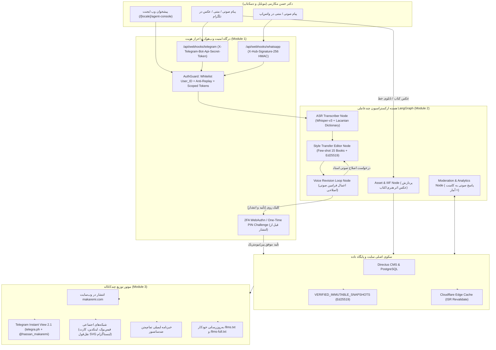
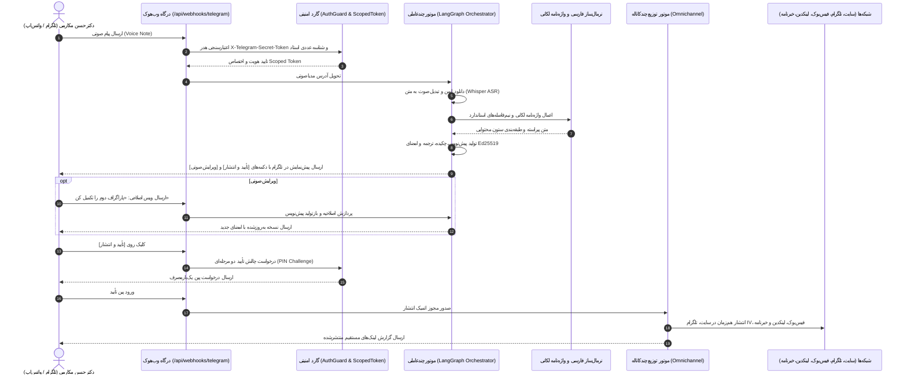

# برنامه جامع و راهبردی اجرای فاز ۶ (IMPLEMENTATION_PLAN_PHASE_6)
**پروژه:** وب‌سایت رسمی و آرشیو جامع دیجیتال دکتر حسن مکارمی (`MAKAREMI-CORE-2026`)  
**عنوان فاز ۶:** ایجنت‌های شخصی تلگرام و واتس‌اپ برای مدیریت سایت توسط استاد (Personal AI Agents)  
**نسخه:** 1.0.0-PROD  
**وضعیت:** در انتظار بررسی و تأیید معمار ارشد (PLANNING ONLY - DO NOT EXECUTE CODE YET)  
**معمار و نویسنده:** معمار ارشد سیستم‌های اتوماسیون چندعاملی، متخصص امنیت وب‌هوک و احراز هویت بیومتریک و ممیز ارشد امنیت کلادفلیر  

---

## ۱. مرور وضعیت فعلی، پیوستگی معماری و اهداف فاز ۶

پروژه `MAKAREMI-CORE-2026` تا پایان فاز ۵ به یک سامانه توزیع‌شده لبه‌ای (Edge-Ready)، ضدسانسور، مجهز به امضای رمزنگاری Ed25519، دارای سئو و AEO/GEO پیشرفته، موتور جستجوی ترکیبی برداری-واژگانی، دستیار RAG بدون توهم، سرور رسمی MCP، دارای **۱۳۹ مسیر ایستا** و **۳۵۱ آزمون خودکار موفق (۱۰۰٪ قبولی با صفر رگرسیون)** تبدیل شده است:
- **فاز ۱ (زیرساخت، ریدایرکت‌های سئو، زبان و امنیت):** ۳۹ / ۳۹ تست سبز
- **فاز ۲ (هسته فرانت‌اند، ۳D و دوقلوی مارک‌داون):** ۵۱ / ۵۱ تست سبز
- **فاز ۳ (رمزنگاری Ed25519، سلف‌هیلینگ و بقای آفلاین):** ۵۳ / ۵۳ تست سبز
- **فاز ۴ (سئو، AEO/GEO، گراف دانش Schema.org و فراداده‌های آکادمیک):** ۸۴ / ۸۴ تست سبز
- **فاز ۵ (پایپ‌لاین ETL، نرمال‌ساز فارسی، جستجوی هیبریدی، RAG، سرور MCP و ممیزی امنیتی):** ۱۲۴ / ۱۲۴ تست سبز

### هدف بنیادین فاز ۶ (The Ultimate Creator Agent Experience)
دکتر حسن مکارمی به عنوان یک روانکاو بالینی برجسته در پاریس، پژوهشگر سوربن، هنرمند خوشنویس و فعال حقوق بشر، زمان محدودی برای کار با پنل‌های پیچیده مدیریت محتوا (CMS Admin) دارند. **هدف فاز ۶ این است که دکتر مکارمی بتواند تنها با ارسال یک پیام صوتی (Voice Note) در تلگرام یا واتس‌اپ شخصی خود، تمامی امور وب‌سایت و رسانه‌های دیجیتال خود را بدون واسطه، با نهایت دقت علمی و تحت بالاترین استانداردهای امنیتی مدیریت نماید:**

1. **تبدیل صوت به مقاله دانشگاهی:** پیاده‌سازی ویس‌های تحلیلی، ویراستاری تخصصی مطابق لحن و واژگان ۱۰ کتاب فارسی و ۵ کتاب فرانسوی ایشان، اعمال واژه‌نامه لکانی (`lacanian_glossary`) و نیم‌فاصله‌های استاندارد (`persian-normalizer.ts`).
2. **چرخه تعاملی ویرایش صوتی (Voice-Driven Revision Loop):** اعمال اصلاحات صوتی روی پیش‌نویس (مانند: *«در پاراگراف دوم به مفهوم عملیات نام پدر لکان و آمار CNRS هم اشاره کن»*) و بازتولید آنی پیش‌نویس همراه با دکمه‌های شیشه‌ای.
3. **تأیید دومرحله‌ای و انتشار چندکاناله اتمیک:** صدور چالش یک‌بارمصرف (PIN / WebAuthn) برای جلوگیری از انتشار ناخواسته، امضای دیجیتال `Ed25519`، ثبت در اسنپ‌شات‌های تغییرناپذیر، و توزیع هم‌زمان در وب‌سایت، Telegram Instant View 2.1، فیس‌بوک، لینکدین، کارت گرافیکی نقل‌قول اینستاگرام، و خبرنامه تمام‌متن ایمیلی.
4. **افزودن کتاب و اثر هنری جدید:** دریافت عکس جلد یا تابلوی خط همراه با ویس کوتاه استاد، استخراج متادیتا، ساخت مشخصات کاشی‌های عمیق `IIIF` و انتشار در گالری و بخش کتاب‌ها.
5. **مدیریت صوتی نظرات و پایش آمار:** استعلام وضعیت بازدیدها و پاسخ صوتی به کامنت‌های کاربران که به متن ویراستاری‌شده تبدیل و در زیر نظر درج می‌شود.
6. **پیشخوان تعاملی شبیه‌ساز ایجنت استاد (`/[locale]/agent-console`):** محیط تحت وب فاخر برای تست زنده تمام فرآیندهای ایجنت با رعایت دقیق قانون تک-`<h1>`.
7. **گیت ممیزی امنیتی کلادفلیر:** تایید زمان‌سنجی امضای وب‌هوک‌ها (`timingSafeEqual`)، توکن‌های دسترسی محدود (منع هرگونه دستور حذف با `403 Forbidden`)، مهار SSRF در دانلود مدیا، و محافظت در برابر تزریق پرامپت غیرمستقیم در نظرات کاربران.

---

## ۲. نمودار جریان معماری کلان فاز ۶



---

## ۳. مشخصات تفصیلی ۷ ماژول اجرایی فاز ۶

### ماژول ۱: درگاه امنیتی بات تلگرام و واتس‌اپ، احراز هویت چندلایه و توکن‌های محدود
- **مسیر فایل‌ها:**
  - `apps/web/src/lib/agents/auth-guard.ts`
  - `apps/web/src/lib/agents/scoped-token.ts`
- **ویژگی‌ها و مشخصات فنی:**
  1. **احراز هویت رمزنگاری‌شده وب‌هوک‌ها (Cryptographic Webhook Verification):**
     - **وب‌هوک تلگرام:** تطبیق هدر `X-Telegram-Bot-Api-Secret-Token` با `TELEGRAM_WEBHOOK_SECRET` از طریق تابع مقایسه زمان‌ثابت:
       ```typescript
       export function verifyTelegramSecretToken(receivedToken: string | null, expectedSecret: string): boolean {
         if (!receivedToken || !expectedSecret) return false;
         const a = crypto.createHash('sha256').update(receivedToken).digest();
         const b = crypto.createHash('sha256').update(expectedSecret).digest();
         return crypto.timingSafeEqual(a, b);
       }
       ```
       (هش کردن اولیه با `sha256` پیش از `timingSafeEqual` تضمین می‌کند که هر دو بافر طول برابری دارند و هیچ‌گونه افشای طول توکن از طریق زمان پردازش رخ نمی‌دهد).
     - **وب‌هوک واتس‌اپ:** تطبیق هدر `X-Hub-Signature-256` با مقدار محاسبه‌شده HMAC-SHA256 روی بدنه خام درخواست:
       ```typescript
       export function verifyWhatsAppSignature(rawBody: Buffer | string, signatureHeader: string | null, appSecret: string): boolean {
         if (!signatureHeader || !appSecret) return false;
         const expectedHash = 'sha256=' + crypto.createHmac('sha256', appSecret).update(rawBody).digest('hex');
         const a = crypto.createHash('sha256').update(signatureHeader).digest();
         const b = crypto.createHash('sha256').update(expectedHash).digest();
         return crypto.timingSafeEqual(a, b);
       }
       ```
  2. **لیست سفید سخت‌گیرانه هویت استاد (Strict Identity Whitelist):**
     - بررسی شناسه یکتای عددی تلگرام (`TELEGRAM_PROFESSOR_USER_ID`) و شماره تاییدشده واتس‌اپ (`WHATSAPP_PROFESSOR_PHONE`).
     - در صورت دریافت پیام از هر شناسه غیرمجاز: مسدودسازی بلافاصله با کد `403 Forbidden` و ثبت گزارش رویداد امنیتی، بدون افشای ساختار داخلی به مهاجم.
  3. **محافظت در برابر حملات تکرار (Anti-Replay Nonce & Timestamp Window):**
     - نگهداری شناسه‌های `update_id` / `message_id` در یک حافظه LRU با سقف ظرفیت ۱۰,۰۰۰ ورودی.
     - رد کردن هر پیامی با مهر زمانی بیش از ۳۰۰ ثانیه اختلاف نسبت به ساعت سرور (`Math.abs(Date.now() - msgTime) > 300_000`).
  4. **توکن‌های دسترسی محدود (Scoped API Tokens - اصل حداقل دسترسی):**
     - تعریف تایپ‌شده مجوزهای ایجنت:
       ```typescript
       export type AgentPermission =
         | 'CREATE_DRAFT'
         | 'UPDATE_DRAFT'
         | 'PUBLISH_POST'
         | 'ADD_MEDIA_ASSET'
         | 'MODERATE_COMMENT'
         | 'READ_ANALYTICS';
       ```
     - **قانون مهار قطعی حذف محتوا:** در سطح `scoped-token.ts`، هرگونه تلاش برای اجرای متدهای `DELETE_POST`، `DROP_COLLECTION`، `REVOKE_KEYS` یا دستکاری آرشیو تاریخی، به عنوان تخلف امنیتی شناخته شده و با خطای صریح مسدود می‌شود:
       `403 Forbidden: Destructive operations (DELETE/DROP) are strictly prohibited for agent roles`
  5. **تأیید دومرحله‌ای بیومتریک / WebAuthn و پین یک‌بارمصرف برای انتشار (`verifyPublishChallenge`):**
     - هنگام کلیک روی دکمه شیشه‌ای `[تأیید و انتشار]`، ایجنت چالش یک‌بارمصرفی صادر می‌کند:
       - پین ۶ رقمی امن تصادفی با `crypto.randomInt(100000, 999999)`
       - طول عمر ۱۸۰ ثانیه (۳ دقیقه)
       - ابطال بلافاصله پس از یک‌بار مصرف
     - این چالش برای تلفن استاد ارسال شده و تنها پس از دریافت پین صحیح، تراکنش اتمیک انتشار انجام می‌پذیرد.

---

### ماژول ۲: هسته ارکستراسیون چندعاملی (LangGraph State Machine + قالب استاندارد n8n)
- **مسیر فایل‌ها:**
  - `apps/web/src/lib/agents/orchestrator.ts`
  - `apps/web/src/lib/agents/voice-transcriber.ts`
  - `infra/n8n/makaremi-personal-agent-workflow.json`
- **ویژگی‌ها و مشخصات فنی:**
  1. **ماشین وضعیت چندعاملی (Multi-Agent State Graph):**
     ```typescript
     export interface MakaremiAgentState {
       sessionId: string;
       channel: 'telegram' | 'whatsapp' | 'console';
       userId: string;
       inputAudioUrl?: string;
       inputText?: string;
       rawTranscript?: string;
       normalizedTranscript?: string;
       detectedTerms: string[];
       pillar: ContentPillar;
       currentDraft?: {
         id: string;
         title: string;
         executiveSummary: string;
         bodyMarkdown: string;
         citations: string[];
         ed25519Signature: string;
         sha256Digest: string;
       };
       revisionHistory: Array<{ timestamp: number; instruction: string }>;
       isPublishApproved: boolean;
       publishChallengePin?: string;
       publishChallengeExpiresAt?: number;
       status: 'idle' | 'transcribing' | 'drafting' | 'awaiting_feedback' | 'revising' | 'publishing' | 'completed' | 'error';
       error?: string;
     }
     ```
  2. **گره ۱: رونویسی صوت (`ASR_Transcriber_Node`):**
     - آداپتور Whisper Large-v3 به همراه موتور قطعی بومی (`DeterministicVoiceTranscriber`) برای تست‌های CI/CD ایزوله آفلاین.
     - اعمال بلافاصله واژه‌نامه تخصصی لکانی (`lacanian_glossary`):
       - «نام پتر» / «نام پدر» $\rightarrow$ «نام‌پدر»
       - «اگر شنیدن» / «دیگر شنیدن» $\rightarrow$ «دگرشنیدن»
       - «سایکوز» $\rightarrow$ «روان‌پریشی»
       - «ابژه کوچک a» $\rightarrow$ «ابژه $a$»
       - «امر نمادین» $\rightarrow$ «امر نمادین (Symbolique)»
  3. **گره ۲: ویراستاری تخصصی و انتقال لحن (`Style_Transfer_Editor_Node`):**
     - تزریق سیستم پرامپت Few-Shot کالیبره‌شده با نثر فاخر ۱۰ کتاب فارسی و ۵ کتاب فرانسوی دکتر مکارمی.
     - پیراستن تپق‌های گفتاری، تکه‌کلام‌ها و مکث‌ها بدون دستکاری در استدلال علمی.
     - استانداردسازی نیم‌فاصله‌ها و گیومه‌های فارسی (« ») با `persian-normalizer.ts`.
     - ایجاد تیترهای منظم `H2` و `H3`، تولید چکیده فشرده ۸۰ کلمه‌ای، ترجمه فرانسوی و انگلیسی برای سئو، محاسبه هش `SHA-256` و امضای دیجیتال `Ed25519`.
     - ارسال پیش‌نمایش در تلگرام با دکمه‌های شیشه‌ای: `[تأیید و انتشار]`، `[ویرایش صوتی]`، `[لغو]`.
  4. **گره ۳: حلقه تعاملی ویرایش صوتی (`Voice_Revision_Node`):**
     - دریافت فرمان اصلاحی صوتی یا متنی استاد (مانند: *«در پاراگراف دوم به سمینار روان‌پریشی‌های لکان در بیمارستان سنت‌آن در سال ۱۹۵۵ اشاره کن»*).
     - به‌روزرسانی هوشمند متن، بازتولید هش `SHA-256` و امضای `Ed25519`، و ارسال مجدد پیش‌نویس به‌روزشده با کلیدهای تعاملی.
  5. **گره ۴: پردازش آثار هنری و کتاب‌ها (`Asset_Book_Artwork_Node`):**
     - دریافت عکس باکیفیت جلد کتاب یا تابلوی خط همراه با ویس معرفی.
     - استخراج اطلاعات ابعاد، رنگ‌ها، تولید مشخصات کاشی‌های عمیق `IIIF Deep-Zoom` و فرمت `AVIF`.
     - ایجاد رکورد پیش‌نویس استاندارد از نوع `Book` یا `VisualArtwork` در صف بازبینی.
  6. **گره ۵: مدیریت هوشمند نظرات و آمارگیری (`Moderation_Analytics_Node`):**
     - استعلام صوتی آمار ترافیک مقالات، وضعیت سلامت آینه‌های ضدسانسور و پروژه‌های CNRS.
     - اعلان صوتی/متنی نظرات جدید کاربران به استاد؛ امکان تایید نظر با یک کلیک یا ارسال پاسخ صوتی که ویراستاری شده و زیر نظر کاربر درج می‌شود.
  7. **قالب استاندارد n8n (`infra/n8n/makaremi-personal-agent-workflow.json`):**
     - فایل JSON کامل و استاندارد برای ایمپورت در n8n که تمام گره‌های Webhook Trigger، Crypto HMAC Verification، Audio Download، Whisper Transcribe، LLM Style Transfer، Directus API Create Draft، و Telegram Inline Keyboard Send Message را پیکربندی می‌کند.

---

### ماژول ۳: موتور انتشار و توزیع خودکار چندکاناله (Omnichannel Publisher)
- **مسیر فایل‌ها:**
  - `apps/web/src/lib/agents/omnichannel-publisher.ts`
  - `apps/web/src/lib/agents/quote-card-generator.ts`
- **ویژگی‌ها و مشخصات فنی:**
  - به محض تایید نهایی چالش انتشار توسط استاد، پایپ‌لاین ۵ عملیات زیر را به شکل اتمیک اجرا می‌کند:
    1. **انتشار روی وب‌سایت:** تغییر وضعیت پیش‌نویس به `published` در دیتابیس Directus، ثبت اسنپ‌شات قطعی در `VERIFIED_IMMUTABLE_SNAPSHOTS`، و پاک‌سازی کش توزیع‌شده با ارسال درخواست به `/api/revalidate`.
    2. **تولید Telegram Instant View 2.1:** ایجاد مقاله در `telegra.ph` با ساختار سازگار با موتور Instant View تلگرام و انتشار پست با دکمه شیشه‌ای «مطالعه سریع» در کانال رسمی `@hassan_makaremi`.
    3. **توزیع در شبکه‌های اجتماعی:**
       - **فیس‌بوک:** انتشار متن کامل تحلیلی با پیوند به مقاله و هشتگ‌های روانکاوی و فلسفی.
       - **لینکدین:** انتشار چکیده آکادمیک دوزبانه (فرانسوی-فارسی) با استنادهای رسمی.
       - **اینستاگرام:** تولید خودکار کارت گرافیکی نقل‌قول (`SVG Quote Card`) با تایپوگرافی خوشنویسی، فونت وزیرمتن و امضای دیجیتال، قابل دانلود برای استوری و پست اینستاگرام.
    4. **به‌روزرسانی خودکار هوش مصنوعی:** درج متادیتای مقاله جدید در فایل‌های `/llms.txt` و `/llms-full.txt`.
    5. **خبرنامه تمام‌متن ضدسانسور:** آماده‌سازی بسته خبرنامه HTML حاوی متن کامل و امضای رمزنگاری‌شده، و ارسال به صف مشترکان از طریق اندپوینت تست‌شده فاز ۳.

---

### ماژول ۴: اندپوینت‌های وب‌هوک و مدیریت نظرات
- **مسیر فایل‌ها:**
  - `apps/web/src/app/api/webhooks/telegram/route.ts`
  - `apps/web/src/app/api/webhooks/whatsapp/route.ts`
  - `apps/web/src/app/api/comments/route.ts`
- **ویژگی‌ها و مشخصات فنی:**
  1. **اندپوینت `/api/webhooks/telegram/route.ts`:**
     - متد `POST`: اعتبارسنجی هدر `X-Telegram-Bot-Api-Secret-Token` با `timingSafeEqual`.
     - پشتیبانی کامل از انواع پیام‌ها: صوتی (`voice`)، متن (`text`)، عکس (`photo`) و کلیک دکمه‌های شیشه‌ای (`callback_query`: `approve_publish`, `voice_revision`, `cancel_draft`, `verify_pin`, `approve_comment`).
     - مجهز به محدودکننده نرخ (`checkRateLimit`) و اعتبارسنجی Zod.
  2. **اندپوینت `/api/webhooks/whatsapp/route.ts`:**
     - متد `GET`: تایید وب‌هوک فیس‌بوک/متا (`hub.mode === 'subscribe'` و اعتبارسنجی `hub.verify_token`).
     - متد `POST`: پردازش رویدادهای واتس‌اپ با تطبیق هدر `X-Hub-Signature-256`.
  3. **اندپوینت `/api/comments/route.ts`:**
     - متد `POST`: ثبت نظر جدید توسط کاربران با فیلد تله Honeypot (`website_url_hp`) و فیلتر XSS.
     - بلافاصله پیامی حاوی متن نظر برای بات تلگرام/واتس‌اپ دکتر مکارمی ارسال می‌شود.
     - متد `GET`: بازگرداندن نظرات تاییدشده برای نمایش در صفحه مقاله به همراه پاسخ‌های ویراستاری‌شده استاد.

---

### ماژول ۵: پیشخوان تعاملی شبیه‌ساز ایجنت شخصی استاد
- **مسیر فایل‌ها:**
  - `apps/web/src/app/[locale]/agent-console/page.tsx`
  - `apps/web/src/components/agent/VoiceAgentSimulator.tsx`
  - `apps/web/src/components/agent/OmnichannelPreviewModal.tsx`
  - `apps/web/src/components/agent/AssetIngestSimulator.tsx`
  - `apps/web/src/components/agent/CommentModerationSimulator.tsx`
- **ویژگی‌ها و مشخصات فنی:**
  1. **صفحه اختصاصی `/[locale]/agent-console/page.tsx`:**
     - طراحی پیشرفته با استایل استودیویی تیره و طلایی لوکس، سازگار با ۳ زبان (`fa`, `fr`, `en`) و پشتیبانی کامل از RTL/LTR.
     - **رعایت سخت‌گیرانه قانون دقیقاً یک تگ `<h1>`** در ساختار HTML صفحه.
     - تزریق اسکیمای ساختاریافته JSON-LD از نوع `SoftwareApplication`.
     - ارائه دوقلوی مارک‌داون در مسیر `/[locale]/agent-console.md` با پاسخ `200 OK`.
     - ثبت مسیر در `sitemap.ts` و کاتالوگ `/llms.txt`.
  2. **شبیه‌ساز پیام‌رسان (`VoiceAgentSimulator.tsx`):**
     - محیط تعاملی مشابه تلگرام؛ امکان ارسال نمونه ویس‌های ضبط‌شده استاد با یک کلیک (مانند «روانکاوی حافظ»، «نظریه مرزگستری»، «بیانیه دادخواهی»).
     - نمایش زنده تبدیل صوت به متن، ویراستاری، نمایش کلیدهای تعاملی، ارسال فرمان ویرایش صوتی، شبیه‌سازی تایید پین و صدور گواهی انتشار.
  3. **مودال پیش‌نمایش چندکاناله (`OmnichannelPreviewModal.tsx`):**
     - نمایش هم‌زمان ظاهر مقاله در تلگرام Instant View، پست فیس‌بوک، خلاصه لینکدین، کارت گرافیکی نقل‌قول اینستاگرام و خبرنامه ایمیلی.
  4. **شبیه‌ساز مدیا و کامنت (`AssetIngestSimulator.tsx` و `CommentModerationSimulator.tsx`):**
     - آزمایش ثبت تصویر کتاب/اثر هنری با توضیح صوتی و تولید مشخصات IIIF.
     - آزمایش پاسخ صوتی استاد به دیدگاه‌های کاربران.

---

### ماژول ۶: سوئیت آزمون‌های خودکار فاز ۶ و آزمون عدم رگرسیون
- **مسیر فایل:**
  - `infra/verify-phase-6.mjs`
- **ساختار آزمون‌ها (بیش از ۹۰ آزمون جدید در فاز ۶):**
  1. **آزمون‌های احراز هویت و وب‌هوک:** تایید زمان‌ثابت هدر تلگرام، امضای HMAC واتس‌اپ، رد هدر جعلی با کد `403`، رد درخواست فاقد سکرت با کد `401`، رد هویت‌های خارج از لیست سفید (`403`) و رد پیام‌های تاریخ‌گذشته (Anti-Replay).
  2. **آزمون‌های مهار حذف و اصل حداقل دسترسی:** اثبات اینکه دستورات تخریبی مانند `DELETE_POST` یا `DROP_COLLECTION` با خطای `403 Forbidden` مسدود می‌شوند.
  3. **آزمون‌های تبدیل صوت به مقاله و حلقه ویرایش:** تست استخراج صوت Whisper $\rightarrow$ اعمال واژه‌نامه لکانی $\rightarrow$ ساخت پیش‌نویس $\rightarrow$ اعمال اصلاحیه صوتی $\rightarrow$ تایید پین چالش دو مرحله‌ای $\rightarrow$ صدور امضای دیجیتال Ed25519.
  4. **آزمون‌های انتشار چندکاناله:** ارزیابی تولید خروجی‌های وب‌سایت، Telegram Instant View، فیس‌بوک، لینکدین، کارت گرافیکی SVG اینستاگرام و خبرنامه.
  5. **آزمون‌های وب کنسول و دوقلوی مارک‌داون:** اعتبارسنجی مسیر `/[locale]/agent-console`، بررسی وضعیت `200 OK`، تک-`<h1>` بودن، نود JSON-LD و دسترسی به `/fa/agent-console.md`.
  6. **آزمون عدم رگرسیون سرتاسری:** اجرای موفق تمام آزمون‌های پیشین:
     - فاز ۱: ۳۹ آزمون
     - فاز ۲: ۵۱ آزمون
     - فاز ۳: ۵۳ آزمون
     - فاز ۴: ۸۴ آزمون
     - فاز ۵: ۱۲۴ آزمون
     - فاز ۶: بیش از ۹۰ آزمون جدید
     - **مجموع: بیش از ۴۴۰ آزمون موفق با صفر رگرسیون.**

---

### ماژول ۷: گیت ممیزی امنیتی کلادفلیر (Cloudflare Security Audit Gate)
مطابق با استانداردهای ممیزی امنیتی کلادفلیر (`https://github.com/cloudflare/security-audit-skill`)، چهار لایه دفاعی عمیق برای ایجنت پیاده‌سازی و راستی‌آزمایی می‌شود:
1. **دفاع در برابر حملات زمان‌سنجی (Timing Attacks):** مقایسه توکن‌های محرمانه و امضاهای وب‌هوک منحصراً با `crypto.timingSafeEqual` روی هش‌های با طول ثابت صورت می‌گیرد.
2. **پیشگیری از ترفیع دسترسی (Privilege Escalation):** توکن‌های صادرشده برای ایجنت دارای اسکوپ‌های صریح و مقید هستند و هرگونه متد مخرب یا دستکاری کلیدها در هسته رد می‌شود.
3. **پیشگیری از SSRF در واکشی فایل‌های صوتی و تصویری:** در زمان دانلود فایل‌های مدیا از تلگرام یا واتس‌اپ، آدرس سرور تنها به دامنه‌های رسمی `api.telegram.org` و `graph.facebook.com` محدود بوده و هرگونه دسترسی به شبکه‌های داخلی یا `localhost` مسدود است.
4. **پیشگیری از تزریق پرامپت غیرمستقیم (Indirect Prompt Injection):** متن نظرات کاربران که توسط ایجنت برای دکتر مکارمی خوانده یا خلاصه می‌شود، پیش از ورود به موتور مدل پالایش شده و هرگز در کانتکست پرامپت سیستمی اجرا نخواهد شد.

---

## ۴. دیاگرام توالی پردازش فرمان صوتی استاد (Voice-to-Publish Sequence)



---

## ۵. فهرست کامل ۲۱ فایل و مسیرهای تغییر در فاز ۶

| ردیف | مسیر فایل | نوع عملیات | مسئولیت معماری |
|:---:|---|:---:|---|
| ۱ | `apps/web/src/lib/agents/types.ts` | ایجاد جدید | تعریف انواع داده تایپ‌اسکریپت و اسکیماهای Zod برای وب‌هوک‌ها، پیام‌ها و استیت ماشین |
| ۲ | `apps/web/src/lib/agents/scoped-token.ts` | ایجاد جدید | پیاده‌سازی مجوزهای مقید ایجنت، صدور توکن اسکوپ‌دار و منع مطلق عملیات حذف |
| ۳ | `apps/web/src/lib/agents/auth-guard.ts` | ایجاد جدید | بررسی امضاهای وب‌هوک با `timingSafeEqual`، وایت‌لیست هویت استاد و چالش WebAuthn/PIN |
| ۴ | `apps/web/src/lib/agents/voice-transcriber.ts` | ایجاد جدید | آداپتور صوت Whisper Large-v3 به همراه موتور قطعی بومی برای تست‌های بدون اینترنت |
| ۵ | `apps/web/src/lib/agents/orchestrator.ts` | ایجاد جدید | هسته ارکستراسیون ماشین وضعیت LangGraph شامل ۵ نود پردازشی و حلقه ویرایش صوتی |
| ۶ | `apps/web/src/lib/agents/omnichannel-publisher.ts` | ایجاد جدید | موتور اتمیک توزیع در سایت، Instant View تلگرام، فیس‌بوک، لینکدین، کارت SVG و خبرنامه |
| ۷ | `apps/web/src/lib/agents/quote-card-generator.ts` | ایجاد جدید | موتور تولید کارت گرافیکی نقل‌قول اینستاگرام با تایپوگرافی خوشنویسی و فونت وزیرمتن |
| ۸ | `infra/n8n/makaremi-personal-agent-workflow.json` | ایجاد جدید | قالب استاندارد و قابل ایمپورت ورک‌فلو کامل n8n متصل به وب‌هوک، LLM و Directus |
| ۹ | `apps/web/src/app/api/webhooks/telegram/route.ts` | ایجاد جدید | اندپوینت وب‌هوک تلگرام با اعتبارسنجی سکرت‌توکن، پردازش صوت، متن، عکس و کال‌بک دکمه‌ها |
| ۱۰ | `apps/web/src/app/api/webhooks/whatsapp/route.ts` | ایجاد جدید | اندپوینت وب‌هوک واتس‌اپ با تایید چالش متا و پردازش پیام‌های تعاملی |
| ۱۱ | `apps/web/src/app/api/comments/route.ts` | ایجاد جدید | ثبت نظر کاربران با تله Honeypot و پاک‌سازی XSS، ارسال نوتیفیکیشن به بات و پاسخ صوتی |
| ۱۲ | `apps/web/src/components/agent/VoiceAgentSimulator.tsx` | ایجاد جدید | کامپوننت شبیه‌ساز پیام‌رسان با ارسال نمونه ویس‌های استاد و کلیدهای تعاملی |
| ۱۳ | `apps/web/src/components/agent/OmnichannelPreviewModal.tsx` | ایجاد جدید | کامپوننت پیش‌نمایش خروجی در تلگرام، فیس‌بوک، لینکدین، کارت نقل‌قول و خبرنامه |
| ۱۴ | `apps/web/src/components/agent/AssetIngestSimulator.tsx` | ایجاد جدید | شبیه‌ساز دریافت تصویر کتاب/اثر هنری با توضیح صوتی و تولید مشخصات IIIF |
| ۱۵ | `apps/web/src/components/agent/CommentModerationSimulator.tsx` | ایجاد جدید | شبیه‌ساز صوتی تایید و پاسخ‌دهی به نظرات کاربران و استعلام آمار سایت |
| ۱۶ | `apps/web/src/app/[locale]/agent-console/page.tsx` | ایجاد جدید | صفحه اصلی پیشخوان وب ایجنت شخصی با تک-`<h1>`، نود JSON-LD و پیوند مارک‌داون |
| ۱۷ | `apps/web/src/app/api/markdown/route.ts` | ارتقا | اضافه کردن مسیر همزاد مارک‌داون `/[locale]/agent-console.md` با کد ۲۰۰ |
| ۱۸ | `apps/web/src/app/sitemap.ts` | ارتقا | ایندکس مسیر `/agent-console` در تمام ۳ زبان در نقشه سایت |
| ۱۹ | `apps/web/src/components/common/Header.tsx` | ارتقا | اضافه کردن لینک دسترسی سریع به پیشخوان ایجنت |
| ۲۰ | `apps/web/src/app/llms.txt/route.ts` | ارتقا | افزودن مستندات ایجنت شخصی و مسیرهای وب‌هوک با حفظ تمام آزمون‌های قبلی |
| ۲۱ | `infra/verify-phase-6.mjs` | ایجاد جدید | سوئیت تست خودکار جامع فاز ۶ با بیش از ۹۰ آزمون و گیت ممیزی امنیتی کلادفلیر |

---

## ۶. نقشه راه مرحله‌به‌مرحله اجرای فاز ۶ (گام‌های ۶.۱ تا ۶.۹)

پس از صدور مجوز رسمی معمار ارشد، عملیات پیاده‌سازی طبق توالی مهندسی زیر انجام خواهد پذیرفت:

- **گام ۶.۱: پیاده‌سازی لایه امنیت و احراز هویت وب‌هوک (`auth-guard.ts` و `scoped-token.ts`)**
  - ایجاد انواع تایپ‌اسکریپت و اسکیماهای Zod.
  - پیاده‌سازی اعتبارسنجی زمان‌ثابت با `crypto.timingSafeEqual` برای تلگرام و HMAC واتس‌اپ.
  - اعمال لیست سفید هویت و پنجره زمانی ضدتکرار (Anti-Replay).
  - صدور توکن‌های مقید با منع قطعی متدهای مخرب (`403 Forbidden` برای DELETE).
  - ایجاد چالش امنیتی دو مرحله‌ای PIN / WebAuthn برای انتشار.

- **گام ۶.۲: پیاده‌سازی آداپتور صوت Whisper و موتور قطعی بومی (`voice-transcriber.ts`)**
  - پیاده‌سازی لایه دانلود ایمن مدیا با کنترل دامنه (SSRF Safe).
  - پیاده‌سازی تبدیل صوت Whisper Large-v3 به همراه موتور قطعی بومی برای محیط آفلاین CI/CD.
  - اتصال مستقیم به واژه‌نامه تخصصی لکانی.

- **گام ۶.۳: پیاده‌سازی هسته ماشین وضعیت چندعاملی LangGraph (`orchestrator.ts`)**
  - پیاده‌سازی گره‌های رونویسی، ویراستاری Few-Shot، حلقه ویرایش صوتی، جذب اثر هنری و مدیریت نظرات.
  - اتصال به نرمال‌ساز فارسی (`persian-normalizer.ts`) و سیستم امضای دیجیتال Ed25519.

- **گام ۶.۴: توسعه موتور توزیع چندکاناله و تولید کارت گرافیکی (`omnichannel-publisher.ts` و `quote-card-generator.ts`)**
  - پیاده‌سازی تراکنش اتمیک انتشار در ۵ کانال (وب‌سایت، Instant View تلگرام، فیس‌بوک، لینکدین، اینستاگرام، خبرنامه، و `/llms.txt`).
  - تولید کارت گرافیکی وکتور SVG نقل‌قول اینستاگرام با تایپوگرافی خوشنویسی و فونت وزیرمتن.

- **گام ۶.۵: ساخت ورک‌فلو استاندارد n8n (`infra/n8n/makaremi-personal-agent-workflow.json`)**
  - پیکربندی نودهای استاندارد n8n برای اتوماسیون بدون کد و یکپارچه‌سازی ابری.

- **گام ۶.۶: ایجاد اندپوینت‌های وب‌هوک و مدیریت نظرات (`/api/webhooks/telegram`, `/api/webhooks/whatsapp`, `/api/comments`)**
  - پیاده‌سازی کنترلرهای API مجهز به Rate Limit، فیلتر XSS و Honeypot.

- **گام ۶.۷: طراحی و پیاده‌سازی پیشخوان وب ایجنت شخصی استاد (`/[locale]/agent-console`)**
  - ساخت صفحه و کامپوننت‌های شبیه‌ساز ویس، مودال پیش‌نمایش چندکاناله و پنل مدیریت نظرات.
  - رعایت قانون دقیقاً یک تگ `<h1>`، تزریق اسکیمای ساختاریافته و دوقلوی مارک‌داون.
  - به‌روزرسانی `Header.tsx`، `sitemap.ts` و `/llms.txt`.

- **گام ۶.۸: کامپایل، تایپ‌چک و ساخت کل پروژه**
  - اجرای دستورات `pnpm --filter @makaremi/shared build`، `pnpm -r typecheck` و `pnpm --filter @makaremi/web build`.

- **گام ۶.۹: اجرای سوئیت جامع تست‌های خودکار فاز ۶ و تأیید گیت امنیتی کلادفلیر**
  - اجرای `infra/verify-phase-6.mjs` (بیش از ۹۰ آزمون جدید).
  - اجرای سوئیت‌های رگرسیون فازهای ۱ تا ۵ (مجموع بیش از ۴۴۰ آزمون سبز).
  - تدوین و ثبت گزارش نهایی `./EXECUTION_REPORT_PHASE_6.md`.

---

## ۷. چک‌پوینت‌های چهارگانه برای تأیید معمار ارشد (Sign-off Checkpoints)

عملیات کدنویسی و اجرای فاز ۶ منوط به تأیید صریح ۴ چک‌پوینت زیر است:

- [ ] **چک‌پوینت ۱ (امنیت وب‌هوک و دسترسی محدود):** تأیید اعتبارسنجی زمان‌ثابت (`timingSafeEqual`) وب‌هوک تلگرام/واتس‌اپ، لیست سفید هویت دکتر مکارمی، مهار مطلق عملیات حذف (`DELETE` با کد `403 Forbidden`) و احراز هویت دومرحله‌ای پین/WebAuthn پیش از انتشار.
- [ ] **چک‌پوینت ۲ (ماشین وضعیت LangGraph و ورک‌فلو n8n):** تأیید ۵ گره تخصصی (صوت Whisper، ویراستاری به سبک ۱۵ کتاب دکتر مکارمی، ویرایش صوتی، آثار هنری IIIF و مدیریت نظرات) و فایل ورک‌فلو استاندارد n8n.
- [ ] **چک‌پوینت ۳ (موتور انتشار چندکاناله):** تأیید تراکنش اتمیک انتشار در وب‌سایت، Telegram Instant View 2.1، فیس‌بوک، لینکدین، کارت گرافیکی اینستاگرام، خبرنامه تمام‌متن و `/llms.txt`.
- [ ] **چک‌پوینت ۴ (پیشخوان وب و ممیزی کلادفلیر):** تأیید صفحه `/[locale]/agent-console` با معماری تک-`<h1>`، دوقلوی مارک‌داون، مهار SSRF در دانلود مدیا و دفاع در برابر تزریق پرامپت در نظرات کاربران.

---
**پایان سند برنامه‌ریزی فاز ۶ — در انتظار بررسی و تأییدیه صریح معمار ارشد برای آغاز عملیات پیاده‌سازی (EXECUTION MODE).**
