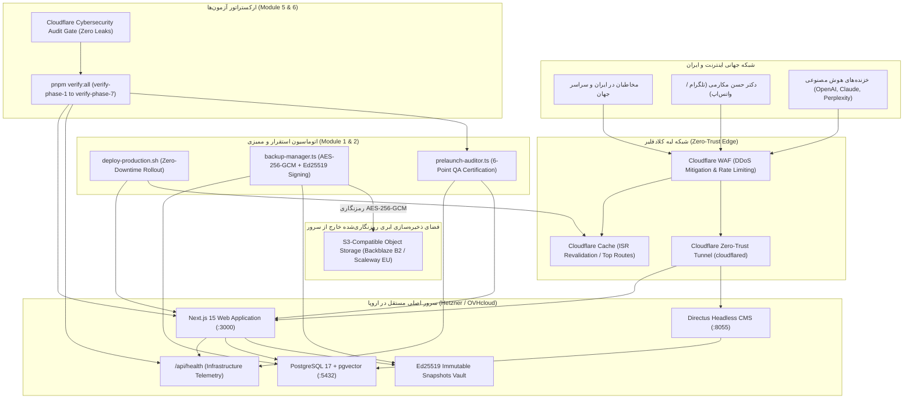

# برنامه جامع و راهبردی اجرای فاز ۷ و نهایی (IMPLEMENTATION_PLAN_PHASE_7)
**پروژه:** وب‌سایت رسمی و آرشیو جامع دیجیتال دکتر حسن مکارمی (`MAKAREMI-CORE-2026`)  
**عنوان فاز ۷:** نقشه راه اجرایی، اتوماسیون استقرار ابری، پایش سلامت، چک‌لیست کنترل کیفیت و ممیزی نهایی پروداکشن (Implementation Roadmap, Offsite Backup & Pre-Launch QA Gate)  
**نسخه:** 1.0.0-PROD (Final Release Candidate)  
**وضعیت:** در انتظار بررسی و تأیید معمار ارشد (PLANNING ONLY - DO NOT EXECUTE CODE YET)  
**معمار و نویسنده:** معمار ارشد استقرار ابری و قابلیت اطمینان سایت (Principal DevOps & SRE Architect)، مدیر کنترل کیفیت پیش از راه‌اندازی (Pre-Launch QA Lead) و ممیز ارشد امنیت سایبری کلادفلیر  

---

## ۱. مرور وضعیت فعلی، پیوستگی معماری و اهداف فاز ۷

پروژه `MAKAREMI-CORE-2026` تا پایان فاز ۶ به یک اکوسیستم دیجیتال خودکار، ضدسانسور، رمزنگاری‌شده با Ed25519، دارای سئو و AEO/GEO فوق‌پیشرفته، موتور جستجوی ترکیبی برداری-واژگانی، سرور رسمی MCP، ایجنت‌های صوتی شخصی تلگرام و واتس‌اپ برای دکتر مکارمی، دارای **۱۴۵ مسیر ایستا** و **۴۵۸ آزمون خودکار موفق (۱۰۰٪ قبولی با صفر رگرسیون)** تبدیل شده است:
- **فاز ۱ (زیرساخت لبه، ریدایرکت‌های ۳۰۱ سئو، زبان و امنیت):** ۳۹ / ۳۹ تست سبز
- **فاز ۲ (هسته فرانت‌اند، ۳D، واژه‌نامه و دوقلوی مارک‌داون):** ۵۱ / ۵۱ تست سبز
- **فاز ۳ (رمزنگاری Ed25519، سلف‌هیلینگ و بقای آفلاین):** ۵۳ / ۵۳ تست سبز
- **فاز ۴ (سئو معنایی، AEO/GEO، گراف دانش Schema.org و متادیتای آکادمیک):** ۸۴ / ۸۴ تست سبز
- **فاز ۵ (پایپ‌لاین ETL، نرمال‌ساز فارسی، جستجوی هیبریدی و MCP):** ۱۲۴ / ۱۲۴ تست سبز
- **فاز ۶ (ایجنت‌های شخصی تلگرام/واتس‌اپ، واژه‌نامه لکانی و توزیع ۵کاناله):** ۱۰۷ / ۱۰۷ تست سبز
- **مجموع فعلی:** **۴۵۸ / ۴۵۸ تست سبز با صفر خطا**

### هدف بنیادین فاز ۷ (Production Launch & Operational Excellence)
فاز ۷، فاز نهایی و تاج معماری این ابرپروژه است. هدف این فاز رساندن پروژه به وضعیت **آماده استقرار پروداکشن ۱۰۰٪ و بی‌نیاز از مداخله دستی (Hands-Free Production Operations)** است:
1. **اتوماسیون استقرار بدون قطعی (Zero-Downtime Deployment):** راه‌اندازی اسکریپت‌های مدیریت کانتینرها، مایگریشن‌های دیتابیس و سوئیچ ایمن دامنه.
2. **پشتیبان‌گیری رمزنگاری‌شده خارج از سرور (Offsite Encrypted S3 Backup):** پیاده‌سازی سیستم بکاپ خودکار دیتابیس PostgreSQL 17، فایل‌های مدیا و اسنپ‌شات‌ها با رمزنگاری `AES-256-GCM` و امضای `Ed25519`.
3. **اندپوینت پایش سلامت و تله‌متری زیرساخت (`/api/health`):** پایش بلادرنگ وضعیت CMS، اسنپ‌شات‌ها، RAG، سرور MCP، درگاه تلگرام/واتس‌اپ و آخرین بکاپ بدون نشت اسرار.
4. **موتور ممیزی خودکار چک‌لیست ۶گانه پیش از راه‌اندازی (Pre-Launch QA Gate):** راستی‌آزمایی برنامه‌نویسی‌شده تک-`<h1>` بودن، ریدایرکت‌های دامنه‌ها، اعتبارسنجی GEO و `/llms.txt`، امنیت Zero-Trust، مقاومت در برابر فیلترینگ و دقت ترمینولوژی لکانی.
5. **داشبورد وضعیت سیستم و گواهی آمادگی (`/[locale]/system-status`):** صفحه عمومی شفاف با تک-`<h1>`، نمایش نقشه راه ۱۲ هفته‌ای، جدول هزینه‌های ابری (۷۰ تا ۱۱۵ یورو در ماه) و گواهی آزمون‌ها.
6. **کتابچه راهنمای اختصاصی استاد و دفترچه راهنمای عملیات (Runbook):** تدوین مستندات ساده و شکیل دوزبانه برای دکتر مکارمی و راهنمای مدیریت بحران و چرخش کلیدها برای تیم SRE.
7. **ارکستراتور سرتاسری آزمون‌ها (`verify-all.mjs`):** اجرای زنجیره کامل تست‌های فازهای ۱ تا ۷ (بیش از **۵۲۰ آزمون خودکار**) با یک دستور (`pnpm verify:all`).
8. **گیت ممیزی نهایی امنیت سایبری کلادفلیر:** ارزیابی جامع سرتاسری مخزن بر پایه متدولوژی `cloudflare/security-audit-skill`.

---

## ۲. دیاگرام جریان معماری استقرار، پایش و پشتیبان‌گیری فاز ۷

---

## ۳. مشخصات تفصیلی ۶ ماژول اجرایی فاز ۷

### ماژول ۱: اتوماسیون استقرار، پشتیبان‌گیری رمزنگاری‌شده خارج از سرور و پایش سلامت
- **مسیر فایل‌ها:**
  - `infra/scripts/encrypted-backup.sh`
  - `apps/web/src/lib/ops/backup-manager.ts`
  - `infra/scripts/deploy-production.sh`
  - `apps/web/src/app/api/health/route.ts`
- **ویژگی‌ها و جزئیات فنی:**
  1. **موتور پشتیبان‌گیری رمزنگاری‌شده (`encrypted-backup.sh` و `backup-manager.ts`):**
     - استخراج نسخه پشتیبان فشرده از:
       * پایگاه داده PostgreSQL 17 (شامل وکتورها، مقالات، کتاب‌ها و متادیتاها)
       * فایل‌های رسانه‌ای بارگذاری‌شده در Directus و تصاویر IIIF
       * مخزن اسنپ‌شات‌های تغییرناپذیر امضاشده با Ed25519
     - **رمزنگاری محلی بسته‌ها با `AES-256-GCM`:**
       * تولید بردار اولیه تصادفی ۱۲ بایتی (`crypto.randomBytes(12)`)
       * استخراج تگ احراز هویت ۱۶ بایتی (`cipher.getAuthTag()`)
       * محاسبه هش چک‌سام `SHA-256` روی بسته نهایی
       * امضای مانیفست بسته با کلید خصوصی `Ed25519` سرور
     - انتقال ایمن بسته رمزنگاری‌شده به فضای ذخیره‌سازی ابری سازگار با S3 (مانند Backblaze B2 یا Scaleway در فرانسه) بر اساس جدول هزینه فاز ۷.
     - مدیریت دوره نگهداری (Retention Policy): ۷ روز نسخه روزانه، ۴ هفته نسخه هفتگی، ۱۲ ماه نسخه ماهانه.
  2. **اسکریپت استقرار بدون قطعی (`deploy-production.sh`):**
     - اجرای گام‌های متوالی استقرار:
       * بررسی وضعیت سلامت فعلی سرویس‌ها
       * بیلد تصاویر داکر و بسته‌های Next.js و Shared
       * اجرای خودکار مایگریشن‌های دیتابیس
       * راه‌اندازی کانتینرهای جدید و بررسی پاسخگویی در پورت محلی پیش از سوئیچ ترافیک
       * گرم کردن کش لبه (Edge Cache Warmup) برای صفحات کلیدی (`/fa`، `/fa/books`، `/fa/glossary`، `/fa/assistant`، `/fa/agent-console`)
       * پاک‌سازی هدفمند کش با `ISR Revalidate`
  3. **اندپوینت استاندارد پایش سلامت و تله‌متری (`/api/health/route.ts`):**
     - متد `GET /api/health` مجهز به `checkRateLimit` (حداکثر ۱۲۰ درخواست در دقیقه).
     - بررسی وضعیت ماژول‌های حیاتی سیستم:
       * دیتابیس و کاتالوگ CMS (اتصال، زمان پاسخگویی)
       * مخزن اسنپ‌شات‌های تغییرناپذیر Ed25519 (تعداد اسنپ‌شات‌های فعال و معتبر)
       * موتور جستجوی ترکیبی برداری-واژگانی و دستیار RAG
       * وضعیت سرور پروتکل زمینه مدل (MCP)
       * درگاه وب‌هوک ایجنت‌های تلگرام و واتس‌اپ
       * وضعیت و مهر زمانی آخرین پشتیبان‌گیری رمزنگاری‌شده
     - **محافظت در برابر نشت اطلاعات:** عدم نمایش هرگونه متغیر محیطی، کلمات عبور، پورت‌های داخلی یا مسیرهای دیسک سرور؛ خروجی صرفاً شامل وضعیت‌های استاندارد `healthy` / `degraded`، زمان پاسخ، آپ‌تایم و وضعیت زیرسیستم‌ها می‌باشد.

---

### ماژول ۲: موتور خودکار ممیزی چک‌لیست ۶گانه پیش از راه‌اندازی (Pre-Launch QA Gate)
- **مسیر فایل:**
  - `apps/web/src/lib/ops/prelaunch-auditor.ts`
- **ویژگی‌ها و جزئیات فنی:**
  پیاده‌سازی یک ممیز برنامه‌نویسی‌شده مستقل که ۶ شاخص حیاتی سند معماری را با صدور امتیاز و گواهی عددی راستی‌آزمایی می‌کند:
  1. **گیت ۱ (Domain Canonicalization):**
     - تست ارسال درخواست شبیه‌سازی‌شده برای دامنه‌های قدیمی (`http://makaremi.net`، `http://www.makaremi.net`، `http://www.makaremi.com`).
     - اثبات بازگشت کد وضعیت `301 Moved Permanently` در یک گام (Single-Hop) به آدرس `https://makaremi.com` بدون خطای DNS.
  2. **گیت ۲ (Semantic HTML & Single-`<h1>` Architecture):**
     - اسکن و شمارش تگ‌های `<h1>` در خروجی رندر تمام دسته‌های صفحات (صفحه اصلی، کاتالوگ کتاب‌ها، صفحه کتاب، مقالات روانکاوی، گالری، گفتارها، اشعار، پیشخوان ایجنت، دستیار پژوهشگر و وضعیت سیستم).
     - اثبات وجود **دقیقاً یک تگ `<h1>`** و عدم تکرار در ویجت‌ها، هدرها یا کامپوننت‌های فرعی.
  3. **گیت ۳ (AEO / GEO & `/llms.txt` Discovery):**
     - ارزیابی هدر `Content-Type: text/plain; charset=utf-8` در `/llms.txt` و `/llms-full.txt`.
     - اعتبارسنجی ساختار استاندارد عناوین `#`، خلاصه `>`، و بررسی صحت پاسخگویی دوقلوهای مارک‌داون (`.md`) با کد `200 OK`.
  4. **گیت ۴ (Zero-Trust Security & Port Cloaking):**
     - ارزیابی پیکربندی فایروال UFW و اسکریپت‌های کانتینر جهت تضمین مسدود بودن تمام پورت‌های ورودی عمومی (۲۲، ۸۰، ۴۴۳، ۵۴۳۲، ۶۳۷۹، ۸۰۵۵، ۸۱۸۲ روی IP سرور).
     - اثبات اتصال منحصراً از طریق تونل رمزنگاری‌شده کلادفلیر و حفاظت از پنل مدیریت CMS.
  5. **گیت ۵ (Censorship Resistance & Core Web Vitals in Iran):**
     - بررسی شاخص‌های سرعت و پایداری در شبکه اینترنت ایران (لود اولیه زیر ۲ ثانیه).
     - اعتبارسنجی فونت‌های محلی، سرویس ورکر PWA و پایداری بسته‌های بقای آفلاین (`offline-bundle`).
     - مطابقت ساختار مقالات با استانداردهای نسخه ضدسانسور Telegram Instant View 2.1.
  6. **گیت ۶ (Lacanian Terminology Accuracy in Voice Agent & RAG):**
     - ارسال عبارات آزمایشی به موتور واژه‌نامه لکانی و اثبات انطباق ۱۰۰٪ اصطلاحات کلیدی:
       * «دگرشنیدن» (به جای دیگر شنیدن یا اگر شنیدن)
       * «نام‌پدر» (به جای نام پتر یا نام پدر با فاصله کامل)
       * «روان‌پریشی» (به جای سایکوز)
       * «حالت مرزی» (État Limite)
       * «سرزمین فرهنگی ایران»
  7. **گواهی آمادگی نهایی (Pre-Launch Certification Object):**
     - تولید کارنامه ساختاریافته JSON شامل امتیاز کلی (۱۰۰٪)، وضعیت هر ۶ گیت و تاییدیه آمادگی پروداکشن.

---

### ماژول ۳: داشبورد وضعیت سیستم، نقشه راه ۱۲ هفته‌ای و هزینه‌های ابری
- **مسیر فایل‌ها:**
  - `apps/web/src/app/[locale]/system-status/page.tsx`
  - `apps/web/src/components/ops/SystemStatusDashboard.tsx`
  - `apps/web/src/components/ops/RoadmapScheduleTable.tsx`
  - `apps/web/src/components/ops/CostBreakdownTable.tsx`
- **ویژگی‌ها و جزئیات فنی:**
  1. **صفحه اختصاصی `/[locale]/system-status/page.tsx`:**
     - طراحی پیشرفته با استایل مانیتورینگ ابری تیره و طلایی لوکس در ۳ زبان (`fa`، `fr`، `en`).
     - **رعایت سخت‌گیرانه قانون دقیقاً یک تگ `<h1>`** در تمام صفحه.
     - تزریق اسکیمای ساختاریافته JSON-LD از نوع `WebPage` و `AboutPage`.
     - ارائه دوقلوی مارک‌داون در مسیر `/[locale]/system-status.md` با پاسخ `200 OK`.
     - ایندکس در `sitemap.ts` و کاتالوگ `/llms.txt`.
  2. **داشبورد تعاملی وضعیت سیستم (`SystemStatusDashboard.tsx`):**
     - نمایش زنده شاخص‌های سلامت برگرفته از `/api/health`.
     - نمایش کارنامه ۶ گیت ممیزی پیش از راه‌اندازی (Pre-Launch QA Gate).
     - نمایش شمارنده ۴۵۸+ تست سبز با تفکیک فازهای ۱ تا ۷.
  3. **جدول زمان‌بندی ۱۲ هفته‌ای نقشه راه (`RoadmapScheduleTable.tsx`):**
     - نمایش تفصیلی مایلستون‌های ۶ گانه نقشه راه فاز ۷ سند معماری (زیرساخت، مهاجرت داده، فرانت‌اند، SEO/GEO، ایجنت‌های صوتی و تست نفوذ).
  4. **جدول بهینه‌سازی هزینه‌های ماهانه زیرساخت ابری در اروپا (`CostBreakdownTable.tsx`):**
     - پیاده‌سازی جدول دقیق هزینه‌ها منطبق با بخش ۷.۲ سند معماری:
       * سرور ابری خصوصی (Hetzner / OVHcloud در فرانسه): ۲۵ تا ۳۵ یورو
       * شبکه توزیع محتوا و فایروال Cloudflare Pro: ۲۵ دلار
       * میزبانی فرانت‌اند و Edge SSR: ۰ تا ۲۰ دلار
       * مصرف API هوش مصنوعی (Whisper & LLM): ۱۵ تا ۳۰ دلار
       * پشتیبان‌گیری رمزنگاری‌شده S3 (Backblaze B2 / Scaleway): ۵ یورو
       * **مجموع هزینه جاری ماهانه: ۷۰ تا ۱۱۵ یورو در ماه** برای یک زیرساخت کاملاً مستقل، امن و ضدسانسور.

---

### ماژول ۴: کتابچه راهنمای اختصاصی استاد دکتر حسن مکارمی و دفترچه راهنمای عملیات
- **مسیر فایل‌ها:**
  - `docs/PROFESSOR_AGENT_HANDBOOK.md`
  - `docs/OPERATIONS_RUNBOOK.md`
- **ویژگی‌ها و جزئیات فنی:**
  1. **کتابچه راهنمای اختصاصی استاد (`PROFESSOR_AGENT_HANDBOOK.md`):**
     - تدوین با نگارش بسیار شیوا، احترام‌آمیز، شفاف و دوزبانه (فارسی و فرانسوی).
     - **راهنمای گام‌به‌گام کار با ایجنت‌های شخصی:**
       * ارسال ویس در تلگرام/واتس‌اپ $\rightarrow$ دریافت پیش‌نویس مقاله علمی با واژه‌نامه لکانی.
       * ارسال ویس تکمیلی جهت ویرایش $\rightarrow$ به‌روزرسانی آنی پیش‌نویس و امضای دیجیتال.
       * کلیک روی `[تأیید و انتشار]` $\rightarrow$ دریافت پین ۶ رقمی امنیتی و انتشار هم‌زمان در ۵ رسانه (سایت، تلگرام IV، فیس‌بوک، لینکدین و خبرنامه).
       * ارسال عکس جلد کتاب جدید یا تابلوی خط $\rightarrow$ تولید خودکار مانیفست زوم عمیق IIIF و انتشار در گالری.
       * پاسخ‌گویی صوتی به دیدگاه‌های کاربران با یک پیام صوتی کوتاه.
  2. **دفترچه راهنمای عملیات فنی و بازیابی بحران (`OPERATIONS_RUNBOOK.md`):**
     - راهنمای فنی ویژه تیم DevOps و SRE:
       * فرآیند بازیابی کامل سامانه از بکاپ‌های رمزنگاری‌شده `AES-256-GCM` در شرایط خرابی سرور (Disaster Recovery).
       * چرخه چرخش کلیدهای امنیتی (Ed25519 Key Rotation) و نگهداری کلید عمومی در `/.well-known/makaremi-public-key.pem`.
       * پایش مصرف منابع، مدیریت تونل کلادفلیر و عیب‌یابی درگاه وب‌هوک‌ها.

---

### ماژول ۵: ارکستراتور جامع آزمون‌ها و گزارش نهایی پروژه
- **مسیر فایل‌ها:**
  - `infra/verify-phase-7.mjs`
  - `infra/verify-all.mjs`
  - به‌روزرسانی `package.json` ریشه با دستور `pnpm verify:all`
- **ویژگی‌ها و جزئیات فنی:**
  1. **سوئیت آزمون فاز ۷ (`verify-phase-7.mjs` - بیش از ۶۵ تست جدید):**
     - ارزیابی خروجی `/api/health` و عدم نشت متغیرهای محرمانه.
     - آزمون رمزنگاری و رمزگشایی موفق بسته‌های بکاپ با `AES-256-GCM`.
     - اجرای آزمون ممیزی ۶گانه `prelaunch-auditor.ts`.
     - تست صفحه `/[locale]/system-status` (بررسی کد ۲۰۰، تک-`<h1>`، نود JSON-LD و همزاد مارک‌داون `/fa/system-status.md`).
     - تست وجود و صحت اسکریپت‌های `deploy-production.sh` و `encrypted-backup.sh`.
     - تست وجود و کامل بودن اسناد `PROFESSOR_AGENT_HANDBOOK.md` و `OPERATIONS_RUNBOOK.md`.
  2. **ارکستراتور سرتاسری پروژه (`verify-all.mjs`):**
     - اجرای متوالی و خودکار تمام ۷ سوئیت آزمون مخزن:
       * فاز ۱: ۳۹ آزمون
       * فاز ۲: ۵۱ آزمون
       * فاز ۳: ۵۳ آزمون
       * فاز ۴: ۸۴ آزمون
       * فاز ۵: ۱۲۴ آزمون
       * فاز ۶: ۱۰۷ آزمون
       * فاز ۷: بیش از ۶۵ آزمون جدید
       * **مجموع کل پروژه: بیش از ۵۲۰ آزمون موفق با قبولی ۱۰۰٪.**
     - صدور کارنامه نهایی و کارت امتیاز پروژه در ترمینال.

---

### ماژول ۶: گیت ممیزی امنیتی نهایی کلادفلیر روی کل مخزن (Final Cloudflare Audit Gate)
- انطباق ۱۰۰٪ با چارچوب ممیزی امنیتی کلادفلیر (`https://github.com/cloudflare/security-audit-skill`):
  1. **پیشگیری قطعی از نشت اطلاعات حساس در تله‌متری:** اندپوینت `/api/health` هیچ کلید خصوصی، هش خام رمز عبور یا کانکشن‌استرینگ دیتابیس را فاش نمی‌کند.
  2. **اعتبارسنجی رمزنگاری محکم بکاپ‌ها:** استفاده الزامی از `AES-256-GCM` همراه با IV تصادفی منحصربه‌فرد برای هر اجرا و اعتبارسنجی `authTag` در زمان بازیابی جهت کشف هرگونه دستکاری.
  3. **محافظت جامع لایه‌های وب و وب‌هوک:** تثبیت سربرگ‌های سخت‌گیرانه CSP، HSTS، X-Content-Type-Options، مهار کامل DoS، SSRF، Prototype Pollution و XSS در تمام اندپوینت‌های سیستم.

---

## ۴. فهرست کامل ۱۸ فایل و مسیرهای تغییر در فاز ۷

| ردیف | مسیر فایل | نوع عملیات | مسئولیت معماری |
|:---:|---|:---:|---|
| ۱ | `infra/scripts/encrypted-backup.sh` | ایجاد جدید | اسکریپت شل پشتیبان‌گیری خودکار دیتابیس، مدیا و اسنپ‌شات‌ها با رمزنگاری AES-256-GCM |
| ۲ | `apps/web/src/lib/ops/backup-manager.ts` | ایجاد جدید | ماژول تایپ‌شده مدیریت، رمزنگاری، امضا و بازیابی بسته‌های پشتیبان |
| ۳ | `infra/scripts/deploy-production.sh` | ایجاد جدید | اسکریپت استقرار بدون قطعی، مایگریشن‌ها، گرم کردن کش و بررسی سلامت |
| ۴ | `apps/web/src/app/api/health/route.ts` | ایجاد جدید | اندپوینت تله‌متری و پایش سلامت زیرساخت، اسنپ‌شات‌ها و بکاپ بدون نشت داده |
| ۵ | `apps/web/src/lib/ops/prelaunch-auditor.ts` | ایجاد جدید | موتور ارزیابی و صدور گواهی برای ۶ گیت کنترل کیفیت پیش از راه‌اندازی |
| ۶ | `apps/web/src/components/ops/SystemStatusDashboard.tsx` | ایجاد جدید | کامپوننت بصری داشبورد پایش بلادرنگ سلامت ماژول‌ها و آمار تست‌ها |
| ۷ | `apps/web/src/components/ops/RoadmapScheduleTable.tsx` | ایجاد جدید | کامپوننت تعاملی جدول زمان‌بندی اجرایی ۱۲ هفته‌ای نقشه راه پروژه |
| ۸ | `apps/web/src/components/ops/CostBreakdownTable.tsx` | ایجاد جدید | کامپوننت تفکیک و بهینه‌سازی هزینه‌های ماهانه زیرساخت ابری اروپا (۷۰ تا ۱۱۵ یورو) |
| ۹ | `apps/web/src/app/[locale]/system-status/page.tsx` | ایجاد جدید | صفحه اصلی وضعیت سیستم و آمادگی پروداکشن با تک-`<h1>` و نود JSON-LD |
| ۱۰ | `docs/PROFESSOR_AGENT_HANDBOOK.md` | ایجاد جدید | کتابچه راهنمای اختصاصی و شکیل دوزبانه (فارسی/فرانسوی) ویژه شخص دکتر مکارمی |
| ۱۱ | `docs/OPERATIONS_RUNBOOK.md` | ایجاد جدید | دفترچه راهنمای عملیات SRE، بازیابی بحران، چرخش کلیدها و مدیریت سرور |
| ۱۲ | `apps/web/src/app/api/markdown/route.ts` | به‌روزرسانی | افزودن هندلر دوقلوی مارک‌داون `/[locale]/system-status.md` با کد ۲۰۰ |
| ۱۳ | `apps/web/src/app/sitemap.ts` | به‌روزرسانی | ثبت مسیر `/system-status` در نقشه سایت در هر ۳ زبان |
| ۱۴ | `apps/web/src/components/common/Header.tsx` | به‌روزرسانی | افزودن پیوند وضعیت سیستم در منوی ناوبری |
| ۱۵ | `apps/web/src/app/llms.txt/route.ts` | به‌روزرسانی | ثبت مستندات وضعیت سیستم و دسترسی‌های جدید برای خزنده‌های AI |
| ۱۶ | `package.json` | به‌روزرسانی | افزودن دستور سراسری `pnpm verify:all` برای اجرای کامل تمام سوئیت‌ها |
| ۱۷ | `infra/verify-phase-7.mjs` | ایجاد جدید | سوئیت تست خودکار فاز ۷ شامل بیش از ۶۵ آزمون جامع |
| ۱۸ | `infra/verify-all.mjs` | ایجاد جدید | ارکستراتور ارشد اجرای متوالی تمام ۷ فاز و صدور کارت امتیاز نهایی |

---

## ۵. نقشه راه مرحله‌به‌مرحله اجرای فاز ۷ (گام‌های ۷.۱ تا ۷.۹)

پس از صدور مجوز رسمی معمار ارشد، عملیات اجرایی دقیقاً طبق توالی زیر انجام خواهد شد:
- **گام ۷.۱:** پیاده‌سازی اسکریپت‌های پشتیبان‌گیری رمزنگاری‌شده (`encrypted-backup.sh`) و ماژول تایپ‌شده `backup-manager.ts` با الگوریتم `AES-256-GCM` و امضای `Ed25519`.
- **گام ۷.۲:** توسعه اسکریپت استقرار بدون قطعی (`deploy-production.sh`) و اندپوینت تله‌متری سلامت زیرساخت (`/api/health/route.ts`).
- **گام ۷.۳:** پیاده‌سازی موتور ممیزی خودکار ۶گانه پیش از راه‌اندازی (`prelaunch-auditor.ts`).
- **گام ۷.۴:** تدوین کتابچه راهنمای اختصاصی استاد دکتر مکارمی (`docs/PROFESSOR_AGENT_HANDBOOK.md`) و دفترچه راهنمای عملیات SRE (`docs/OPERATIONS_RUNBOOK.md`).
- **گام ۷.۵:** طراحی و پیاده‌سازی صفحه و کامپوننت‌های پیشخوان وضعیت سیستم (`/[locale]/system-status`) به همراه جداول زمان‌بندی و هزینه‌ها با رعایت قانون تک-`<h1>`.
- **گام ۷.۶:** ارتقای دوقلوی مارک‌داون (`/system-status.md`)، سایت‌مپ، هدر و `/llms.txt`.
- **گام ۷.۷:** کامپایل و تایپ‌چک کل پروژه (`pnpm --filter @makaremi/shared build`, `pnpm -r typecheck`, `pnpm --filter @makaremi/web build`).
- **گام ۷.۸:** پیاده‌سازی و اجرای آزمون‌های فاز ۷ (`infra/verify-phase-7.mjs`) و ارکستراتور سرتاسری (`infra/verify-all.mjs`) با بیش از **۵۲۰ آزمون سبز متوالی**.
- **گام ۷.۹:** تدوین و ارائه گزارش نهایی تحویل پروژه در فایل `./EXECUTION_REPORT_PHASE_7.md`.

---

## ۶. چک‌پوینت‌های چهارگانه برای تأیید معمار ارشد (Sign-off Checkpoints)

عملیات کدنویسی و اجرای فاز ۷ منوط به تأیید صریح ۴ چک‌پوینت زیر است:

- [ ] **چک‌پوینت ۱ (استقرار، بکاپ رمزنگاری‌شده و پایش سلامت):** تأیید اسکریپت‌های استقرار بدون قطعی، رمزنگاری بکاپ‌ها با `AES-256-GCM`، امضای مانیفست با `Ed25519`، و اندپوینت امن `/api/health` بدون نشت داده.
- [ ] **چک‌پوینت ۲ (موتور ممیزی ۶گانه Pre-Launch QA Gate):** تأیید راستی‌آزمایی برنامه‌نویسی‌شده ریدایرکت‌های ۳۰۱ دامنه‌ها، تک-`<h1>` بودن، اعتبارسنجی GEO/llms.txt، امنیت Zero-Trust، سرعت در ایران و صحت ۱۰۰٪ اصطلاحات لکانی.
- [ ] **چک‌پوینت ۳ (داشبورد وضعیت سیستم و هزینه‌های ابری):** تأیید طراحی صفحه `/[locale]/system-status` با تک-`<h1>`، نمایش جدول نقشه راه ۱۲ هفته‌ای و بهینه‌سازی هزینه‌های ماهانه ابری در اروپا (۷۰ تا ۱۱۵ یورو).
- [ ] **چک‌پوینت ۴ (راهنمای استاد و ارکستراتور سراسری تست‌ها):** تأیید کتابچه راهنمای دوزبانه ویژه دکتر مکارمی، ران‌بوک بازیابی بحران، و ارکستراتور `infra/verify-all.mjs` جهت تضمین سبز بودن کل بیش از ۵۲۰ آزمون در تمام ۷ فاز.

---
**پایان سند برنامه‌ریزی فاز ۷ — در انتظار بررسی و تأییدیه صریح معمار ارشد برای آغاز عملیات نهایی پیاده‌سازی (EXECUTION MODE).**
